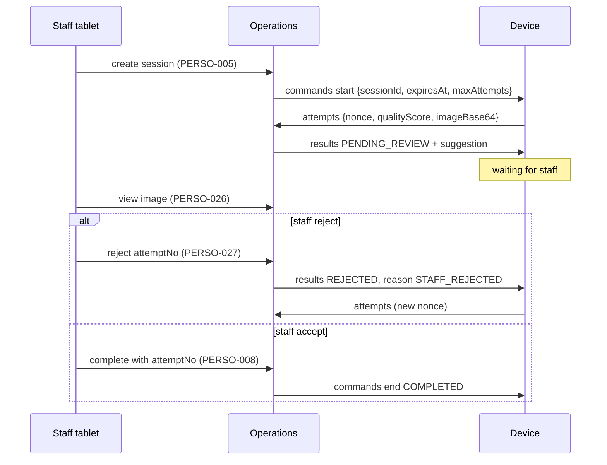

# Fingerprint capture device contract (MQTT)

Contract for the capture device firmware (ESP32 + AS608). It implements PERSO-007 of `docs/plans/active/operations-personalization.md` (decision D-P-07, revised; flow revised 2026-11-15: "the capture staff decides"). Production use stays blocked until the AS608 hardware proof (D-P-06).

The device never calls an HTTP API. Staff start, review and finish a capture from the store tablet over HTTP (PERSO-005, 006, 026, 027, 008). The device only talks MQTT to the broker, and Operations talks to the same broker.

The quality threshold on the server is only a **suggestion**. Every usable capture is stored and shown to the staff, and the staff decides which image is accepted.

## 1. Broker connection

| Setting       | Value                                                                                              |
| ------------- | -------------------------------------------------------------------------------------------------- |
| Broker        | Eclipse Mosquitto 2, MQTT 3.1.1 (protocol level 4)                                                 |
| Address       | Field devices: MQTT over WebSocket + TLS, `wss://<mqtt public hostname>:443/` (Cloudflare Tunnel → `mosquitto:9001`). Tailnet clients: `mqtt://<Tailscale IP>:1883`. |
| Username      | the device code, for example `ring-01`                                                             |
| Password      | per-device password issued with the broker user                                                    |
| Client ID     | any stable unique value, for example the device code                                               |
| Clean session | `false` (so QoS 1 messages published while the device was offline are delivered on reconnect)      |
| Keep alive    | 30 s                                                                                               |
| Reconnect     | retry with backoff (1 s up to 30 s)                                                                |

Device code: `[A-Za-z0-9_-]{1,80}`. It must be one of the codes registered in `OPERATIONS_CAPTURE_DEVICE_CODES`. The broker ACL lets a device use only `memora/capture/<its own device code>/#`. Operations trusts the device code taken from the topic, never from the payload: a payload field named `deviceCode` is ignored.

## 2. Topics

All messages are UTF-8 JSON, QoS 1, `retain = false`. Maximum message size is 256 KB (broker limit; larger messages are dropped).

| Topic                                  | Direction            | Purpose                                                                                         |
| -------------------------------------- | -------------------- | ----------------------------------------------------------------------------------------------- |
| `memora/capture/{deviceCode}/hello`    | device to Operations | Optional. Publish after every (re)connect.                                                      |
| `memora/capture/{deviceCode}/commands` | Operations to device | The device subscribes. Carries the `start`, `next` and `end` commands.                               |
| `memora/capture/{deviceCode}/attempts` | device to Operations | One message per capture attempt.                                                                |
| `memora/capture/{deviceCode}/results`  | Operations to device | The device subscribes. One result per attempt message, plus one when the staff reject an image. |

The device subscribes to `commands` and `results` (QoS 1) on every connect.

## 3. Sequence

1. Device connects, subscribes to `commands` and `results`, publishes `hello` (payload `{}` or any JSON, it is not read).
2. Staff create a session on the tablet (PERSO-005). Operations publishes a `start` command to `commands`. If the device has an open session when it sends `hello`, Operations publishes the `start` command again.
3. On `start`, the device remembers `sessionId` and asks the customer to place the finger. For each capture it publishes one `attempts` message with a fresh `nonce`.
4. Operations answers every parseable attempt on `results` with the same `sessionId` and `nonce`.
5. The device shows the outcome. Rules:
   - `result = PENDING_REVIEW`: the image is stored and the tablet shows it to the staff with the `suggestion` (`PASS` or `LOW_QUALITY`). The device shows "waiting for staff". Several attempts can be pending at once (up to 3); the device captures again only after a `next` (or `start`) command and a button press.
   - `result = REJECTED` (no `reason`, the attempt had no image, `CAPTURE_FAILED`): ask for another capture if `remainingAttempts > 0`.
   - `sessionStatus = FAILED`: the session failed; an `end` command follows.
6. The staff look at the image on the tablet and either:
   - accept it (PERSO-008, with the chosen `attemptNo`): Operations publishes `end` with `status = COMPLETED`;
   - ask for another scan (PERSO-028): Operations publishes `next`; or close the session without picking (PERSO-029): `end` with `status = CANCELLED`;
   - reject it (PERSO-027): Operations publishes a `STAFF_REJECTED` result (section 4.4). With attempts left the device asks for a new capture. With none left the session is `FAILED` and an `end` command with `status = FAILED` follows.
7. On `end` the device clears the session and returns to idle.

A session allows at most 3 attempts and lives for the configured TTL (default 15 minutes) from creation. After that the device receives `SESSION_EXPIRED` (no `end` command is sent for expiry; the device may also use `expiresAt` from `start`).

### 3.1 Sequence diagram



### 3.2 Device state machine

| State           | Entered when                                                                                                          | Leaves when                                                                                                                                                          |
| --------------- | --------------------------------------------------------------------------------------------------------------------- | -------------------------------------------------------------------------------------------------------------------------------------------------------------------- |
| `IDLE`          | boot, `end`, or `SESSION_EXPIRED` / `SESSION_NOT_OPEN` / `SESSION_NOT_FOUND`                                          | `start` command, then `CAPTURING`                                                                                                                                    |
| `CAPTURING`     | `start`, `STAFF_REJECTED` with `remainingAttempts > 0`, or `REJECTED` (`CAPTURE_FAILED`) with `remainingAttempts > 0` | capture done and `attempts` published, then `SENDING`                                                                                                                |
| `SENDING`       | an `attempts` message was published                                                                                   | `results` with the same nonce: `PENDING_REVIEW` then `WAITING_STAFF`; `REJECTED` then `CAPTURING` (or `IDLE` if `sessionStatus = FAILED`); `ok: false` per section 6 |
| `WAITING_STAFF` | `PENDING_REVIEW`                                                                                                      | `STAFF_REJECTED` result then `CAPTURING`; `next` then `CAPTURING`; `end` then `IDLE`; time-out by `expiresAt` then `IDLE`                                                                     |

In `WAITING_STAFF` the device does not publish another attempt until a `next` command arrives. The server no longer refuses a new attempt while others are pending (`REVIEW_PENDING` is not sent any more).

Device-local behaviour (no extra messages, Operations is not told): the reference firmware inserts a
`CONFIRM` step before every `CAPTURING` (after `start` and after a rejection) and only starts capturing
when a person presses its button. It may also keep its open `sessionId` and attempt count across a
restart and re-apply them when `start` for the same session arrives again after `hello`.

## 4. Messages

### 4.1 `commands` (Operations to device)

```json
{
  "type": "start",
  "sessionId": "9bf6b096-d5e2-494c-b8cb-3e091a16a864",
  "expiresAt": "2026-11-15T07:57:14.000Z",
  "maxAttempts": 3
}
```

`start` may arrive more than once for the same session (re-sent after `hello`, or QoS 1 redelivery). Treat a repeated `sessionId` as the same session; do not reset the attempt counter shown to the user from it, use `results` for that.

```json
{
  "type": "end",
  "sessionId": "9bf6b096-d5e2-494c-b8cb-3e091a16a864",
  "status": "COMPLETED",
  "acceptedAttemptNo": 2
}
```

```json
{
  "type": "next",
  "sessionId": "9bf6b096-d5e2-494c-b8cb-3e091a16a864",
  "attemptNo": 2
}
```

`next` (PERSO-028, QoS 1) means the staff asked for another scan: the device leaves `WAITING_STAFF` and goes back to `CAPTURING`, then captures after a button press. `attemptNo` is the number the next attempt will get. Nothing is stored for it; a repeated `next` is harmless.

`end` tells the device the session is over: `status` is `COMPLETED` (the staff accepted an image; `acceptedAttemptNo` names it), `FAILED` (no attempts left and nothing pending or accepted) or `CANCELLED` (the staff closed the session without picking, PERSO-029). The device shows the outcome, clears `sessionId` and returns to idle. Ignore an `end` for a session that is not the current one. Ignore unknown `type` values.

### 4.2 `attempts` (device to Operations)

```json
{
  "sessionId": "9bf6b096-d5e2-494c-b8cb-3e091a16a864",
  "nonce": "a3f9c1d27b6e40f58c1d92e7",
  "qualityScore": 187,
  "imageBase64": "<base64 of the raw AS608 image>",
  "firmwareVersion": "1.0.2"
}
```

| Field             | Rules                                                                                                                                                                                                                                                                                                                                                           |
| ----------------- | --------------------------------------------------------------------------------------------------------------------------------------------------------------------------------------------------------------------------------------------------------------------------------------------------------------------------------------------------------------- |
| `sessionId`       | Required. UUID from the `start` command.                                                                                                                                                                                                                                                                                                                        |
| `nonce`           | Required. 16 to 64 characters, only `A-Z a-z 0-9 _ -`. Generate a new random value per attempt (for example 12 random bytes as hex). Reuse the same nonce only when re-sending the same attempt after a missing result (see section 5).                                                                                                                         |
| `qualityScore`    | Required with an image: JSON number, 0 to 1000 inclusive. May be omitted when there is no image.                                                                                                                                                                                                                                                                |
| `imageBase64`     | The captured image: standard base64 with padding (RFC 4648, no line breaks, no `data:` prefix) of a BMP file (section 4.5), decoded size at most 180000 bytes. **Omit it (or send an empty string) when the AS608 `Img2Tz` conversion failed**; the attempt is then recorded as `REJECTED` with reason `CAPTURE_FAILED`, counts as used, and nothing is stored. |
| `firmwareVersion` | Optional. Printable ASCII, 1 to 40 characters.                                                                                                                                                                                                                                                                                                                  |

The device sends every capture that produced an image, whatever its score. `qualityScore` is computed by the firmware (section 4.6). Operations compares it with its own threshold (`OPERATIONS_CAPTURE_QUALITY_THRESHOLD`, not known to the device) only to produce a `suggestion` for the staff: `PASS` when the score is greater than or equal to the threshold, else `LOW_QUALITY`. The suggestion never rejects an attempt.

Unknown extra fields are ignored. A message that is not valid JSON, or has no valid `sessionId` and `nonce`, is dropped without any answer (nothing to correlate); the device should time out and retry.

### 4.3 `results` (Operations to device)

Success (the attempt was recorded):

```json
{
  "sessionId": "9bf6b096-d5e2-494c-b8cb-3e091a16a864",
  "nonce": "a3f9c1d27b6e40f58c1d92e7",
  "ok": true,
  "attemptNo": 1,
  "result": "PENDING_REVIEW",
  "suggestion": "PASS",
  "remainingAttempts": 2,
  "sessionStatus": "IN_PROGRESS"
}
```

| Field               | Values                                                                                                                                                                                                                 |
| ------------------- | ---------------------------------------------------------------------------------------------------------------------------------------------------------------------------------------------------------------------- |
| `attemptNo`         | 1 to 3, allocated by the server.                                                                                                                                                                                       |
| `result`            | `PENDING_REVIEW` (stored, waiting for the staff) or `REJECTED` (no image, `CAPTURE_FAILED`).                                                                                                                           |
| `suggestion`        | `PASS` or `LOW_QUALITY`. Only with `PENDING_REVIEW`.                                                                                                                                                                   |
| `remainingAttempts` | Attempts left (3 minus `attemptNo`).                                                                                                                                                                                   |
| `sessionStatus`     | `IN_PROGRESS`, or `FAILED` when a `CAPTURE_FAILED` attempt used the third slot (an `end` command with `FAILED` follows). A replay answers with the current session status, which can also be `COMPLETED` or `EXPIRED`. |

Failure (nothing was recorded for this nonce):

```json
{
  "sessionId": "9bf6b096-d5e2-494c-b8cb-3e091a16a864",
  "nonce": "a3f9c1d27b6e40f58c1d92e7",
  "ok": false,
  "error": "REVIEW_PENDING"
}
```

### 4.4 Staff review: `STAFF_REJECTED`

When the staff reject a `PENDING_REVIEW` image after looking at it (PERSO-027), Operations publishes a second result for that attempt, with the original `nonce`:

```json
{
  "sessionId": "9bf6b096-d5e2-494c-b8cb-3e091a16a864",
  "nonce": "a3f9c1d27b6e40f58c1d92e7",
  "ok": true,
  "attemptNo": 1,
  "result": "REJECTED",
  "reason": "STAFF_REJECTED",
  "remainingAttempts": 2,
  "sessionStatus": "IN_PROGRESS"
}
```

The rejected attempt still counts as used and its image is deleted. The device must:

- `remainingAttempts > 0` (`sessionStatus = IN_PROGRESS`): go back to waiting for a finger and publish the next attempt with a new nonce.
- `remainingAttempts = 0` (`sessionStatus = FAILED`): stop. An `end` command with `status = FAILED` follows; staff must create a new session.
- `remainingAttempts = 0` with `sessionStatus = IN_PROGRESS` (other attempts are still `PENDING_REVIEW`): stay waiting for the staff; do not scan again. The session ends with `end` (`COMPLETED` with `acceptedAttemptNo`, or `CANCELLED`). Only `sessionStatus = FAILED` ends the session from a result.

Match this message by `sessionId` and `attemptNo`/`nonce`. When the staff accept an image, no result is sent; the `end` command (`COMPLETED`) is the signal.

### 4.5 Image format

`imageBase64` decodes to an uncompressed BMP file exported from the AS608 `UpImage`:

- 8-bit grayscale, 256 x 288 pixels, with a 256-entry grayscale palette.
- The file starts with the bytes `BM`, and the little-endian uint32 at offset 2 (the BMP file size) must equal the exact byte length of the decoded file. Otherwise the attempt is answered with `INVALID_MESSAGE` and nothing is recorded.
- At most 180000 bytes decoded (a 256 x 288 8-bit BMP is about 74.8 KB).

Operations stores the file with `Content-Type: image/bmp` under `personalization/fingerprint/{orderId}/sessions/{sessionId}/attempt-{attemptId}.bmp`.

### 4.6 Quality score

The firmware computes `qualityScore` (0 to 1000): the AS608 `Img2Tz` conversion must succeed (otherwise send the attempt without an image), then score = ridge-area coverage x contrast, scaled to 0 to 1000. The server threshold is tuned from real captures and only drives the suggestion.

## 5. Nonce and retry rules

- QoS 1 is at-least-once. The broker may deliver an `attempts` message twice. Operations stores the nonce with the attempt and, when it sees the same nonce again for the same session, it does not create a second attempt: it answers again with the recorded attempt (its current `result`).
- If the device sent an attempt and got no `results` message within about 10 seconds, it may publish the same message again with the same nonce. It never causes a double attempt.
- Keep resending the pending attempt with the same nonce (for example every 10 s, then every 15 s) until a
  `results` message for it arrives or the session expires; send it at once after a reconnect. Do not
  replace it with a new capture just because no result came (that would make the customer scan again).
- For a new capture, always use a new nonce.
- Match a `results` message to the attempt by `sessionId` and `nonce`. Ignore results for other nonces.
- A failed attempt message (`ok: false`) is not an attempt: it does not consume one of the 3 attempts.

## 6. Error codes

| `error`                    | Meaning                                                                                                                            | Device action                                                                              |
| -------------------------- | ---------------------------------------------------------------------------------------------------------------------------------- | ------------------------------------------------------------------------------------------ |
| `INVALID_MESSAGE`          | Valid `sessionId` and `nonce`, but another field is wrong (score out of range, bad base64, image is not a valid BMP, wrong types). | Fix the firmware; do not retry the same payload.                                           |
| `SESSION_NOT_FOUND`        | Unknown session.                                                                                                                   | Go to idle; wait for a new `start`.                                                        |
| `DEVICE_MISMATCH`          | The session belongs to another device.                                                                                             | Go to idle; wait for a new `start`.                                                        |
| `SESSION_NOT_OPEN`         | The session is completed or cancelled.                                                                                             | Go to idle; wait for a new `start`.                                                        |
| `SESSION_EXPIRED`          | The session passed its TTL.                                                                                                        | Go to idle; staff must create a new session.                                               |
| `MAX_ATTEMPTS_REACHED`     | Already 3 attempts (session failed).                                                                                               | Go to idle; staff must create a new session.                                               |
| `ATTEMPT_ALREADY_ACCEPTED` | An attempt was already accepted in this session.                                                                                   | Stop capturing; wait for `end`.                                                            |
| `REVIEW_PENDING`           | Not sent since 2026-11-17 (kept for older firmware).                                                                                | Show "waiting for staff"; do not capture until a `STAFF_REJECTED` result or `end` arrives. |
| `IMAGE_TOO_LARGE`          | Decoded image above 180000 bytes.                                                                                                  | Fix the firmware.                                                                          |
| `DUPLICATE_NONCE`          | Reserved. A repeated nonce is answered with the recorded attempt instead.                                                          | n/a                                                                                        |
| `INTERNAL_ERROR`           | Operations could not store the attempt (for example object storage down). Nothing was recorded.                                    | Retry later with a new nonce.                                                              |

## 7. Not in this contract

- Staff HTTP APIs: PERSO-005, 006, 008, 026, 027 (see the plan and Swagger).
- Public TLS exposure of the broker (deferred).
- Tuning of the quality threshold: set from real captures in the Phase 1 hardware tests (D-P-06).
