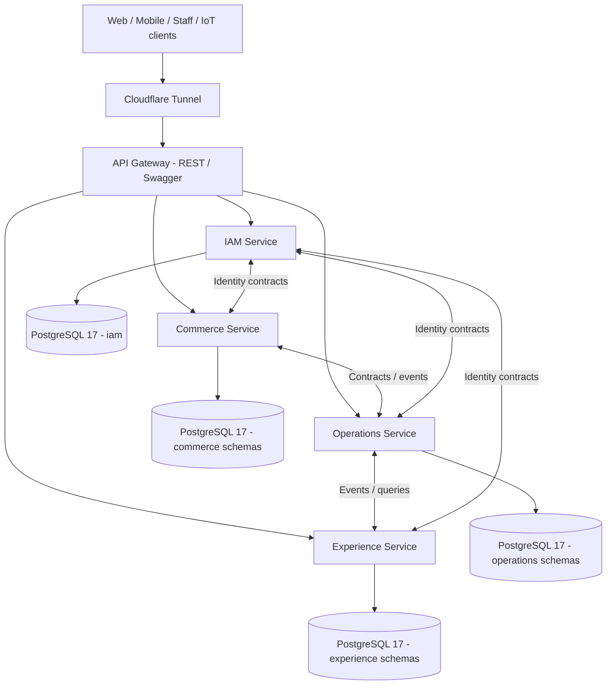

# MEMORA — Backend Architecture & Domain Ownership

> **ADR-001 · Status: ACCEPTED (service topology)**  
> **Decision date:** 2026-10-17  
> **Scope:** NestJS backend monorepo, API Gateway, PostgreSQL domain schemas, microservice boundaries, integration and deployment  
> **Target:** **4 business microservices + 1 API Gateway**  
> **Implementation status:** ADR-001 is accepted. Source now contains all four business services plus the Gateway. Business behavior, database roles, and production rollout are not at the same stage. See [Current source and rollout](#11-current-source-and-rollout) and [business-service-structure.md](business-service-structure.md).

## 1. Architectural decision

MEMORA adopts **four independently deployable business microservices**:

1. **IAM Service** (`iam-service`): identity, authentication, authorization and verified customer/guest identity.
2. **Commerce Service** (`commerce-service`): product catalog, pricing, inventory, pre-order design, orders and payments.
3. **Operations Service** (`operations-service`): personalization, production, fulfillment and after-sales.
4. **Experience Service** (`experience-service`): digital memory, AI consultation and shared platform capabilities.

A separate **API Gateway** (`api-gateway`) exposes public HTTP endpoints, applies request-level security and forwards commands/queries to their owning service. **The Gateway is not counted as a business microservice** and does not own business tables.

> **Architectural principle:** 12 database domains **do not** mean 12 microservices. A service may own several domains. Domain → Feature defines code organization; service ownership defines the deployment and data boundary.

### 1.1 Logical topology



The four PostgreSQL nodes in the diagram represent **logical schema ownership, not four running PostgreSQL servers**. Initially they may reside in **one PostgreSQL instance/database** with separate credentials and schema privileges. Redis, object storage and approved AI/search infrastructure are shared *infrastructure*, not additional business microservices.

## 2. Canonical mapping: 12 domains → 4 services

The domain names and proposed table counts follow **MEMORA Database Master Tracker — Guest v1.0**. The service mapping is the architectural decision accepted on 2026-10-17.

| Microservice | Owned database domain | Proposed tables | Primary responsibility |
|---|---|---:|---|
| IAM | `iam` | 6 | Accounts, identities, RBAC |
| Commerce | `catalog` | 8 | Ring templates, variants, materials and gemstone compatibility |
| Commerce | `pricing` | 3 | Price items, price history, pricing rules |
| Commerce | `inventory` | 5 | Ring blanks, gemstones, reservations and inventory ledger |
| Commerce | `design` | 2 | Carts and pre-order ring design drafts |
| Commerce | `ordering` | 9 | Orders, ring item versions, quotes, payments and final confirmation |
| Operations | `personalization` | 9 | Consents, sources, capture, design review and change requests |
| Operations | `production` | 14 | Production lock, work orders, laser, remake and QC |
| Operations | `fulfillment` | 3 | Delivery/pickup, recipient verification, handover proof |
| Operations | `after_sales` | 4 | Claims, custody, maintenance plans and claim history |
| Experience | `memory` | 3 | Memory cards, content and access grants |
| Experience | `platform` | 8 | LightRAG, AI consultation, audit, notifications, evidence, sharing, configurations |
| **TOTAL** | **12 domains** | **74** | **73 core + 1 optional table** |

**By deployable service:** IAM **6**, Commerce **27**, Operations **30**, Experience **11** proposed tables. The source tracker reports **956 proposed fields**. The tracker explicitly says the schema is a **proposed logical baseline, not deployed DDL**. ERD/physical schema and pending schema changes require separate sign-off.

### 2.1 API Gateway — not a data owner

- Provides public REST/HTTP contracts, input validation, authentication/authorization guards, documentation, rate limiting as appropriate and error mapping.
- Delegates business commands/queries to the domain-owning service through versioned internal contracts.
- May perform lightweight presentation-level aggregation; must **not** own domain transactions or bypass business services.
- Must **not** directly update orders, payment state, production locks, consent, biometric source or inventory.

## 3. Service responsibilities and authoritative data

### 3.1 `iam-service`

**Domain:** `iam` (6 tables).  
**Source of truth:** accounts, role assignments, permissions, verified guest/customer ownership identity.

Key tables: `users`, `customer_identities`, `roles`, `permissions`, `user_roles`, `role_permissions`.

- Owns account lifecycle, authentication, token/session policy, RBAC and identity verification.
- Guest Orders may be owned by **verified Customer Identity without requiring an account** (DB Decisions D01–D03).
- Other services retain the necessary `customer_identity_id` / `user_id` and verify protected actions through IAM contracts.
- No other service may write IAM tables directly.

### 3.2 `commerce-service`

**Domains:** `catalog` (8), `pricing` (3), `inventory` (5), `design` (2), `ordering` (9) — **27 tables**.

- **Catalog:** Ring Templates, GLB/engraving constraints, materials, template variants, gemstones and compatibility.
- **Pricing:** price items, approved price versions, pricing rules and price snapshots used in commercial quotes.
- **Inventory:** stocks, allocations, reservation/consumption and immutable movements ledger.
- **Design:** Cart and Ring Design Draft **before** order creation.
- **Ordering:** Orders, Ring Items/Versions, Quotes, Final Confirmation, payment/refund ledger and P1/P2/P3 financial gates.
- Owns payments and financial idempotency. Payment callback/webhook processing must not be duplicated in Operations.
- **Operations never writes inventory directly**: reserve/allocate/consume/release must go through Commerce-owned contract(s).

### 3.3 `operations-service`

**Domains:** `personalization` (9), `production` (14), `fulfillment` (3), `after_sales` (4) — **30 tables**.

- **Personalization:** consents, source bindings, fingerprint/soundwave capture sessions and attempts, protected source metadata, placements, design reviews and change requests.
- **Production:** Production Lock, packages, laser process profiles, work orders/steps, jeweler assignments, laser executions, remake lineage and final QC.
- **Fulfillment:** handover session and immutable proof, delivery/redelivery attempts, recipient verification.
- **After-sales:** claims, claim events, maintenance policy and chain of custody.
- Must verify upstream Commerce and IAM conditions; it may not accept a frontend assertion that P2 was paid or consent approved.

**Production Lock preconditions:** Manager Approval **and** verified Customer Final Confirmation for the exact Ring Item Versions **and** valid Final Quote **and** P2 satisfied. The resulting lock is immutable.

### 3.4 `experience-service`

**Domains:** `memory` (3), `platform` (8) — **11 tables**.

- **Memory:** Memory Card, Memory Content and Access Grants; enforce activation, PIN and verified-owner policy.
- **AI / LightRAG:** governed knowledge documents, AI conversations and messages.
- **Platform:** evidence metadata, notifications, audit aggregation, sanitized share links and operational configuration.

Platform table ownership is **explicit**, not an invitation for all services to write shared tables:

| Table(s) | Owner / access rule |
|---|---|
| `lightrag_knowledge_documents` | Experience: approved knowledge/version/ingestion |
| `ai_conversations`, `ai_messages` | Experience: AI sessions, messages and retrieval trace |
| `evidence_assets` | Experience: common evidence metadata; Operations submits references/events |
| `notifications` | Experience: dispatch and delivery history; other services produce events |
| `audit_logs` | Experience: central audit store; producers persist critical audit evidence reliably before publication |
| `share_links` | Experience: sanitized read-only links; Commerce exposes approved projections |
| `system_configurations` | Experience: typed/versioned runtime configurations, **never secrets** |

**Important:** An Experience outage must not allow an unsafe financial, consent or production transition, nor silently lose a business-critical audit event. Use locally persisted outbox/audit evidence, retry and reconciliation.

## 4. Main Flow ownership (MF01–MF06)

| Main Flow | Lead owner | Integration boundary |
|---|---|---|
| **MF01 — Discovery, Configuration & Design Draft** | Commerce | Experience for LightRAG / share links; IAM for identity when required |
| **MF02 — Order, Deposit & Personalization** | Commerce + Operations | Commerce for Order / Quote / P1; Operations for Consent / Source / Capture; IAM for verified ownership |
| **MF03 — Review, Final Quote, Design Lock & Authorization** | Operations + Commerce | Operations for reviews, changes and lock; Commerce for Final Quote, Final Confirmation and P2 |
| **MF04 — Production, Remake & Final QC** | Operations | Commerce for inventory reservations/consumption |
| **MF05 — Final Payment, Handover & Digital Memory** | Operations + Experience | Commerce for P3 and payment ledger; Operations for handover; Experience for card activation/grants |
| **MF06 — After-sales Claim Handling** | Operations | Commerce for SERVICE quotes/refunds; IAM for identity; Experience for Memory/data-rights cases |

### 4.1 Business invariants

- Guest/Customer Identity must be verified for actions requiring ownership. A login account is optional for a Guest Order.
- MF01 stores pre-order configuration/drafts; protected biometric/audio source collection requires MF02 policy, consent and appropriate authorization.
- Fingerprint capture requires successful **P1**, accepted consent and authorized staff/device; session and attempt history remain auditable.
- Ring Item Versions, quotes, payments and final confirmations follow the documented immutable/versioned gates.
- **Never** Production Lock until the full approval/confirmation/quote/P2 boundary is satisfied.
- A remake creates a new production attempt with lineage. It does not overwrite QC or automatically create another sale.
- Memory access and post-handover changes require verified owner and corresponding grant/PIN rules.

## 5. Data ownership, PostgreSQL and migrations

### 5.1 Initial physical database decision

Use **one PostgreSQL 17 instance** for MEMORA initially, organizing logical ownership by its 12 existing/proposed schemas. This is an implementation direction, **not a claim that every schema/table already exists**.

| Service DB role | Schemas permitted for writes |
|---|---|
| IAM DB role | `iam` |
| Commerce DB role | `catalog`, `pricing`, `inventory`, `design`, `ordering` |
| Operations DB role | `personalization`, `production`, `fulfillment`, `after_sales` |
| Experience DB role | `memory`, `platform` |

Mandatory guardrails:

1. Give each service its **own DB credentials** and minimum schema privileges; do not reuse PostgreSQL superuser credentials in services.
2. **One schema has one write owner.** The service owning a domain also owns its Prisma models, migration files and schema rollout.
3. Transactions/FKs **within the same service's schemas** may be used where appropriate.
4. Review all proposed **cross-service foreign keys** in the logical ERD. Do not treat the tracker as authorization for cross-service runtime SQL/repository access. Prefer stable UUID references plus contract checks where service boundaries require independence.
5. No distributed ACID transaction across Commerce/Operations/Experience. Use persisted state transitions, idempotent commands, outbox/events, retries and compensating workflows.
6. Preserve migration backward compatibility during rolling releases; schema changes need a migration checklist, preflight and rollback/recovery plan.
7. Redis is for ephemeral sessions/locks/cache/queues, not the authoritative ledger. Protected Fingerprint/Soundwave files belong in access-controlled object storage; PostgreSQL stores metadata. Qdrant contains approved LightRAG knowledge only (DB Decision D16).

> **Approval note:** The tracker records **D15 (“one PostgreSQL with domain schemas”) as PROPOSED**. This document accepts that pattern as MEMORA's **initial deployment direction**; physical DDL, permission design and cross-service FK exceptions remain subject to technical approval.

### 5.2 Inter-service communication

| Link | Preferred mechanism | Example purpose | Status |
|---|---|---|---|
| Gateway → IAM/Commerce/Operations/Experience | gRPC request/response | Public API queries and commands | Architectural guideline; contracts per feature |
| Operations → Commerce | gRPC command/query | Check financial gate, inventory reservation, reconcile | Contract TBD |
| Commerce → Operations | Transactional outbox + asynchronous event | Payment succeeded, order created, confirmation invalidated | Event transport TBD |
| Operations → Experience | Transactional outbox + asynchronous event | Handover completed, evidence/notification, memory activation | Event transport TBD |
| Domain services → IAM | gRPC + selected events | Ownership / permissions verification | IAM contract evolution TBD |

Rules: document **timeout, retries, idempotency key, error semantics, correlation ID and contract version** for every integration. A message broker is not chosen solely by this ADR; evaluate BullMQ/Redis or a dedicated broker against ordering, delivery and recovery requirements.

## 6. NestJS monorepo layout

```text
apps/
├── api-gateway/
├── iam-service/
├── commerce-service/
│   └── src/modules/
│       ├── catalog/
│       ├── pricing/
│       ├── inventory/
│       ├── design/
│       └── ordering/
├── operations-service/
│   └── src/modules/
│       ├── personalization/
│       ├── production/
│       ├── fulfillment/
│       └── after-sales/
└── experience-service/
    └── src/modules/
        ├── memory/
        └── platform/

libs/
├── contracts/        # Shared versioned gRPC/protobuf + transport contracts ONLY
├── common/           # Framework-agnostic utilities, logging, error standards, etc.
└── ...               # Shared technical libraries; not cross-owner domain repositories

deploy/
├── infra/            # PostgreSQL, Redis and tunnel / platform infrastructure
└── backend/          # Gateway and independently built service images
```

The domain folders above exist. Commerce, Operations, and Experience domain modules are empty. Feature folders and the four layers are the target in [business-service-structure.md](business-service-structure.md), not code that has been written. IAM is organized as `application/`, `presentation/`, and `repositories/`; do not copy that tree into the other three services.

### 6.1 Gateway modules are domain/feature based

```text
apps/api-gateway/src/modules/
├── iam/auth/
├── catalog/ring-templates/
├── design/carts/
├── ordering/orders/
├── personalization/capture/
├── production/work-orders/
└── memory/cards/
```

- Organize as **Domain → Feature → internal layers**. Do not organize all Gateway APIs under a `commerce-service/` folder merely because they share a backend process.
- For HTTP-only features, use `controllers/`, `dto/`, `docs/` directly.
- Introduce `http/`, `sse/` or `websocket/` subfolders **only when the feature needs more than one transport**.
- Public routes follow business resources, e.g. `/api/v1/catalog/templates`, `/api/v1/cart/items`, `/api/v1/orders` — not microservice process names.
- Shared contracts may be referenced by multiple apps, but **business repositories/models must not be imported across service ownership boundaries**.

## 7. Deployment, CI/CD and Git workflow

### 7.1 Deployment target

- **Five application runtimes at full rollout:** `api-gateway`, `iam-service`, `commerce-service`, `operations-service`, `experience-service`.
- One-shot Prisma migration containers/jobs are **not** additional microservices.
- Each runtime has its own Docker image, health/readiness probes, logs, environment configuration and migration version.
- Run on the existing MEMORA Mini PC using Docker Compose and Cloudflare Tunnel until operational needs justify changing orchestration.
- Do not publish PostgreSQL/Redis to the public internet. Cloudflared inside Docker must reach Gateway on a **shared Docker network** (not the tunnel container's `127.0.0.1` unless it uses an appropriate host-network configuration).
- Do not overwrite or restart unrelated Docker Compose projects on the host.
- Deploy release images by immutable digest/commit SHA after CI gates; bootstrap/rollback/backup procedures remain explicit.

### 7.2 GitHub branches

Adopt **GitHub Flow** with stable `main` and short-lived branches:

```text
<type>/<domain>-<feature>

feat/catalog-ring-templates
feat/design-guest-cart
feat/ordering-create-order
feat/personalization-fingerprint-capture
fix/iam-refresh-rotation
infra/mini-pc-bootstrap
ci/ghcr-publish
```

A feature branch may change Gateway, owning microservice, contracts, tests and migrations together. **Do not** create long-lived branches named only `iam-service`, `commerce-service`, `operations-service`, etc. PRs should identify associated MF01–MF06, impacted domains, schema/proto changes and automated test evidence.

## 8. Implementation stages

| Stage | Scope | Exit criteria (summary) |
|---|---|---|
| **G0 — Current foundation** | API Gateway, IAM, Mini PC infrastructure, CI/CD | Identity/RBAC verified; runner, secrets, image publish and health validated |
| **G1 — Commerce** | Catalog → Pricing → Design/Cart → Ordering/Payment → Inventory | MF01 and relevant MF02/MF03 financial flows tested, migrations/contracts reviewed |
| **G2 — Operations** | Consent/Capture → Review/Lock → Production/QC → Handover/After-sales | Critical MF02–MF06 flows, audit, idempotency and failure recovery verified |
| **G3 — Experience** | LightRAG/share support for MF01; Digital Memory and platform capabilities for MF05 | Governed AI content, secure memory activation, notifications/audit pipelines |
| **G4 — Hardening** | Security, performance, backup/restore, release procedures | E2E/regression, restore rehearsal, access review and controlled release |

The stage order describes **ownership and priorities**, not a strict requirement to finish one entire service before starting another dependent feature. Experience capabilities needed for MF01 may be implemented early.

## 9. Decision register

### Accepted in this ADR

- **4 microservices + 1 API Gateway**.
- Domain allocation: IAM `iam`; Commerce `catalog`, `pricing`, `inventory`, `design`, `ordering`; Operations `personalization`, `production`, `fulfillment`, `after_sales`; Experience `memory`, `platform`.
- **Inventory stays in Commerce**; Operations modifies inventory only via Commerce contracts.
- **Digital Memory and platform tables stay in Experience**, with explicitly controlled cross-service events and access.
- Gateway organized by **Domain → Feature**, not backend service names.

### Not yet finalized by this ADR

- Physical ERD/schema changes and cross-service FK exceptions (tracker D15 is `PROPOSED`).
- Exact gRPC proto definitions, event names/payloads, outbox transport, timeout/retry/SLO policy.
- Security DB grants and migration orchestration for every new service.
- `maintenance_plans` optional policy: tracker D14 is **DECISION REQUIRED**.
- Detailed data rights, evidence, notifications and audit failure recovery contracts.

## 10. References

- [MEMORA Database Master Tracker — Guest v1.0](https://docs.google.com/spreadsheets/d/1TAcBkuald9TVt4B-GN46UD0j8ddT7IH8mwgVD3ALiak/edit): `OVERVIEW`, `DOMAINS`, `TABLES`, `DECISIONS`.
- [MEMORA Business Flow Decision Tracker](https://docs.google.com/spreadsheets/d/1czN5EyjeTFN3wAwguPuk-Boh4YBlKmjdeOCUVx_C_cE/edit): MF01–MF06 decision summary.
- MEMORA `REPORT 3.docx` and `REPORT 7.docx`: business behavior, requirements and architecture context.
- MEMORA architecture decision made 2026-10-17: four service topology and domain ownership.
- [Business service structure](business-service-structure.md): target Domain → Feature → Layer convention for Commerce, Operations, and Experience.

## 11. Current source and rollout

Labels mean different things. **Accepted** is still section 9. **Implemented** means the repository contains the code. **Configured** means CI or Compose declares it. **Proposed** means a review artifact that has not been executed. **Deployed** means the default Mini PC release starts it. This document does not claim a live GitHub Actions run or a live database check.

| Area | State |
|---|---|
| IAM business behavior | **Implemented.** Auth, guest identity, RBAC, and admin gRPC/HTTP exist. Prisma migrations exist. The schema has 8 models; the accepted tracker count remains 6 tables. The two extra models are `RbacBootstrapExecution` and `SecurityAuditEvent`. |
| Commerce | **Foundation implemented.** Five domain modules (`catalog`, `pricing`, `inventory`, `design`, `ordering`) and **27** Prisma models. Modules are empty. No business RPC. No Prisma migration directory. |
| Operations | **Foundation implemented.** Four domain modules (`personalization`, `production`, `fulfillment`, `after_sales`) and **30** Prisma models. Modules are empty. No business RPC. No Prisma migration directory. |
| Experience | **Foundation implemented.** Two domain modules (`memory`, `platform`) and **11** Prisma models. Platform is this domain, not a separate service. Modules are empty. No business RPC. No Prisma migration directory. |
| Health | **Implemented** on Gateway and all four business services. |
| Business gRPC for Commerce, Operations, Experience | **Not implemented.** No service proto beyond IAM, health, and pagination. |
| GHCR | **Configured.** Push to `main` is set up to publish six images: Gateway, IAM, IAM migrate, Commerce, Operations, and Experience. Push to `dev` runs Quality and Security only. This ADR does not claim those packages exist in the registry. |
| Compose | **Configured.** Default backend project starts Gateway and IAM. Commerce, Operations, and Experience are in profile `domain-services` and are not started by a normal deploy. |
| PostgreSQL roles | **Proposed.** `deploy/postgres/proposals/` is review SQL. It has not been applied. The deploy helper still refuses `--enable-domain-services` until grants are verified, and that refusal stays in place. |
| Production domain services | **Not deployed.** A default release does not start them and must not be described as a five-application production rollout. |

---

**Usage in Cursor:** This file is `docs/architecture/memora-backend-4-service.md`. Treat the **Accepted** decisions as the architecture baseline. Section 11 separates implemented source from configured CI, proposed SQL, and the default Mini PC deploy.
