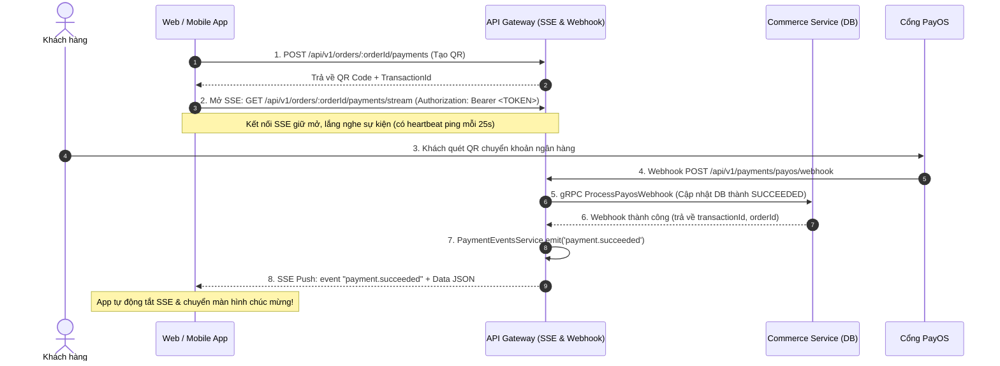

# Kế hoạch Triển khai: Realtime Payment Server-Sent Events (SSE) cho Memora [COMPLETED]

## 1. Mục tiêu & Bối cảnh
- **Bối cảnh:** Khi người dùng quét mã QR VietQR (PayOS) trên Web hoặc Mobile App, cổng thanh toán PayOS sẽ gửi Webhook `POST /api/v1/payments/payos/webhook` về API Gateway. 
- **Đã hoàn thành:** Cung cấp endpoint **Server-Sent Events (SSE)** chuẩn thời gian thực tại API Gateway:
  👉 `GET /api/v1/orders/:orderId/payments/stream`
  Web và Mobile App kết nối nhận thông báo thanh toán thành công ngay tức thì (<100ms) mà không cần polling liên tục.

---

## 2. Thiết kế Kỹ thuật & Luồng Dữ liệu (Architecture & Sequence)



---

## 3. Danh sách Endpoint & Hợp đồng API

### Endpoint SSE tại API Gateway:
- **Method:** `GET`
- **URL:** `/api/v1/orders/:orderId/payments/stream`
- **Headers:** 
  - `Accept: text/event-stream`
  - `Authorization: Bearer <CUSTOMER_TOKEN>` (Bảo toàn 100% chuẩn `JwtAuthGuard` và `toVerifiedActor(principal)`).
- **Format SSE Events trả về:**
  1. **Event kết nối thành công:**
     ```text
     event: connected
     data: {"message":"Listening for payment events for order <orderId>","orderId":"...","timestamp":"..."}
     ```
  2. **Event Heartbeat (Ping định kỳ mỗi 25s chống timeout proxy/load balancer):**
     ```text
     event: ping
     data: {"timestamp":"2026-11-17T14:00:00.000Z"}
     ```
  3. **Event Thanh toán thành công:**
     ```text
     event: payment.succeeded
     data: {
       "orderId": "uuid",
       "transactionId": "uuid",
       "status": "SUCCEEDED",
       "timestamp": "2026-11-17T14:15:00.000Z"
     }
     ```

---

## 4. Hướng dẫn Code Mẫu Tích hợp Phía Client (Frontend & Mobile)

### Cách A: Web React / Next.js (Dùng thư viện `@microsoft/fetch-event-source` chuẩn OWASP)
Thư viện này hỗ trợ truyền Header `Authorization: Bearer <TOKEN>`, tự động reconnect khi rớt mạng:
```bash
npm install @microsoft/fetch-event-source
```

```tsx
import { useEffect } from 'react';
import { fetchEventSource } from '@microsoft/fetch-event-source';

export function usePaymentSSE(orderId: string, token: string, onPaymentSuccess: (data: any) => void) {
  useEffect(() => {
    const ctrl = new AbortController();

    fetchEventSource(`http://localhost:3001/api/v1/orders/${orderId}/payments/stream`, {
      method: 'GET',
      headers: {
        'Accept': 'text/event-stream',
        'Authorization': `Bearer ${token}`,
      },
      signal: ctrl.signal,
      onmessage(ev) {
        if (ev.type === 'payment.succeeded') {
          const paymentData = JSON.parse(ev.data);
          ctrl.abort(); // Đóng stream ngay lập tức khi thanh toán thành công
          onPaymentSuccess(paymentData);
        } else if (ev.type === 'ping') {
          // Heartbeat keep-alive
        }
      },
      onerror(err) {
        console.error('Lỗi kết nối SSE:', err);
      },
    });

    return () => {
      ctrl.abort(); // Hủy kết nối khi thoát trang
    };
  }, [orderId, token]);
}
```

### Cách B: Mobile Flutter
Sử dụng package `http` nguyên bản của Flutter:
```dart
import 'dart:convert';
import 'package:http/http.dart' as http;

Future<void> listenPaymentSSE(String orderId, String token, Function onPaid) async {
  final request = http.Request(
    'GET',
    Uri.parse('http://your-domain.com/api/v1/orders/$orderId/payments/stream'),
  );
  request.headers['Accept'] = 'text/event-stream';
  request.headers['Authorization'] = 'Bearer $token';

  final client = http.Client();
  final response = await client.send(request);

  response.stream
      .transform(utf8.decoder)
      .transform(const LineSplitter())
      .listen((line) {
    if (line.startsWith('event: payment.succeeded')) {
      // Đọc dòng data kế tiếp
    } else if (line.startsWith('data: ')) {
      final jsonStr = line.substring(6);
      final data = jsonDecode(jsonStr);
      if (data['status'] == 'SUCCEEDED') {
        client.close(); // Đóng kết nối
        onPaid(data);
      }
    }
  });
}
```

---

## 4. Danh sách File Dự kiến Tạo & Sửa đổi

### File tạo mới:
1. `apps/api-gateway/src/modules/ordering/payments/services/payment-events.service.ts`
   - Quản lý RxJS `Subject` làm in-memory event bus tốc độ cao giữa Webhook và các SSE connections.
   - Hỗ trợ publish sự kiện khi Webhook nhận thanh toán và subscribe theo `orderId`.
2. `apps/api-gateway/src/modules/ordering/payments/controllers/order-payments-sse.controller.ts`
   - Chứa endpoint `@Sse(':orderId/payments/stream')`.
   - Lọc event theo `orderId`, tự động gộp heartbeat ping và đóng stream sau khi gửi event thành công.

### File sửa đổi:
1. `apps/api-gateway/src/modules/ordering/payments/controllers/payments-webhook.controller.ts`
   - Inject `PaymentEventsService`.
   - Sau khi gọi gRPC `processPayosWebhook` thành công, emit sự kiện để đẩy xuống SSE.
2. `apps/api-gateway/src/modules/ordering/payments/payments.module.ts` (hoặc module liên quan)
   - Đăng ký `PaymentEventsService` và Controller mới vào DI container.
3. `apps/api-gateway/src/modules/ordering/payments/docs/payments.swagger.ts`
   - Bổ sung tài liệu Swagger cho SSE endpoint.

---

## 5. Kế hoạch Kiểm thử & Hướng dẫn Frontend Tích hợp
1. **Kiểm thử Unit & E2E:**
   - Dùng script curl hoặc Node.js EventSource mở kết nối SSE tới `http://localhost:3001/api/v1/orders/:orderId/payments/stream`.
   - Gửi payload giả lập webhook PayOS vào `http://localhost:3001/api/v1/payments/payos/webhook`.
   - Kiểm tra xem kết nối SSE có nhận ngay lập tức event `payment.succeeded` hay không.
2. **Tài liệu hướng dẫn Code mẫu tích hợp phía Client:**
   - Hướng dẫn Web (Native `EventSource` hoặc `@microsoft/fetch-event-source` của React/Next.js).
   - Hướng dẫn Mobile (Flutter `http` SSE stream hoặc React Native).
