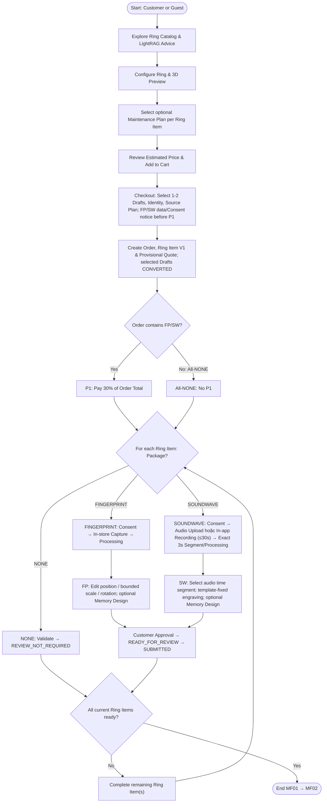

> **Repository snapshot, 2026-11-15** of the post-Review 2 Main Flow (numbering MF01–MF04). Source of truth: https://drive.google.com/file/d/1Wzs50m6A-h0ca3YgBbyCbYz-gFkGp3vB/view
> If this copy and the Drive file differ, the Drive file wins. Older documents (permission sources such as `MF02-07`, the 2026-10 API Master) use the previous six-flow numbering.

# MF01 — Configure & Place Ring Order

> **MEMORA \| Main Flow 01 — Business-level baseline sau Review 2**  
> **Trạng thái:** Nội bộ nhóm đã thống nhất; chờ giảng viên xác nhận trong Review tiếp theo.  
> **Phiên bản:** 2026-11-01  
> **Gộp từ:** MF01 (Discovery, Configuration & Design Draft) \+ MF02 (Order, Deposit & Personalization) trước Review 2\.  
> **Nguyên tắc:** Đây là Main Flow cấp mục tiêu nghiệp vụ. Các bước kỹ thuật, trạng thái chi tiết và API được đặc tả trong Activity Diagram, Sequence Diagram, Use Case Specification và State Machine.

## 1\. Business Goal

**Mục tiêu nghiệp vụ:** Cho phép Customer khám phá danh mục, lựa chọn và cấu hình từ **1–2 chiếc nhẫn (Ring Items) cho một Order**, đặt hàng hợp lệ và hoàn thiện thiết kế cá nhân hóa khi áp dụng để các Ring Items đủ điều kiện chuyển sang quy trình xem xét, xác nhận giá cuối cùng và sản xuất ở MF02 mới.

**Kết quả kinh doanh kỳ vọng:**

1. Khách hàng tự chọn các cấu hình được phép dựa trên Ring Template, xem 3D Preview và Estimated Price, rồi đưa thiết kế hợp lệ vào Cart.  
2. Hệ thống tạo Order từ 1–2 Ring Design Draft được chọn, xác minh chủ sở hữu/Guest phù hợp, lưu Ring Item Version V1 và Provisional Quote.  
3. Nếu Order có ít nhất một FINGERPRINT hoặc SOUNDWAVE (FP/SW), **thông báo rõ yêu cầu xử lý dữ liệu cá nhân và cho Customer đọc chính sách trước Checkout/P1**; sau khi tạo Order và P1 thành công mới thu **Consent chính thức**, rồi thu nguồn thật, Processing, FP placement hoặc SW segment selection, Memory Design nếu opt-in, Customer Approval và Submit đối với các Ring Items có cá nhân hóa.  
4. Nếu toàn Order là NONE (All-NONE), bỏ qua P1 và toàn bộ quy trình Source/Personalization; các Ring Item đủ điều kiện `REVIEW_NOT_REQUIRED`.  
5. Kết thúc với Order và current Ring Item Versions đủ điều kiện để MF02 tiếp nhận, **chưa có Manager Approval, Final Quote, Customer Final Confirmation hay Production Lock**.

**Phân biệt:** Một Order có 1–2 Ring Items; package thuộc từng Ring Item, trong khi P1 và các commercial/production gates được đánh giá ở cấp Order.

## 2\. Actors

| Actor / Entity | Trách nhiệm trong MF01 |
| :---- | :---- |
| **Customer (Registered User)** | Khám phá, cấu hình, quản lý Cart trên các thiết bị sau khi đăng nhập; có thể tiếp tục một persisted Design Draft hợp lệ qua Design Code; tạo Order, lựa chọn Source Plan, thanh toán P1 nếu áp dụng, chấp thuận Consent, cung cấp source, chỉnh và xác nhận Personalization Design, Submit |
| **Guest** | Khám phá, cấu hình, lưu Draft trong Guest Cart; có thể dùng Design Code để tiếp tục một thiết kế đã lưu trên thiết bị khác và chuyển/ghép Guest Cart khi Login/Register từ phiên hợp lệ; chỉ được Create Order không tài khoản khi **All-NONE**, sau khi email được xác minh |
| **Store Staff** | Hỗ trợ tại cửa hàng và thực hiện Fingerprint Capture có sự đồng ý của Customer; không được tự quyết định package/source/approval hay trở thành Order Owner |
| **PayOS Payment Gateway (external)** | Cung cấp kết quả giao dịch P1 cho Order có FP/SW; chỉ callback/webhook xác thực hợp lệ được ghi nhận là thanh toán thành công |
| **Fingerprint IoT Device — AS608 \+ ESP32 (external)** | Thu fingerprint thật trong capture session tại cửa hàng theo quyền và Consent hợp lệ |

**Supporting system components (không phải business decision-makers):** LightRAG tư vấn theo knowledge đã duyệt; Product/Catalog & Pricing rules; Audio/Fingerprint Processing Service; Inventory/Order services. Manager, Jeweler, Delivery Staff không thực hiện các quyết định nghiệp vụ của MF01.

## 3\. Preconditions

1. MEMORA đã công bố Ring Catalog và Ring Templates **ACTIVE**, bao gồm material, size, gemstone options/slots, personalization packages, mapping GLB và ENGRAVE\_SURFACE đủ điều kiện sử dụng.  
2. Customer/Guest có thể truy cập kênh được hỗ trợ: Web, Mobile Web/Customer application hoặc phiên có Store Staff hỗ trợ tại cửa hàng.  
3. Không cần đăng nhập, tồn tại Order, thanh toán hoặc cung cấp source thật trước khi bắt đầu browse/configuration.  
4. Trước **Create Order**, phải có từ 1–2 Ring Design Draft `IN_CART` trong ACTIVE Cart; phải đáp ứng identity verification, configuration validity, price/inventory revalidation và thông tin Checkout cần thiết.  
5. Với bất kỳ FP/SW trong Order, Customer phải Login/Register **trước Create Order**; Guest Checkout chỉ áp dụng khi **toàn bộ Ring Items đều NONE**, yêu cầu xác minh email.  
6. **Chỉ khi chọn tiếp tục thiết kế giữa các thiết bị:** Design Code phải tham chiếu tới persisted Ring Design Draft `IN_CART` hợp lệ, chưa hết hạn và chưa bị thu hồi. Khôi phục thiết kế không thay thế identity verification hoặc điều kiện Checkout/Create Order.

## 4\. Main Flow

### 4.1. Main Flow Overview

Sơ đồ này có **một nhánh P1 theo Order**, sau đó **ba nhánh NONE / FINGERPRINT / SOUNDWAVE theo từng Ring Item**. Với Mixed Order, P1 áp dụng cho toàn Order nhưng chỉ các Ring Items FP/SW cần nguồn và thiết kế cá nhân hóa.

&nbsp;

**Chú thích sơ đồ:**

- Trước khi vào `ITEM`, điều kiện P1 đã được xử lý một lần ở **cấp Order** nếu có bất kỳ FP/SW.  
- Với **All-NONE**, tất cả Ring Items đi theo nhánh NONE; không có P1.  
- Với **Mixed Order (NONE \+ FP/SW)**, sau P1 một Ring Item đi theo NONE, Ring Item còn lại đi theo FP hoặc SW.  
- Với **2 FP hoặc 2 SW**, SHARED/SEPARATE được chọn tại Checkout; SHARED chỉ dùng chung **source gốc**, không dùng chung FP placement hoặc SW segment selection, design version hay Customer Approval.  
- Điều kiện `All current Ring Items ready?` là exit gate của MF01, **không phải Manager Approval hay Production Authorization**.  
- Flowchart là business overview, không biểu diễn các lần retry, giao dịch DB hoặc luồng từng màn hình. Với FP/SW, thông tin về xử lý dữ liệu/Consent phải được công bố trước P1; việc xem thông báo **không thay thế Consent chính thức** sau P1 và trước thu nguồn. Chỉ những Draft được chọn mới `CONVERTED` sau Create Order thành công. Design Code để tiếp tục persisted Draft trên thiết bị khác và Guest Cart Migration là các nhánh tùy chọn **trước Checkout** (AF01/AF15), không phải bước bắt buộc của Main Flow.

### 4.2. Main Flow Description

| Bước | Business Stage | Mô tả và đầu ra chính |
| :---- | :---- | :---- |
| **MF01-S01** | **Explore Catalog & Advice** | Customer/Guest duyệt Ring Catalog, filter/sort theo dữ liệu có cấu trúc hoặc sử dụng LightRAG để nhận tư vấn. AI không tự đặt giá, thay cấu hình hay tạo Order. |
| **MF01-S02** | **Configure Ring** | Chọn Ring Template, material, target size/resize nếu hợp lệ và gemstone configuration theo các Gemstone Slots/Groups mà Template hỗ trợ. Với **Standard Gemstone**, chọn gemstone option tương thích; viên đá vật lý cụ thể được phân bổ ở giai đoạn sau, không HOLD tại Configure. Với **Certified Gemstone**, chọn đúng từng viên đá có định danh riêng từ các viên `AVAILABLE` phù hợp với slot/group; hệ thống kiểm tra khả năng cung cấp tại thời điểm cấu hình nhưng **chưa HOLD trước Create Order**. 3D Preview và Estimated Price phản ánh cấu hình đá đã chọn; giá, tính tương thích và tồn kho được kiểm tra lại tại Add to Cart/Create Order. Chọn đúng một package trong NONE/FP/SW; Digital Memory opt-in chỉ cho FP/SW; **optional Maintenance Plan** theo từng Ring Item cho NONE/FP/SW, ví dụ `LIFETIME_POLISHING`, được chọn khi Configure/Checkout và xác nhận trước Create Order. FP/SW trước thu nguồn chỉ có mockup cố định, view-only. |
| **MF01-S03** | **Preview, Estimate & Cart** | Hiển thị Estimated Price bao gồm selected Maintenance Plan price line theo từng Ring Item (nếu có); validate tại Add to Cart. Nếu hợp lệ, tạo Ring Design Draft `IN_CART` gắn với một ACTIVE Cart. Có thể edit Draft hoặc chia sẻ sanitized read-only preview theo chính sách. Với persisted Draft hợp lệ, Customer/Guest có thể tạo Design Code để tiếp tục thiết kế trên thiết bị khác bằng cách khôi phục **một bản sao** vào Cart của phiên nhận sau revalidation; thao tác này không chuyển ownership của Draft gốc. Không HOLD tồn kho lúc này. |
| **MF01-S04** | **Checkout & Identity** | Chọn 1–2 Drafts từ Cart, review/xác nhận selected Maintenance Plan (nếu có) trên từng Ring Item; xác minh Customer hoặc email Guest All-NONE; thu thông tin liên hệ/recipient và fulfillment cần thiết; Source Plan `SHARED/SEPARATE` chỉ khi cả 2 Ring Items cùng FP hoặc cùng SW, trường hợp khác `N/A`. **Với FP/SW, trước khi thanh toán P1 cần công bố thông báo privacy/Consent và hiển thị rõ điều khoản: việc Customer chỉ từ chối Consent bắt buộc sau P1 thành công không tự động làm phát sinh quyền hoàn P1, ngoại trừ các quyền/ngoại lệ pháp luật bắt buộc. Ghi nhận xác nhận đã được thông báo/acknowledgement trước P1, kèm policy version và thời điểm; đây KHÔNG phải formal Consent cho xử lý source. Điều khoản phải được pháp lý/chủ dự án xác nhận trước khi đưa vào production.** |
| **MF01-S05** | **Create Order & Provisional Quote** | Revalidate catalog, configuration, pricing và inventory ACTIVE. Certified Gemstones: HOLD đồng thời đủ N viên phân biệt trong transaction theo rule. **Chỉ khi Create Order thành công**, tạo Order, 1–2 Ring Items và Version V1, rồi chuyển **chỉ những Draft được chọn** từ `IN_CART` sang `CONVERTED` (`cart_id=NULL`), loại khỏi active Cart nhưng không xóa lịch sử; Draft không được chọn vẫn `IN_CART`. **Nếu Create Order thất bại phải rollback, không chuyển Draft nào sang `CONVERTED`.** Lưu Provisional Quote từ pricing snapshot hiện hành, gồm selected Maintenance Plan line theo từng Ring Item; Plan entitlement trước handover chưa `ACTIVE`. |
| **MF01-S06** | **Initial Payment Gate** | Nếu Order có ít nhất một FP/SW: P1 \= 30% Order Total theo active Provisional Quote và phải thành công trước Source Collection. **Đã ghi evidence acknowledgement của privacy/Consent notice và điều khoản không tự động hoàn P1 chỉ do từ chối Consent sau trả cọc (subject to mandatory legal rights) trước P1; formal Consent độc lập, chỉ được thu sau P1 SUCCEEDED và trước source collection.** Nếu All-NONE: **không thu P1**, đi tiếp theo fast path. |
| **MF01-S07** | **Personalization by Package** | NONE: không cần source, Consent, Placement, Memory Design, Customer Personalization Approval.  FP: Consent → AS608/ESP32 capture tại cửa hàng → quality check → processing/vectorizing → cho Customer điều chỉnh **position**, **scale có min/max theo Ring Template**, **rotation** trong ENGRAVE\_SURFACE. SW: Consent → **upload audio hợp lệ hoặc ghi âm trực tiếp trong app tối đa 30 giây** → validate/normalize → chọn **đúng một đoạn 3 giây** → tạo waveform/asset; **không cho chỉnh position/scale/rotation**, hình khắc dùng vị trí, kích thước và hướng cố định do Ring Template quy định. Nếu opt-in, hoàn thiện Memory Design riêng cho từng Ring Item. SW input có thời lượng dưới 3 giây hoặc lựa chọn khác đúng 3 giây đều bị từ chối; source được thu/xử lý chỉ sau P1 thành công và Consent hợp lệ. |
| **MF01-S08** | **Customer Approval, Submit & Exit** | FP/SW Customer xác nhận đúng preview/current version → `READY_FOR_REVIEW`, sau Submit → `SUBMITTED`. NONE hợp lệ → `REVIEW_NOT_REQUIRED`. MF01 hoàn tất khi các current Ring Item Versions thỏa exit gate tương ứng; chuyển sang MF02. |

Định nghĩa mốc chính:

- **Ring Design Draft**: chỉ tồn tại sau Add to Cart; trước đó cấu hình ở FE/session; Draft không phải Order.  
- **Ring Item Version V1**: tạo khi Create Order; snapshot độc lập với source Draft, không live-sync.  
- **Provisional Quote**: được tính sau Create Order; không phải Final Quote và không tự Production Lock.  
- **Customer Approval (MF01)**: chốt đúng bản Personalization Design từng Ring Item để Submit Review. **Customer Final Confirmation (MF02)**: xác nhận giá cuối cùng \+ toàn bộ current Ring Item Versions ở cấp Order.

### 4.3. Ring Item Branches

| Package / Order case | P1 ở cấp Order | Source & Processing | Personalization approval | Current Version tại exit |
| :---- | :---- | :---- | :---- | :---- |
| **All-NONE (1–2 NONE)** | **Không** | Không | Không | Tất cả `REVIEW_NOT_REQUIRED` |
| **Order có FINGERPRINT** | **Có, 30% toàn Order** | Consent \+ capture FP thật tại cửa hàng \+ ACCEPTED quality \+ vector asset \+ placement | Có | FP `SUBMITTED` |
| **Order có SOUNDWAVE** | **Có, 30% toàn Order** | Consent \+ upload audio thật \+ chọn segment/waveform asset; vị trí/kích thước/hướng khắc cố định theo Ring Template | Có | SW `SUBMITTED` |
| **NONE \+ FP/SW** | **Có, 30% toàn Order** | Chỉ thu source cho FP/SW | Chỉ FP/SW | NONE `REVIEW_NOT_REQUIRED`; FP/SW `SUBMITTED` |
| **FP \+ SW / 2 FP / 2 SW** | **Có, 30% toàn Order** | Source theo từng package; 2 cùng package có thể SHARED/SEPARATE | Riêng từng Ring Item | Các current personalized versions `SUBMITTED` |

### 4.4. Optional Maintenance Plan per Ring Item — Quyết định đã chốt 2026-11-02

- Customer có thể **chọn hoặc bỏ chọn** gói Maintenance Plan cho từng Ring Item ngay lúc Configure/Checkout, bất kể package `NONE`, `FINGERPRINT` hay `SOUNDWAVE`. Không bắt buộc mua Plan để nhận Warranty hoặc yêu cầu Paid Maintenance sau bán hàng.  
- Gói baseline đầu tiên: `LIFETIME_POLISHING` (dịch vụ đánh bóng/chăm sóc tiêu chuẩn). Coverage: standard cleaning, standard polishing, light surface refinishing; tối đa **2 lần hoàn tất dịch vụ trong mỗi 12 tháng**, không đồng nghĩa unlimited usage.  
- Không cover: đổi size theo yêu cầu, đổi engraving, thay đá, sửa kết cấu lớn hoặc dịch vụ ngoài phạm vi. Những việc này có thể được đánh giá theo Warranty hoặc Paid Maintenance ở MF04.  
- Plan selection và giá là **commercial configuration** của đúng Ring Item. Estimated Price → Provisional Quote tại MF01 phải chứa plan line (nếu selected); Final Quote và Customer Final Confirmation ở MF02 bind lại plan code, scope/price và exact Ring Item.  
- Với Order có FP/SW, P1 là 30% **Provisional Order Total đã bao gồm giá plan** nếu có; All-NONE **vẫn không có P1/P2** dù có mua Plan và trả toàn bộ số dư ở MF03.  
- Plan `PENDING` trước handover; chỉ được activate sau successful full-Order handover tại MF03. MF04 kiểm tra plan ACTIVE, coverage và remaining benefit usage khi có Maintenance Claim.

## 5\. Alternative Flows

| ID | Trigger / Alternative | Handling & Return Point |
| :---- | :---- | :---- |
| **AF01** | Guest browse/configure & Cart Migration | Không cần login để browse/configure; khi Add to Cart hợp lệ, persist Draft vào ACTIVE Guest Cart có expiry. Nếu Guest Login/Register thành công **trong phiên Guest hợp lệ**, xác minh phiên nguồn rồi migrate/merge các Draft `IN_CART` còn hợp lệ vào Customer Cart; xử lý trùng/xung đột có kiểm soát, revalidate cấu hình/giá và không âm thầm ghi đè. Đăng nhập không tự liên kết Guest Order cũ chỉ vì email trùng. |
| **AF02** | Guest Checkout All-NONE | Thu guest email/phone/recipient/fulfillment, xác minh email trước Create Order; `owner_user_id` có thể NULL; không tạo Digital Memory. |
| **AF03** | Guest Checkout chứa bất kỳ FP/SW | Yêu cầu Login/Register trước khi Create Order; giữ Draft/Cart hợp lệ và tiếp tục sau khi định danh. |
| **AF04** | Draft không hợp lệ ở Add to Cart / Create Order | Reject bước không hợp lệ; giữ lựa chọn/draft phù hợp để chỉnh sửa, không tự áp cấu hình mới. Nếu giá đổi, cho Customer xem và xác nhận lại giá ước tính mới. **Create Order thất bại không được đánh dấu Draft `CONVERTED` hoặc xóa Draft khỏi Cart.** |
| **AF05** | P1 pending / failed / timeout (Order có FP/SW) | Chưa mở Consent/Source Collection. Payment Attempt 15 phút; retry P1 trên cùng Order trong 24 giờ theo baseline cũ sau khi revalidate và tái HOLD nếu cần; quá 24 giờ chưa thành công → `EXPIRED_UNPAID`. **Rule này không áp dụng cho All-NONE**. |
| **AF06** | Fingerprint capture không đạt | Store Staff có tối đa 3 capture attempts mỗi Capture Session; chỉ sample đạt quality threshold mới ACCEPTED. Nếu thất bại, mở session mới theo policy; không process nguồn rejected. |
| **AF07** | Soundwave audio/segment không hợp lệ | Yêu cầu upload file hợp lệ hoặc ghi âm lại trong app (tối đa 30 giây), rồi chọn đúng một đoạn 3 giây; không mở thao tác điều chỉnh position/scale/rotation; chỉ tạo production asset từ source/segment hợp lệ. |
| **AF08** | Source Plan SHARED / SEPARATE | SHARED chỉ cùng loại source gốc trong đúng consent scope của hai Ring Items cùng package. Mỗi Ring Item vẫn có asset/version/preview/Approval riêng; với FP có placement/scale/rotation riêng, với SW có lựa chọn đoạn thời gian riêng nhưng vị trí/kích thước/hướng khắc cố định theo Ring Template. |
| **AF09** | Customer muốn đổi Source Plan sau khi đã thu nguồn | Không đổi trực tiếp: revalidate, thực hiện re-consent và relink/collect source theo plan mới; không tự reuse source ngoài scope. |
| **AF10** | Placement/preview không đạt ràng buộc | Block Customer Approval; với FP Customer chỉ được chỉnh position/scale (giới hạn min/max theo template)/rotation trong ENGRAVE\_SURFACE đúng boundary/forbidden zone/tolerance; với SW Customer chỉ được upload/chọn lại time segment hợp lệ, không được kéo/thu phóng/xoay waveform trên nhẫn. |
| **AF11** | Một Ring Item hoàn thiện trước Ring Item còn lại | Giữ readiness theo `current Ring Item Version`; có thể Submit personalized item riêng. MF01 exit cấp Order chỉ khi mọi Ring Item đạt đầu ra. |
| **AF12** | Customer đổi physical design sau `READY_FOR_REVIEW` | Tạo controlled new `Ring Item Version DRAFT`, giữ version cũ cho audit; thực hiện lại validation/pricing/source/approval bị ảnh hưởng. |
| **AF13** | Certified Gemstone HOLD hết hạn | Không tự giữ đá mãi. Với FP/SW: P1 failure/timeout trả HOLD→AVAILABLE và re-HOLD khi retry. Với All-NONE: HOLD ban đầu 15 phút, nếu chưa Final Confirmation thì release; MF02 kiểm tra và tái HOLD tại Final Confirmation trước khi chuyển RESERVED; nếu hết hàng, dừng production authorization. |
| **AF14** | Customer hủy hoặc không tiếp tục | Giữ trace Order/Payment/Version theo trạng thái; cancellation/refund áp dụng policy stage tương ứng. **Nếu Customer FP/SW từ chối Consent sau P1, không thu/xử lý source hoặc Submit; yêu cầu hỗ trợ/hủy được xử lý theo policy đã được phê duyệt, không mặc định hoàn cọc hoặc tự chuyển sang NONE.** Các rule cancellation dựa vào P1/P2 cũ phải đồng bộ lại cho All-NONE trong lần duyệt Order Lifecycle. |
| **AF15** | Cross-device Design Continuation bằng Design Code | Customer/Guest trên thiết bị nhận nhập Design Code của một persisted Draft `IN_CART`. Hệ thống kiểm tra mã còn hiệu lực/chưa bị thu hồi, không cho đoán mã hoặc truy cập dữ liệu bảo vệ; khôi phục **bản sao cấu hình** vào ACTIVE Cart của phiên nhận sau khi revalidate template/options/giá. Nếu mã hết hạn/không hợp lệ hoặc cấu hình không còn được hỗ trợ, từ chối hoặc yêu cầu chỉnh sửa/xác nhận trước khi lưu; không sửa Draft gốc, không tự chuyển toàn bộ Cart hay quyền sở hữu Order. |

### 5.1. Maintenance Plan Selection Changed before Order Creation

Nếu Customer đổi gói Maintenance Plan trước Create Order, hệ thống revalidate plan availability/price/eligibility, cập nhật Estimated Price/Cart và xác nhận lại selected Plan trước checkout. Sau Create Order nhưng trước Production Lock, thay đổi plan là thay đổi commercial terms: MF02 phải dùng controlled repricing \+ Final Quote/Confirmation mới nếu áp dụng; không âm thầm sửa active confirmed quote.

## 6\. Postconditions

### 6.1. Successful Outcome

1. Một **Order** hợp lệ đã được tạo từ đúng 1–2 selected `IN_CART` Drafts.  
2. Order có đúng 1–2 **Ring Items** và các **current Ring Item Versions** hợp lệ; selected Drafts chuyển `CONVERTED` (`cart_id=NULL`) nhưng không hard-delete; Cart còn lại tiếp tục ACTIVE nếu còn sử dụng.  
3. **Provisional Quote** được lưu cùng các pricing references/snapshots áp dụng, **bao gồm Maintenance Plan price line per Ring Item nếu chọn**, chưa có Final Quote; entitlement của Plan chưa ACTIVE.  
4. Nếu Order chứa FP/SW, P1 đã được ghi nhận **SUCCEEDED** trước việc thu source và Consent hợp lệ đã được xác nhận trước capture/upload/process.  
5. Từng current Ring Item Version ở trạng thái đầu ra:  
   - `NONE → REVIEW_NOT_REQUIRED` sau validation hợp lệ.  
   - `FINGERPRINT → SUBMITTED` sau actual source, processing, chỉnh position/scale trong min/max/rotation hợp lệ, optional Memory Design, Customer Approval và Submit.  
   - `SOUNDWAVE → SUBMITTED` sau upload hoặc in-app recording hợp lệ (ghi âm tối đa 30 giây), chọn đúng một đoạn 3 giây, processing thành waveform với hình khắc cố định theo template, optional Memory Design, Customer Approval và Submit (không cho chỉnh position/scale/rotation).  
6. Order có dữ liệu owner/guest, chosen fulfillment mode và Source Plan (nếu cần) để tiếp tục MF02. Không có source nào bị sử dụng ngoài Consent/scope.  
7. **Chưa có** Manager Approval, Final Quote, Customer Final Confirmation, P2, Production Lock, Production Authorization, physical production, QC, Handover hoặc Digital Memory Activation.

### 6.2. Incomplete / Non-success

- Nếu chưa Create Order: giữ Draft/Cart theo policy; MF01 chưa đạt business goal.  
- Nếu Order có FP/SW nhưng chưa P1 hoặc chưa hoàn tất nguồn/Customer Approval: Order vẫn đang xử lý ở MF01, chưa đạt exit gate.  
- Nếu Certified Gemstone của All-NONE chỉ còn Order chưa được Final Confirmed: **HOLD 15 phút không có nghĩa là đã RESERVED**. MF02 chịu trách nhiệm tái xác minh tồn kho trước Production Lock.

## 7\. Business Rules

| ID | Business Rule | Nguồn nền |
| :---- | :---- | :---- |
| **MF01-BR01** | Ring Template ACTIVE là authority cho Material/Size/Gemstone/Package và compatibility; cấu hình không hợp lệ bị từ chối bởi BE. | Old MF01 |
| **MF01-BR02** | `stone_layout` phải thuộc tập option do ACTIVE Ring Template/slot/group cho phép (ví dụ `NONE`, `SINGLE` hoặc cấu hình nhiều đá tương thích). Không chấp nhận layout/slot/gemstone combination ngoài template. | Old MF01; template compatibility |
| **MF01-BR03** | Nonstandard target size chỉ hợp lệ nếu có supported resize path theo Ring Template \+ Material; không tự chế tác ở MF01. | Old MF01 |
| **MF01-BR04** | Standard Gemstone chọn theo option, viên vật lý được cấp sau; Certified Gemstone phải có đủ N viên AVAILABLE riêng biệt. | Old MF01 |
| **MF01-BR05** | Trước Add to Cart chỉ có FE/session configuration. Valid Add to Cart mới tạo `Ring Design Draft IN_CART` trong ACTIVE Cart; không HOLD tồn kho ở Cart. | Old MF01 |
| **MF01-BR06** | Cart có thể chứa nhiều Draft; mỗi Create Order chọn đúng 1–2 `IN_CART` Drafts. **Sau Create Order thành công**, chỉ selected Drafts chuyển `CONVERTED` và `cart_id=NULL`, các Draft khác vẫn `IN_CART` trong active Cart; Create Order thất bại thì không đổi trạng thái Draft (transaction rollback). | Old MF01; nhóm xác nhận 2026-11-04 |
| **MF01-BR07** | Guest chỉ Create Order khi All-NONE và đã verify email; bất kỳ FP/SW yêu cầu registered Customer. Cart Migration từ Guest chỉ áp dụng với phiên Guest hợp lệ. Email trùng hoặc thao tác Login/Register không tự chứng minh quyền sở hữu hay liên kết Guest Order cũ với tài khoản. | Old MF01 \+ MF02; làm rõ Guest Cart/Order |
| **MF01-BR08** | Source Plan chọn tại Checkout, không nằm trong persisted Draft: 2 FP hoặc 2 SW → SHARED/SEPARATE; các trường hợp khác → N/A. SHARED chỉ là original source. | Old MF01 \+ MF02 |
| **MF01-BR09** | Estimated Price \= ACTIVE Ring Blank selling price \+ resize fee \+ gemstone price \+ personalization fee \+ selected Maintenance Plan price (theo từng Ring Item); Memory eligible không thu thêm. Create Order reprice thành Provisional Quote. | Old MF01 \+ MF02 |
| **MF01-BR10** | Package là một trong `NONE/FINGERPRINT/SOUNDWAVE` và phải được Ring Template hỗ trợ. NONE không có personalization source, engraving placement, Memory entitlement. | Old MF01 |
| **MF01-BR11** | FP/SW trước source thật chỉ dùng mockup fixed/view-only, không chỉnh mockup làm production asset. | Old MF01 |
| **MF01-BR12** | P1 áp dụng **nếu Order có bất kỳ FP/SW**, bằng 30% active Provisional Order Total; webhook/result thanh toán xác thực mới ghi nhận success. **All-NONE không P1.** | Old MF02 \+ quyết định sau Review |
| **MF01-BR13** | FP/SW: trước P1 hiển thị notice/privacy/Consent policy và **điều khoản không tự động hoàn P1 chỉ vì Customer từ chối Consent sau P1** (subject to mandatory legal rights); bắt buộc lưu acknowledgement, policy version, actor, timestamp trước khi tạo payment attempt P1. Acknowledgement không thay thế Consent; formal versioned purpose/source/Ring Item-scoped Consent chỉ thu sau verified P1 success và trước capture/upload/record/process. Consent declined → block source/submit, không tự chuyển package hay tự hoàn cọc; cancellation/refund phải xử lý theo policy đã được legal/business phê duyệt. | BM04 F-02 AC1; F-13; pending legal validation |
| **MF01-BR14** | Fingerprint thực chỉ capture tại cửa hàng qua AS608+ESP32 có Store Staff hỗ trợ; quality ACCEPTED mới được process/vectorize; tối đa 3 attempts/session. | Old MF02 |
| **MF01-BR15** | SW Customer có thể **upload** file audio định dạng hỗ trợ hoặc **ghi âm trực tiếp trong app (tối đa 30 giây)** sau P1 SUCCEEDED và Consent scoped hợp lệ; chọn **đúng một đoạn 3 giây** để sinh waveform khắc. Source <3 giây, chọn sai độ dài, ghi âm >30 giây hoặc file không hợp lệ đều phải bị từ chối. Giới hạn upload file (size/duration/MIME) phải được chốt nhất quán ở API validation spec, không được dùng giới hạn legacy để loại bỏ kênh ghi âm trong app. | BM04 F-02 AC2/AC5; F-12; MF02 2026-11-05 |
| **MF01-BR16** | Phân biệt theo package: **FINGERPRINT** chỉ cho chỉnh position, scale trong giới hạn **min/max do Ring Template/ENGRAVE\_SURFACE quy định** và rotation trong hướng/góc hợp lệ; không biến dạng dữ liệu gốc hay vượt boundary/forbidden zones. **SOUNDWAVE** cho phép upload hoặc ghi âm trực tiếp trong app (tối đa 30 giây) và chọn đúng đoạn 3 giây từ source hợp lệ; **không** có chỉnh position/scale/rotation của waveform. Hình khắc SW lấy vị trí/kích thước/hướng cố định theo Ring Template và được kiểm tra khi tạo Production Package. | Old MF02 |
| **MF01-BR17** | Digital Memory chỉ cho FP/SW, optional mặc định OFF từng Ring Item, phụ phí 0đ. MF01 cho phép hoàn thiện Memory Design nếu opt-in, **không activate/PIN/access**. | Old MF01 \+ MF02 |
| **MF01-BR18** | Ring Item Version V1 tạo khi Create Order. Current DRAFT có thể sửa hợp lệ; sau `READY_FOR_REVIEW` phải freeze production-relevant version. Khi sửa physical design cần controlled new version. | Old MF02 |
| **MF01-BR19** | FP/SW chỉ `READY_FOR_REVIEW` khi source/processing, FP placement hoặc SW segment selection, optional Memory Design và Customer Approval hợp lệ; Submit → `SUBMITTED`. NONE → `REVIEW_NOT_REQUIRED`. | Old MF02 |
| **MF01-BR20** | LightRAG chỉ tư vấn dựa trên ACTIVE knowledge, không tự sửa cấu hình, giá, inventory, Consent hay phê duyệt; structured filters/validation theo DB/rules. | Old MF01 |
| **MF01-BR21** | Certified Gemstone HOLD đủ N viên riêng trong transaction tại Create Order, TTL 15 phút. **Có FP/SW:** P1 success→RESERVED; fail/expired→AVAILABLE. **All-NONE:** MF02 sau Final Confirmation hợp lệ phải đảm bảo HOLD hiện hành/re-HOLD rồi RESERVED trước Production Lock. | Quyết định mới B \+ Old MF01/02 |
| **MF01-BR22** | Order-level Final Quote, Customer Final Confirmation và Production Lock đều thuộc **MF02**. Có FP/SW cần P2 trước lock; All-NONE không P2. | Quyết định mới A |
| **MF01-BR23** | Share Design Draft chỉ được tạo cho persisted Draft, ở dạng sanitized **read-only preview link** có thể revoke; không transfer ownership hoặc expose protected source/Order. Read-only share link **không phải** Design Code cho việc tiếp tục chỉnh sửa thiết kế giữa các thiết bị. | Old MF01; phân biệt Design Handoff |
| **MF01-BR24** | Mọi thay đổi price/availability giữa Add to Cart và Create Order đều cần revalidation; không tự thay đổi lựa chọn của Customer khi không hợp lệ. | Old MF01 |

| **MF01-BR25** | Customer được chọn optional Maintenance Plan cho mọi package NONE/FP/SW theo từng Ring Item; plan code/price/coverage là optional commercial configuration, không phải Personalization hoặc Memory entitlement. | Decision Tracker MF06-17 + quyết định 2026-11-02 |
| **MF01-BR26** | Baseline `LIFETIME_POLISHING`: tối đa 2 completed standard polishing benefits trong mỗi 12 tháng; cover standard cleaning, polishing, light surface refinishing; không cover resize/engraving/gemstone replacement/major repair. Plan không transferable mặc định. | Decision Tracker MF06-17 |
| **MF01-BR27** | Estimated Price và Provisional Order Quote phải tính selected Plan line theo từng Ring Item; FP/SW P1 30% tính trên provisional total có Plan, All-NONE không tạo P1/P2 kể cả khi mua Plan. | Decision Tracker MF06-17 + quyết định mới |
| **MF01-BR28** | Plan chưa ACTIVE trước handover; chỉ MF03 được phép activation sau successful full-Order handover; MF04 xử lý covered-vs-paid maintenance, không thay Warranty. | Decision Tracker MF06-17 |
| **MF01-BR29** | Design Code chỉ tạo từ persisted Ring Design Draft `IN_CART` thuộc ACTIVE Cart và còn hợp lệ. Khi nhận trên thiết bị khác, chỉ khôi phục một **bản sao cấu hình** thành Draft mới thuộc Cart của phiên nhận; Draft gốc vẫn thuộc phiên/owner ban đầu, không chuyển Order hoặc toàn bộ Cart. | Bổ sung Cross-device Design Handoff |
| **MF01-BR30** | Design Code là mã khó đoán, giới hạn thời gian sử dụng và có thể thu hồi; hệ thống phải kiểm tra tính hợp lệ, chống thử đoán mã và revalidate catalog/options/pricing trước khi cho phép lưu bản sao. Không chứa/cấp quyền truy cập fingerprint, audio nguồn thật, Memory, Consent, thông tin Customer/Order/Payment hoặc dữ liệu bảo vệ; tách biệt sanitized read-only share link. | Bổ sung an toàn Design Handoff |
| **MF01-BR31** | Guest Cart Migration chỉ diễn ra sau Login/Register thành công từ phiên Guest nguồn còn hợp lệ; merge những Draft `IN_CART` hợp lệ vào Customer Cart mà không âm thầm ghi đè hoặc đóng toàn bộ Cart. Customer đã đăng nhập trên thiết bị khác truy cập Cart gắn tài khoản; Guest Order cũ vẫn độc lập, không auto-link theo email. | Bổ sung Guest Cart/Order boundary |

### 7.1. Certified Gemstone Reservation — Quy tắc riêng theo loại Order

| Mốc | All-NONE | Order có FP/SW |
| :---- | :---- | :---- |
| Add to Cart | Availability check; no HOLD | Availability check; no HOLD |
| Create Order | Atomic HOLD đủ N viên; TTL 15 phút | Atomic HOLD đủ N viên; TTL 15 phút |
| Sau Create Order | Chưa RESERVED, không thanh toán | P1 30% trong MF01 |
| Chuyển RESERVED | **MF02, sau Customer Final Confirmation hợp lệ**, kiểm tra/re-HOLD nếu TTL đã hết | **MF01, sau P1 success** |
| Production Lock | MF02 sau Final Confirmation \+ reservation/preproduction gates | MF02 sau Final Confirmation \+ P2 satisfied \+ gates |
| Thanh toán cuối | 100% theo policy giao/nhận ở MF03 | P3 ở MF03 |

**Nguyên tắc:** Không bao giờ chuyển từ HOLD đã hết hạn hoặc viên đá đã được Order khác giữ sang RESERVED. Khi thiếu đá, chặn gate tiếp theo, không tạo Production Lock trên inventory không hợp lệ.

### 7.2. Điểm cần đồng bộ State Machine sau khi chốt 4 MF

- All-NONE **không đi qua `AWAITING_P1` hoặc `AWAITING_P2`**. Theo Decision B, baseline nội bộ dùng `PENDING_FINAL_QUOTE` cho All-NONE (MF02-BR10); cập nhật State Machine/API enum và transitions chính thức theo reviewer approval, không tạo tên trạng thái thứ hai.  
- Chính sách `EXPIRED_UNPAID` sau 24 giờ chưa có P1 chỉ áp dụng cho Order cần P1; không dùng để hết hạn All-NONE.  
- Cancellation/refund policy cũ dựa trên P1/P2 phải được cập nhật theo việc All-NONE chưa thanh toán trước khi sản xuất.  
- Certified Gemstone của All-NONE được RESERVED ở MF02, không phải khi MF01 Create Order thành công.

## 8\. Flow Boundary

### 8.1. MF01 Ownership

| MF01 sở hữu | Ghi chú |
| :---- | :---- |
| Explore & LightRAG Advice; Configure/3D Preview | Tư vấn và chọn option hợp lệ |
| Optional Maintenance Plan selection per Ring Item | NONE/FP/SW; ghi code/price line trong Estimated Price, Draft/Checkout và Provisional Quote |
| Estimated Price, Cart, persisted Ring Design Draft | Không giữ inventory |
| Cross-device Design Continuation (Design Code) & Guest Cart Migration | Chỉ persisted Draft `IN_CART`; phục hồi bản sao sau revalidation; không tự chuyển quyền sở hữu Guest Order |
| Customer/Guest Checkout, identity, fulfillment selection, Source Plan | Guest chỉ All-NONE |
| Create Order, Ring Item Versions, Provisional Quote | Chưa Final Quote |
| P1 cho Order có FP/SW | Theo toàn Order |
| Consent, FP/SW Actual Source Collection & Processing | Chỉ sau P1 hợp lệ |
| Personalization Placement, optional Memory Design | Theo từng Ring Item |
| Customer Approval & Submit | FP/SW `SUBMITTED`; NONE `REVIEW_NOT_REQUIRED` |

### 8.2. Không thuộc MF01

| Nghiệp vụ | Chủ sở hữu |
| :---- | :---- |
| Manager Review, Request Changes, Final Quote, Customer Final Confirmation | **MF02 — Produce & Quality Check Ring Order** |
| P2 (nếu có FP/SW), Production Lock, Production Authorization, Work Order, Production, REWORK/REMAKE, Manager Final QC | **MF02** |
| All-NONE Certified Gemstone RESERVED sau Final Confirmation | **MF02** |
| All-NONE thanh toán 100% hoặc FP/SW P3, Payment Verification, toàn bộ Order Handover | **MF03 — Complete Payment & Handover Order** |
| Warranty & Digital Memory Activation sau successful full-Order handover | **MF03** |
| Warranty claim, Maintenance, Return và xử lý hậu mãi | **MF04 — Manage After-sales Services** |
| Sau bàn giao: Memory PIN, Access Grants, Digital Memory Access, WebAR | **Supporting Use Cases** |
| DATA\_RIGHTS | **Supporting Use Case độc lập** |

### 8.3. MF01 → MF02 Contract

- **Input MF02:** Order hợp lệ, current Ring Item Versions, Provisional Quote (có selected Maintenance Plan lines per Ring Item nếu mua), payment evidence P1 nếu áp dụng, source/consent/processing/FP placement hoặc SW time-segment/Customer Approval evidence nếu có.  
- **Version readiness:** NONE \= `REVIEW_NOT_REQUIRED`; FP/SW \= `SUBMITTED`.  
- **MF02 Review:** Manager chỉ review Ring Item FP/SW ở trạng thái `SUBMITTED`; không review NONE.  
- **Final Quote gate ở MF02:** mọi current versions phải `MANAGER_APPROVED` đối với FP/SW hoặc `REVIEW_NOT_REQUIRED` đối với NONE.  
- **Customer Final Confirmation ở MF02:** cấp Order, bind current versions và Final Quote; **không phải** Customer Approval của Personalization trong MF01.  
- **No partial production:** Production Lock và Production Authorization cấp Order; không cho một nhẫn đi production nếu nhẫn còn lại chưa đạt gate toàn Order.

---

### 8.4. BM04-aligned API implementation contract (synchronization 2026-11-13)

> **Status:** Quy tắc triển khai theo BM04 v1.0 và baseline nội bộ 4 MF. Đây là business/API contract để thiết kế endpoint, payload, authorization và tests; **không** khẳng định API đã triển khai, test đã PASS hay reviewer đã ký. Các quyết định thay đổi phạm vi/giá/chính sách vẫn cần xác nhận theo quy trình.

- **Cart/Order atomicity:** Create Order chỉ chấp nhận 1–2 Draft `IN_CART` trong ACTIVE Cart; revalidate current template/price/inventory, atomically tạo Order, Ring Items V1 và Provisional Quote. Chỉ selected Drafts chuyển `CONVERTED`; lỗi phải rollback toàn bộ. Không HOLD stock lúc Add to Cart.
- **Identity & sharing:** Guest chỉ được All-NONE sau verified email; FP/SW yêu cầu đăng nhập. Design Code clone configuration sau revalidation, không chuyển owner/Order và không tiết lộ source; sanitized read-only link không có quyền redeem. Guest Cart merge chỉ khi chứng minh valid source session.
- **P1/Consent gate:** `any(FP/SW)` → P1 = 30% Provisional Order Total gồm Plan lines; `All-NONE` → no P1. Trước P1 lưu acknowledgement của privacy/Consent notice + disclosure về trường hợp Consent refusal (chờ pháp lý duyệt); sau verified P1 chỉ cấp source-session khi formal versioned purpose/source/Ring Item consent hợp lệ. Endpoint upload/record/capture/process phải tự enforce gate, không tin FE.
- **Source & output:** FP chỉ AS608/ESP32 in-store, tối đa 3 attempts/session, processed accepted source → bounded translate/scale/rotate. SW nhận uploaded supported audio hoặc in-app record ≤30s, chọn `segment_duration_ms=3000` chính xác và dùng fixed template geometry; reject source <3s/recording >30s/other selection duration, no SW transform. Hai SW dùng SHARED source vẫn có segment/waveform/approval từng item.
- **Cross-flow exit:** FP/SW current version `SUBMITTED`, NONE `REVIEW_NOT_REQUIRED`; MF01 không tạo Final Quote/P2/Design Lock/Production. Server mutations phải bảo vệ resource owner, consent scope, state/version và audit evidence. Các test case ID thuộc BM04 Section 6.1, evidence runtime chưa xác minh.

## Reference / Change Record

- **2026-11-13 — BM04 sync:** đồng bộ chính xác 3s SW, hỗ trợ in-app recording ≤30s, privacy/P1 acknowledgement và điều khoản nonrefund-with-legal-exceptions, định dạng BR02/BR25–31, trạng thái All-NONE và API boundary theo BM04; không đổi scope còn chờ reviewer.

- **Legacy sources:** MF01.md và MF02.md trong `MAIN FLOW/MAIN FLOW TRƯỚC REVIEW 2`; Decision Tracker tabs MF01, MF02, MF03, MF05.  
- **Approved internally after Review 2:** 4 business Main Flows; All-NONE không P1/P2, trả 100% ở MF03; FP/SW giữ P1/P2/P3; Final Quote luôn ở MF02; Certified Gemstone All-NONE RESERVED ở MF02 sau Final Confirmation; exit gate MF01 theo current Ring Item Versions.  
- **Synchronization status:** Nội dung file này là baseline MF01 mới; chưa tự động cập nhật Report 1–5, registration, tracker, ERD, API specs hay diagrams.  
- **Synchronization 2026-11-02:** Bổ sung optional Maintenance Plan per Ring Item vào Configure/Checkout, Estimated Price/Provisional Quote và P1 provisional total cho Order FP/SW; All-NONE vẫn không P1/P2. Final Quote thuộc MF02; activation thuộc MF03; service entitlement thuộc MF04. Theo Decision Tracker MF06-17 và quyết định nhóm đã chốt.  
- **Lecturer approval:** Pending.  
- **2026-11-02 (Design Code / Guest Cart clarification):** MF01-S03, AF01/AF15, BR07/BR23/BR29–BR31, Actors, Preconditions và MF01 Ownership bổ sung việc tiếp tục persisted Draft giữa thiết bị (copy-only), merge Cart từ Guest Session hợp lệ và ranh giới Guest Order. Không thay đổi order/payment/personalization/production gates.
- **2026-11-02 (Gemstone selection clarification):** Làm rõ MF01-S02: Standard Gemstone chọn theo option; Certified Gemstone chọn viên đá định danh `AVAILABLE` theo slot/group, không HOLD trước Create Order; Preview/Estimated Price cập nhật theo lựa chọn và revalidate ở Add to Cart/Create Order. Không thay đổi BR04/BR21 hoặc timing HOLD/RESERVED.

- **2026-11-04 (FP/SW editing controls confirmed by team):** FP cho chỉnh position, scale (min/max theo Ring Template) và rotation trong giới hạn ENGRAVE_SURFACE; SW theo bản ghi quyết định 2026-11-04 từng chỉ upload, chọn 2–5s; **đã supersede theo BM04 2026-11-13:** upload hoặc in-app recording ≤30s, chọn đúng 3s, không cho chỉnh position/scale/rotation. Giá trị giới hạn FP cụ thể cần được cấu hình/test theo Template, không tự đặt số.

- **2026-11-04 (C06/C07 confirmed):** Mai Nhân Kiệt xác nhận selected Drafts chuyển `IN_CART → CONVERTED` sau Create Order thành công; Draft khác giữ trong Cart và khi Create Order lỗi không convert. Nhóm chọn công bố yêu cầu xử lý dữ liệu/Privacy/Consent và điều kiện thanh toán-hủy FP/SW **trước Checkout/P1**, trong khi Consent chính thức vẫn ghi nhận **sau P1 success và trước Source Collection/Processing**. Việc từ chối Consent không làm phát sinh quyền hoàn P1 tự động; cần áp dụng chính sách hủy/hoàn tiền đã phê duyệt.
