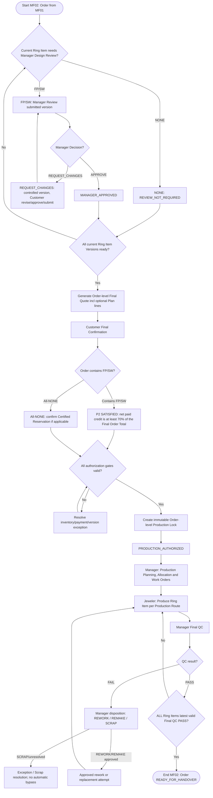
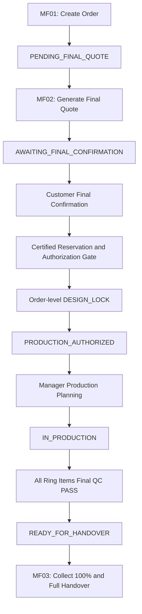

> **Repository snapshot, 2026-11-15** of the post-Review 2 Main Flow (numbering MF01–MF04). Source of truth: https://drive.google.com/file/d/1Pgvb6fLGs377RElxVfEj1O5Mcy8nK3Lk/view
> If this copy and the Drive file differ, the Drive file wins. Older documents (permission sources such as `MF02-07`, the 2026-10 API Master) use the previous six-flow numbering.

# MF02 — Produce & Quality Check Ring Order

> **MEMORA | Main Flow 02 — Business-level baseline sau Review 2**  
> **Trạng thái:** Nhóm đã thống nhất nội bộ phạm vi MF02 và các quyết định A1/B/C2; chưa phải phê duyệt của giảng viên.  
> **Phiên bản:** 2026-11-01  
> **Gộp từ:** MF03 — Review, Final Quote, Payment & Design Lock + MF04 — Production, Finishing & QC trước Review 2.  
> **Đầu vào:** MF01 mới — Configure & Place Ring Order.  
> **Đầu ra:** MF03 mới — Complete Payment & Handover Order.  
> **Nguyên tắc:** Main Flow tập trung mục tiêu, actor, business gates và kết quả. API/DB/chi tiết máy laser nằm trong các đặc tả kỹ thuật tương ứng.

## 1. Business Goal

**Mục tiêu nghiệp vụ:** Bảo đảm một Order gồm 1–2 Ring Items được xét duyệt thiết kế khi cần, xác nhận giá và cấu hình cuối cùng, đáp ứng các gate thương mại và tồn kho, được Production Lock cấp Order, sản xuất theo đúng thiết kế khóa và tất cả thành phẩm vượt qua Manager Final QC trước khi chuyển sang thanh toán cuối/bàn giao ở MF03.

**Business outcomes:**
1. Manager Review đúng current submitted version của từng Ring Item FINGERPRINT/SOUNDWAVE (FP/SW); Ring Item NONE không cần Design Review.
2. Chỉ khi mọi current Ring Item Version đã `MANAGER_APPROVED` (FP/SW) hoặc `REVIEW_NOT_REQUIRED` (NONE), hệ thống mới tạo Final Quote cấp Order.
3. Customer/Guest hợp lệ xác nhận Final Quote, exact Ring Item Versions/configuration và fulfillment/commercial terms ở **Customer Final Confirmation**. Đây là bằng chứng khác với Customer Personalization Approval của MF01.
4. Order có FP/SW hoàn thành P2 để cumulative net payment credit đạt **at least 70% of the Final Order Total**; All-NONE không P1/P2 nhưng phải thỏa Certified Gemstone Reservation Gate nếu có.
5. Hệ thống chỉ tạo **Production Lock cấp Order** và `PRODUCTION_AUTHORIZED` sau các gate tương ứng; không release sản xuất riêng một nhẫn khi toàn Order chưa được phép.
6. Manager lập kế hoạch/allocate vật tư và assign Work Order theo từng Ring Item; Jeweler sản xuất theo immutable Production Package và Production Route của nhẫn.
7. Manager Final QC độc lập đối với từng Production Attempt, xử lý REWORK/REMAKE/SCRAP nếu FAIL.
8. Chỉ khi **tất cả current Ring Items QC PASS** thì Order mới `READY_FOR_HANDOVER` và MF02 kết thúc.

**Phạm vi quyết định:** Final Quote, Final Confirmation, P2, Production Lock, Authorization và completion gate ở **cấp Order**. Manager Design Review, Work Order, Production Attempt, Inventory Allocation và Final QC ở **cấp Ring Item**, liên kết về một Order.

## 2. Actors

| Actor / External Entity | Trách nhiệm trong MF02 |
| --- | --- |
| **Customer (Registered User)** | Xem và xác nhận Final Quote/versions của Order, thanh toán P2 nếu cần, đề xuất Physical Design Change trước Lock, yêu cầu hủy theo policy, xem public production milestones |
| **Guest (chỉ All-NONE)** | Xác thực quyền Order bằng order code + verified email/session hợp lệ để xem, xác nhận Final Quote; không được thao tác Order người khác |
| **Manager** | Review FP/SW submitted versions và quyết định APPROVE/REQUEST_CHANGES; duyệt change/cancellation exceptions; lập kế hoạch sản xuất, inventory allocation và assignment; Final QC, REWORK/REMAKE/SCRAP dispositions |
| **Jeweler** | Nhận Work Order nếu đủ skill/permission; thực hiện chuẩn bị, resize, gemstone setting, laser engraving khi áp dụng, finishing, cập nhật production evidence; không tự Final QC |
| **PayOS Payment Gateway (external)** | Xử lý và xác minh Payment 2 của Order có FP/SW; không áp dụng cho All-NONE |
| **Laser System (external technical system)** | Thực thi engraving từ đúng Production Package/laser-ready asset đã được authorize; không tự chọn nội dung thiết kế |

**Supporting components:** Order/Pricing/Inventory services, Production Management, Laser Export/Processing. Các thành phần này áp dụng deterministic rules và lưu audit, không thay quyết định của Customer/Manager.

## 3. Preconditions

### 3.1. MF02 Entry từ MF01

1. Order hợp lệ, chưa hủy, có 1–2 Ring Items; đã được tạo cùng Ring Item Versions và Provisional Quote tại MF01.
2. Nếu Order có bất kỳ FP/SW, P1 đã thành công tại MF01, Consent và actual source/processing, FP placement hoặc SW time-segment/fixed geometry, Customer Approval cho các personalized versions đã hợp lệ.
3. Đối với từng **current Ring Item Version**:
   - NONE → `REVIEW_NOT_REQUIRED` sau validation.
   - FP/SW → `SUBMITTED` sau `READY_FOR_REVIEW` và Customer Submit.
4. Source Plan `SHARED/SEPARATE`, nếu có, đã được xử lý ở MF01; SHARED original source không đồng nghĩa cùng design/version/placement.
5. Order Owner hoặc Guest được xác thực/ủy quyền hợp lệ đối với các thao tác cần Customer Final Confirmation.

### 3.2. Các gate nội bộ MF02 (không phải điều kiện phải có trước khi bắt đầu MF02)

- Manager có thể Review một personalized current version khi version đó `SUBMITTED`, dù Ring Item khác chưa Submit.
- **Final Quote Gate:** ALL current Ring Item Versions: FP/SW `MANAGER_APPROVED`, NONE `REVIEW_NOT_REQUIRED`.
- **Production Authorization Gate:** Final Quote + Customer Final Confirmation active và bind cùng current versions; FP/SW P2 SATISFIED; All-NONE Certified reservation nếu cần; các inventory/production constraints hợp lệ.
- **Production Start Gate:** Order đã `PRODUCTION_AUTHORIZED`, có Production Package/Work Order và đủ vật tư/skill/permission.
- **Completion Gate:** mọi Ring Item có latest valid Manager Final QC = PASS.

## 4. Main Flow

### 4.1. Main Flow Overview

Sơ đồ dưới đây chia **Ring Item Design Review** trước khi hội tụ vào **Order-level Commercial/Authorization Gate**, sau đó tách theo **Ring Item Production & Final QC**.

**Chú thích nghiệp vụ:**
- Trường hợp `REQUEST_CHANGES` thực chất quay lại **subprocess design revision thuộc MF01**, Customer Approve và Submit version mới rồi mới quay về Manager Review tại MF02. Mũi tên trên là abstraction cấp business.
- FP/SW đã RESERVED Certified Gemstone sau P1 của MF01; phải revalidate reservation trước Lock nếu bị chậm/hết hạn. Nhánh All-NONE RESERVED ngay sau Customer Final Confirmation hợp lệ và trước Lock.
- `QC FAIL → SCRAP` **không tự động dẫn về Production**. Manager phải quyết định và phê duyệt phương án khôi phục/replacement/exception, hoặc xử lý dừng/hủy theo policy.
- `PASS → ALL PASS?` kiểm tra toàn Order; Ring Item còn lại có thể vẫn đang chế tác/QC. Không có partial handover.
- Không coi `Final Confirmation` là `Production Lock`; Lock phải qua authorization gates riêng.

### 4.2. Main Flow Description

| Step | Business Stage | Hành động và kết quả |
| --- | --- | --- |
| **MF02-S01** | **Manager Design Review** | Manager Review từng current FP/SW `SUBMITTED` version: compatibility, manufacturability, source completeness, **FP position/scale (min-max)/rotation** hoặc **SW chosen audio segment với vị trí/kích thước/hướng khắc cố định theo template**, 3D↔production consistency. APPROVE → `MANAGER_APPROVED`; REQUEST_CHANGES → reason và controlled revision. NONE được bỏ qua ở Design Review. |
| **MF02-S02** | **Order Design Readiness** | Khi tất cả current versions: FP/SW `MANAGER_APPROVED` hoặc NONE `REVIEW_NOT_REQUIRED`, mở gate tạo Final Quote. |
| **MF02-S03** | **Generate Final Quote** | Tạo Final Quote cấp Order từ current versions, active pricing context và snapshot; bao gồm resize/gemstone/personalization, memory opt-in reason/0đ nếu eligible, **selected Maintenance Plan price line per Ring Item nếu có** và fulfillment fee. Chụp plan_code, coverage/policy version, price; Plan chưa ACTIVE trước handover. |
| **MF02-S04** | **Customer Final Confirmation** | Authorized Customer hoặc Guest All-NONE xác nhận Final Quote + exact Ring Item Versions + design/Memory option/**Maintenance Plan selection per Ring Item**/fulfillment. Persist independent evidence và active confirmation; không tự tạo Lock. |
| **MF02-S05** | **Payment / Certified Reservation Gate** | FP/SW: thu P2 theo payment credit để đạt **at least 70% of the Final Order Total**; Certified Stone reservation tồn tại từ P1 phải hợp lệ. All-NONE: bỏ P2; Certified Gemstone nếu có phải được HOLD/re-HOLD và RESERVED đúng viên sau Final Confirmation, trước Lock. |
| **MF02-S06** | **Production Lock & Authorization** | Khi tất cả gate hợp lệ, tạo immutable Production Lock cấp Order, mỗi design_lock_item bind exact current Ring Item Version; chỉ Lock thành công mới chuyển `PRODUCTION_AUTHORIZED`. |
| **MF02-S07** | **Production Planning & Allocation** | Manager tạo/release Production Package từ Lock, allocate Ring Blank/Gemstones theo Ring Item, resolve Production Route, tạo Production Attempt/Work Order và phân công Jeweler đủ skill/permission. |
| **MF02-S08** | **Production Execution** | Jeweler thực hiện Work Order đúng thứ tự và constraints: prepare, resize nếu cần, laser nếu FP/SW, gemstone setting nếu có, finishing; log progress/material/laser evidence. Khi production bắt đầu, Order `IN_PRODUCTION`. |
| **MF02-S09** | **Manager Final QC** | Manager đối chiếu thành phẩm với locked Production Package, size, engraving (FP đúng transform đã duyệt; SW đúng segment và fixed template geometry), gemstone, finishing và chất lượng tổng thể; quyết định PASS hoặc FAIL. FAIL phải qua REWORK/REMAKE/SCRAP có traceability. |
| **MF02-S10** | **Complete Order Production** | Chỉ khi mọi current Ring Item có latest valid Final QC PASS, Order chuyển `READY_FOR_HANDOVER`, chuyển MF03 xử lý final payment và full-Order handover. |

> **FP/SW production geometry (BM04 F-12 / synced 2026-11-05):** FP Production Package dùng chính xác position, scale trong min/max theo template và rotation đã được Customer/Manager duyệt. SW Production Package dùng waveform từ **selected audio time segment đúng 3s từ upload hoặc bản ghi trong app tối đa 30s**, với engraving position/size/orientation **cố định theo Ring Template**, tuyệt đối không nhận transform SW từ Customer. Cả hai phải bind đúng current/locked Ring Item Version, mapping profile, ENGRAVE_SURFACE và checksum; invalid/stale assets bị block.

### 4.3. Order-level Authorization Branches

| Gate | All-NONE | Order chứa bất kỳ FP/SW (bao gồm Mixed Order) |
| --- | --- | --- |
| Manager Design Review | Skip đối với tất cả NONE | Review FP/SW; các NONE cùng Order skip |
| All Ring Items Ready | Toàn bộ `REVIEW_NOT_REQUIRED` | FP/SW `MANAGER_APPROVED` và NONE `REVIEW_NOT_REQUIRED` |
| Final Quote | Bắt buộc ở MF02 | Bắt buộc ở MF02 |
| Customer Final Confirmation | Bắt buộc, Guest verification nếu Guest Order | Bắt buộc |
| P2 | **Không** | `max(0, 70% × Final Order Total - eligible net payment credit)` |
| Certified Gemstone | Sau Final Confirmation: ensure valid HOLD → RESERVED | Đã RESERVED sau P1 MF01, còn valid trước Lock |
| Production Lock | Sau confirmation + reservation/constraints | Sau confirmation + P2 SATISFIED + reservation/constraints |
| Production & Manager QC | Bắt buộc | Bắt buộc |

**Đầu ra MF02 đồng nhất:** Order `READY_FOR_HANDOVER`. All-NONE thanh toán 100% ở MF03; Order có FP/SW thanh toán phần còn lại P3 ở MF03.

### 4.4. Maintenance Plan Commercial Snapshot — Quyết định 2026-11-02

- MF01 đã cho phép Customer chọn optional Maintenance Plan trên từng Ring Item với package `NONE`, `FINGERPRINT` hoặc `SOUNDWAVE`. MF02 **không tự động bán thêm plan**, mà revalidate và đưa selected Plan vào Final Quote cấp Order.
- Final Quote phải liệt kê `plan_code` (baseline `LIFETIME_POLISHING`), selected Ring Item, giá bán gói, policy/coverage version, quota dịch vụ; Plan không phải miễn phí bảo hành, không phải Digital Memory và không đổi Production Route.
- Baseline `LIFETIME_POLISHING`: tối đa **2 completed standard polishing benefits trong mỗi 12 tháng**, cover standard cleaning/polishing/light surface refinishing; không cover resize, engraving/gemstone replacement hoặc major repair.
- Customer Final Confirmation xác nhận cả Plan line/commercial terms. Nếu plan được thêm, bỏ, đổi hoặc repricing **trước Lock**, tạo Final Quote version mới và yêu cầu Customer Final Confirmation mới; không overwrite approved/locked quote.
- Total Order Price bao gồm Plan (nếu có): P2 của FP/SW dùng mục tiêu **at least 70% of the Final Order Total**, đã bao gồm Plan, trừ net paid credit (P1 đã dựa trên provisional quote tại MF01). All-NONE **vẫn không P2** dù đã chọn Plan.
- Plan entitlement chưa `ACTIVE` khi Production Lock/Order `READY_FOR_HANDOVER`. Activation thuộc MF03 **sau successful full-Order handover**, không phải điều kiện Production Authorization/QC.

## 5. Alternative Flows

| ID | Trigger / Alternative | Business Handling |
| --- | --- | --- |
| **MF02-AF01** | Manager `REQUEST_CHANGES` đối với FP/SW | Manager ghi checklist/reason và tạo Review Decision bind submitted version. Tạo controlled new Ring Item Version `DRAFT`; version cũ giữ audit/`SUPERSEDED` khi new current; Customer quay lại subprocess MF01, revalidate source/FP placement hoặc SW time segment/quote nếu ảnh hưởng, Approval → Submit → Manager Review lại. |
| **MF02-AF02** | Customer Physical Design Change trước Production Lock | Customer gửi request; Manager đánh giá. Nếu chấp nhận, tạo new controlled version, không sửa trực tiếp version approved. Invalidate affected Final Quote/Final Confirmation; đi lại Customer Approval/Manager Review nếu FP/SW, hoặc `REVIEW_NOT_REQUIRED` nếu NONE. |
| **MF02-AF03** | Giá/cuối cùng hoặc fulfillment thay đổi trước Lock | Reprice và tạo Final Quote version mới khi production-relevant/commercial fields đổi. Giữ tiền P1 thực trả làm payment credit; không rewrite lịch sử. Customer Final Confirmation lại nếu quote/versions thay đổi. |
| **MF02-AF04** | P2 failed/timeout hoặc payment callback lặp | Order ở `AWAITING_P2`, không Lock, không authorize. Ghi payment attempt idempotently; retry trên cùng quote/confirmation nếu còn valid. |
| **MF02-AF05** | All-NONE Certified HOLD đã hết khi Customer Final Confirmation | Hệ thống kiểm tra availability và atomically tái HOLD đủ từng certified stone rồi RESERVED; thiếu hàng thì chặn Lock, không xác nhận giữ viên không có thật; nếu stone/config/price phải thay thì revalidate Final Quote/Final Confirmation. |
| **MF02-AF06** | FP/SW Certified RESERVED trước Authorization bị hết hạn/chậm | Gia hạn hợp lệ hoặc revalidate/replace theo policy, không dùng reservation expired để Lock; nếu thay đổi physical/commercial specs phải đi lại review/quote/confirmation tương ứng. |
| **MF02-AF07** | Thiếu Ring Blank, vật tư, Certified Stone khi planning | Ring Item chờ Inventory, chưa start Work Order; giữ Order Authorized/production readiness phù hợp; không tự thay locked template/material/stone. Manager xử lý inventory/exception. |
| **MF02-AF08** | Jeweler thiếu skill hoặc permission | Hard-block assign/reassign/start step. Chọn nhân sự có active required skill/minimum level và permission; đặc biệt LASER_ENGRAVE yêu cầu skill phù hợp + `LASER_OPERATE`. |
| **MF02-AF09** | Production Package hoặc Laser Profile không hợp lệ | Block laser/affected step; resolve Production Exception theo Manager; không tự đổi engraving asset, ENGRAVE_SURFACE, placement hoặc locked depth constraints. |
| **MF02-AF10** | Final QC FAIL — REWORK | Manager chọn REWORK nếu sửa được trên Production Attempt hiện tại; ghi reason/evidence; cùng attempt quay về production step phù hợp rồi bắt buộc Final QC lại. |
| **MF02-AF11** | Final QC FAIL — REMAKE | Manager chọn REMAKE; production attempt cũ FAILED; tạo attempt và Work Order mới linked parent, phân bổ vật tư mới, thực hiện lại và Final QC. Không tạo thêm commercial Ring Item/charge chỉ vì lỗi nội bộ. |
| **MF02-AF12** | Final QC FAIL — SCRAP | Manager ghi reason/evidence, SCRAP attempt/vật tư hỏng và Inventory WRITE_OFF; không cho về AVAILABLE. Không tự quay lại sản xuất nếu chưa có disposition hợp lệ cho replacement/remake. |
| **MF02-AF13** | Hai Ring Items hoàn thành lệch nhau | Ring Item có QC PASS được derive ready ở cấp item; Order vẫn `IN_PRODUCTION` cho đến khi tất cả QC PASS; không thu P3 riêng hoặc handover riêng. |
| **MF02-AF14** | Customer All-NONE muốn hủy trước Production Lock | Cho phép hủy thông thường, **không thu phí**; giữ Order/Quote/reservation history và release vật tư chưa dùng hợp lệ. |
| **MF02-AF15** | Customer All-NONE muốn hủy sau Production Lock | **Quyết định A1:** gửi Cancellation Request để Manager xét duyệt; không tự hủy, không unlock. Nếu Manager chấp thuận, stop remaining work hợp lệ, settle inventory/cost, cancellation deduction không vượt payment credit thực thu; không tạo nghĩa vụ thanh toán thêm chỉ để thu cancellation fee. |
| **MF02-AF16** | Order đã QC PASS nhưng Customer chưa thanh toán/nhận hàng | Không tự chuyển CANCELLED. Order sang MF03 `READY_FOR_HANDOVER`; thực thi final-payment/collection/escalation ở MF03. |
| **MF02-AF17** | Certified Gemstone RESERVED nhưng sản xuất trì hoãn sau Authorization | **Quyết định C2:** reservation gắn Authorized Order được bảo vệ, không tự release theo TTL; theo dõi exception/Manager escalation, chuyển đúng viên `ALLOCATED` khi lập Work Order. |

### 5.1. Cancellation All-NONE — Quyết định A1 đã chốt

**Chính sách business:**
- Trước Production Lock: All-NONE được hủy miễn phí.
- Sau Production Lock: Customer chỉ gửi **cancellation request**, Manager phê duyệt/từ chối; không có self-service immediate cancel.
- Phí theo stage (nếu được tính để audit theo policy) **không đồng nghĩa số tiền đã thu**.
- Cancellation deduction = `min(stage cancellation fee, actual eligible payment credit)`. Refund = payment credit − deduction; không yêu cầu thu thêm để bù đủ stage fee.
- Ví dụ All-NONE trị giá 10.000.000đ, payment credit = 0đ và đã IN_PRODUCTION: Manager approve cancel → deduction 0đ, refund 0đ; chi phí nội bộ và inventory disposition được ghi nhận, không trình bày là đã thu phí 70%.
- Nếu Manager từ chối request hợp lệ theo policy, Order tiếp tục lifecycle; có log lý do và thông báo Customer.
- Không hard-delete hoặc mở khóa lại Production Lock, Work Order, Production Attempt, material movements sau cancel.
- Các quy tắc về phí hủy/hoàn tiền cần được công bố rõ cho Customer và áp dụng theo chính sách giao dịch hợp lệ.

### 5.2. Order Lifecycle All-NONE — Quyết định B đã chốt

- `PENDING_FINAL_QUOTE` là **Order state mới**, được nhóm chấp thuận theo phương án B; cần đồng bộ vào State Machine/API/ERD sau khi duyệt toàn bộ flows.
- All-NONE **không sử dụng** `AWAITING_P1`, `DESIGN_IN_PROGRESS`, `AWAITING_P2`, `EXPIRED_UNPAID` do không có P1/P2.
- Tại Customer Final Confirmation, nếu Certified Gemstone cần thiết không còn sẵn/không reserve được thì **không mở Production Lock**. Confirmation/Reservation phải có gate nhất quán, không để active confirmed snapshot dẫn đến sử dụng stone bị Order khác lấy.
- `PRODUCTION_AUTHORIZED` là được phép chuẩn bị sản xuất, **chưa** phải đã gia công; Order chỉ chuyển `IN_PRODUCTION` khi Work Order/Production Attempt đầu tiên thực sự STARTED.
- FP/SW tiếp tục theo `AWAITING_P1 → DESIGN_IN_PROGRESS → AWAITING_FINAL_CONFIRMATION → AWAITING_P2 → PRODUCTION_AUTHORIZED → IN_PRODUCTION → READY_FOR_HANDOVER`.
- Nếu production-relevant version/Quote thay đổi trước Lock, tất cả confirmation cũ không còn phù hợp phải INVALIDATED; gate tạo Lock phải kiểm tra nhất quán các đối tượng hiện hành.

### 5.3. Certified Gemstone Reservation Delay — Quyết định C2 đã chốt

| Mốc | Status / Chính sách |
| --- | --- |
| MF01 Add to Cart | Availability check, **no HOLD** |
| MF01 Create Order | Atomic HOLD đủ N certified stones riêng biệt, TTL 15 phút |
| MF01 P1 SUCCEEDED (Order chứa FP/SW) | HOLD → RESERVED |
| MF02 Customer Final Confirmation (All-NONE) | Revalidate current HOLD hoặc atomic re-HOLD nếu hết hạn; sau confirmation hợp lệ → RESERVED |
| Trước Production Authorization | RESERVED mặc định 7 ngày; Customer-delay extension đến 14 ngày theo policy; nội bộ Memora delay có thể gia hạn hợp lệ |
| Sau Production Authorization, trước Allocation | **Vẫn RESERVED nhưng được bảo vệ** bằng Order/active Production Lock; không auto-release bởi TTL bình thường; Manager theo dõi overdue/exception |
| Manager Planning / Work Order | Chuyển đúng certified stone đã RESERVED sang ALLOCATED theo Ring Item/Production Attempt/Work Order |
| Production uses stone | ALLOCATED → USED; lưu certified identity/certificate/lineage |
| Damaged/SCRAP | DAMAGED/SCRAPPED + WRITE_OFF; không trở lại AVAILABLE |
| Valid order cancellation before use | Quản lý release/disposition theo tình trạng vật lý, Order lifecycle và audit; không tự release stone đã USED/SCRAPPED |

**Lưu ý về data model:** không cần hai `RESERVED` enum khác nhau. `RESERVED` sau Authorization được bảo vệ vì quan hệ với `PRODUCTION_AUTHORIZED`/active Design Lock. Hệ thống có thể hiển thị/derive `RESERVED_PROTECTED` như lý do nghiệp vụ, **không tạo enum mới bắt buộc**. C2 không có nghĩa giữ vô hạn mà không review; mỗi overdue cần được Manager quản lý.

### 5.4. Optional Maintenance Plan Changed before Lock

Nếu selected Plan thay đổi hoặc có pricing/coverage error trước Design Lock: revalidate plan availability, regenerate Final Quote/version và invalidate old Customer Final Confirmation. Giữ payment credit P1/P2 thực trả theo ledger; không tạo physical Ring Item Version mới chỉ vì commercial-only Plan change, trừ khi đồng thời có thay đổi physical design thật. Sau Lock: không tự sửa commercial plan line hoặc Design Lock; phải đi controlled commercial exception theo policy.

## 6. Postconditions

### 6.1. Successful Outcome

MF02 thành công khi **tất cả** điều kiện sau đúng:
1. Mỗi Ring Item có current version được phép sản xuất: FP/SW `MANAGER_APPROVED`; NONE `REVIEW_NOT_REQUIRED`.
2. Final Quote hợp lệ cấp Order lưu pricing snapshot, đúng current versions và fulfillment details, Customer Final Confirmation còn ACTIVE và bind đúng quote/versions.
3. FP/SW: P2 SATISFIED, cumulative net payment credit đạt **at least 70% of the Final Order Total** **bao gồm selected Maintenance Plan price** nếu có (trừ trường hợp round/credit policy hợp lệ); All-NONE: P2 không áp dụng, certified reservation gate hoàn tất nếu có.
4. Active Order-level Production Lock immutable được tạo và bind mỗi exact version; Order từng được chuyển `PRODUCTION_AUTHORIZED` trước khi sản xuất.
5. Production Packages và Work Orders đều dựa trên locked snapshot; từng Ring Item có Production Attempt/Work Order, inventory allocation và progress evidence phù hợp.
6. Jeweler thực hiện đúng Production Route với skill/permission cần thiết; Manager Final QC độc lập cho từng Ring Item/valid Production Attempt.
7. **Tất cả current Ring Items latest valid Final QC = PASS**, không còn failed/open production recovery hay QC pending.
8. Order.status = `READY_FOR_HANDOVER`, đủ điều kiện chuyển MF03.

### 6.2. Không đạt exit gate

- Chưa Manager Approve đủ FP/SW → chưa tạo Final Quote.
- Có Final Quote nhưng chưa Customer Final Confirmation → chưa Lock.
- Có Final Confirmation nhưng chưa P2 SATISFIED ở Order FP/SW → chưa Lock.
- All-NONE chưa Certified Reservation hợp lệ nếu có Certified Stone → chưa Lock.
- Lock chưa tạo thành công → không `PRODUCTION_AUTHORIZED` và không start Work Order.
- Một Ring Item QC PASS, Ring Item còn lại FAIL/đang sản xuất → Order vẫn trong MF02.
- Sản phẩm hoàn thiện nhưng chưa Manager Final QC PASS → không được MF03.
- MF02 **không** thu P3 hoặc All-NONE final 100%, không bàn giao, không kích hoạt Warranty hay Digital Memory.

## 7. Business Rules

| ID | Business Rule |
| --- | --- |
| **MF02-BR01** | Manager Design Review chỉ áp dụng cho FP/SW `SUBMITTED` current Ring Item Version, không Review NONE. |
| **MF02-BR02** | Manager chỉ `APPROVE` hoặc `REQUEST_CHANGES` kèm reason/checklist; không chỉnh trực tiếp version được Submit. Quyết định và người duyệt được audit theo exact version. |
| **MF02-BR03** | `REQUEST_CHANGES` / approved pre-Lock Physical Change phải tạo new controlled `DRAFT` version với lineage; invalidate active quote/confirmation nếu thay đổi ảnh hưởng, chạy lại Customer Approval/Submit/Manager Review đúng package. |
| **MF02-BR04** | Final Quote chỉ tạo khi ALL current versions: FP/SW `MANAGER_APPROVED`, NONE `REVIEW_NOT_REQUIRED`; không tạo Final Quote từng Ring Item riêng. |
| **MF02-BR05** | Final Quote snapshot bao gồm price/quote version, product configuration, gemstone, personalization, resize, eligible Memory opt-in, **selected Maintenance Plan price line per Ring Item**, plan_code/coverage/price và fulfillment fee; Memory eligible FP/SW là INCLUDED_WITH_PERSONALIZATION, phụ phí 0đ; NONE không có Memory. |
| **MF02-BR06** | Final Quote không tự hết hiệu lực chỉ vì master price đổi/thời gian trôi; production-relevant version thay đổi phải tạo quote mới và invalidated confirmation liên quan. |
| **MF02-BR07** | Customer Final Confirmation ở cấp Order, bind đúng Final Quote + một current version của từng Ring Item + optional Maintenance Plan lines/terms; là bằng chứng riêng với Manager Approval và Customer Approval ở MF01; không tự tạo Lock. |
| **MF02-BR08** | P2 chỉ áp dụng Order chứa FP/SW. `P2 = max(0, 0.70 × Final Order Total - Eligible Net Payment Credit)`. Nếu payment credit >=70%, P2 SATISFIED mà không tạo 0đ gateway transaction. |
| **MF02-BR09** | Payment 1/P2 đã trả là immutable payment history/credit; khi reprice không thu lại P1, chỉ xử lý difference ở milestone tiếp theo; webhook idempotent. |
| **MF02-BR10** | All-NONE không có P1/P2. Sau Final Confirmation hợp lệ, Certified Stones nếu có phải RESERVED chính xác trước Lock; dùng lifecycle `PENDING_FINAL_QUOTE` mà không qua `AWAITING_P1`/`AWAITING_P2`. **Decision B**. |
| **MF02-BR11** | Production Lock cấp **Order**, bind exact current Ring Item Versions, Final Quote và ACTIVE Final Confirmation; create design_lock_items/hash per item; không có `ring_items.status` hay `ring_item_versions.status=LOCKED` bắt buộc. |
| **MF02-BR12** | Không được Lock hoặc Production Authorized khi bất kỳ Order-level gate thiếu; chỉ khi Lock thành công mới chuyển `PRODUCTION_AUTHORIZED`; không partial production authorization. |
| **MF02-BR13** | Lock ACTIVE immutable. Không unlock/overwrite để sửa physical design; post-Lock exception theo controlled cancel/remake/replacement flow và giữ toàn bộ audit. Digital-only content không ảnh hưởng physical/commercial snapshot được quản lý riêng. |
| **MF02-BR14** | Certified Stones trước Authorization có standard RESERVED TTL 7 ngày, customer-delay max extension 14 ngày hoặc nội bộ delay extension hợp lệ. Sau Authorization RESERVED được bảo vệ không timer release; Manager allocate đúng viên khi Work Order Planning. **Decision C2**. |
| **MF02-BR15** | Inventory Allocation cấp Ring Item theo locked Template Variant (Ring Template + Material + Standard Size), target resize nếu áp dụng; Certified Stone identity/certificate không được thay âm thầm. |
| **MF02-BR16** | Production Package chỉ release từ đúng active Design Lock; mỗi Work Order bind Order/Ring Item/Production Attempt/Production Package và snapshot Template Production Route + requirements. |
| **MF02-BR17** | Production Route là configurable theo Ring Template; RESIZE, LASER_ENGRAVE, GEMSTONE_SETTING, FINISHING chỉ có khi phù hợp configuration. Không hard-code một sequence cho mọi nhẫn hoặc cho Jeweler skip/reorder tùy ý. |
| **MF02-BR18** | Manager assignment chỉ khi Jeweler có required skill active và level >= minimum, đồng thời quyền hệ thống áp dụng; laser cần `LASER_ENGRAVING` skill + `LASER_OPERATE` permission. |
| **MF02-BR19** | Laser dùng đúng lock-bound asset/placement, ENGRAVE_SURFACE, mapping version, laser profile/checksum và manufacturing safety constraints; không dùng file Draft/obsolete hoặc tự thay laser process profile trái policy. |
| **MF02-BR20** | Jeweler production steps phải được log với Work Order/Attempt/actor/time/result. Customer chỉ thấy published milestones, không mặc định xem nội bộ logs, checksum, evidence hay máy móc. |
| **MF02-BR21** | Manager là owner Final QC; Jeweler không tự Final-QC sản phẩm mình trực tiếp làm. QC checklist gồm physical design/engraving, gemstone identity/setting, size, finishing và defect/safety. |
| **MF02-BR22** | QC FAIL phải có Manager disposition `REWORK / REMAKE / SCRAP`. REWORK trên attempt hiện tại, REMAKE tạo linked attempt+Work Order mới, SCRAP cần WRITE_OFF, không disposition nào bỏ qua QC lại nếu tiếp tục sản xuất. |
| **MF02-BR23** | Internal REWORK/REMAKE không tạo commercial Ring Item mới, không tự tạo invoice/Final Quote mới cho Customer. Certified Stone bị damaged/scrap phải giữ lineage và chỉ replacement nếu equivalent locked spec; khác spec thì controlled exception. |
| **MF02-BR24** | All-NONE trước Production Lock được hủy miễn phí. Sau Lock: Customer gửi request, Manager duyệt; không self-cancel; `deduction=min(stage_fee, actual_payment_credit)`, không thu thêm chỉ để đủ phí. **Decision A1**. |
| **MF02-BR25** | Cấp Ring Item readiness chỉ derive từ latest valid QC PASS của current production attempt; không persist `ordering.ring_items.status=READY_FOR_HANDOVER`. |
| **MF02-BR26** | Order chỉ `READY_FOR_HANDOVER` khi tất cả current Ring Items QC PASS; không partial handover hoặc P3 per Ring Item. |
| **MF02-BR27** | Physical Design Change trước Lock phải phân biệt production-relevant với digital-only; `memory_enabled` hoặc fulfillment thay đổi ảnh hưởng commercial snapshot có thể yêu cầu Final Quote/Confirmation mới. |
| **MF02-BR28** | Promotion engine chưa thuộc scope hiện tại; nếu triển khai sau phải là explicit quote line/version trước Final Confirmation, không mutate quote đã Lock. |

| **MF02-BR29** | Optional Maintenance Plan chọn ở MF01 cho bất kỳ package NONE/FP/SW được xác thực và ghi rõ thành Plan price line/version trong Final Quote cấp Order; không được biến thành Memory/Personalization entitlement. |
| **MF02-BR30** | Customer Final Confirmation bind Plan line theo Ring Item. Add/remove/change Plan hoặc price/coverage terms trước Lock bắt buộc revised Final Quote + reconfirmation; commercial-only Plan change không tự tạo physical Ring Item Version. |
| **MF02-BR31** | FP/SW P2 đưa eligible net paid credit đạt **at least 70% of the Final Order Total**, **đã bao gồm Plan price** nếu có; All-NONE vẫn không có P2. Plan entitlement chỉ kích hoạt tại MF03 sau handover, không thuộc Production/QC gate. |

### 7.1. Các điểm kiểm soát quan trọng

**Production Authorization theo loại Order**
- **All-NONE:** ALL versions `REVIEW_NOT_REQUIRED` → Final Quote → Customer Final Confirmation → Certified Reservation Gate nếu có → DESIGN_LOCK → `PRODUCTION_AUTHORIZED`.
- **Order chứa FP/SW:** FP/SW versions `MANAGER_APPROVED` + NONE versions `REVIEW_NOT_REQUIRED` → Final Quote → Customer Final Confirmation → P2 SATISFIED → valid inventory/reservation gate → DESIGN_LOCK → `PRODUCTION_AUTHORIZED`.
- P2 chỉ cần thu phần thiếu để net paid đạt **at least 70% of the Final Order Total**; không ép giao dịch P2 40% cố định nếu đã có repricing/credit.
- Final Confirmation không tương đương Design Lock; đối với FP/SW Lock chỉ sau P2, đối với All-NONE Lock chỉ sau reservation/authorization gates.

**Certified Gemstone & cancellation**
- Ở MF02, All-NONE Certified Reservation thực hiện **sau** Final Confirmation đúng quote/versions. Nếu HOLD từ MF01 hết hạn, phải re-HOLD atomically; không reserve đá đã bị Order khác chiếm.
- Sau `PRODUCTION_AUTHORIZED`, giữ RESERVED được bảo vệ trong thời gian Manager chưa allocate, không thả timer tự động; Manager cần quản lý reservation quá hạn.
- All-NONE không có tiền thanh toán ban đầu nên cancellation deduction thực tế thường bằng 0đ; stage-based policy fee vẫn có thể được tính/audit nhưng **không được biểu diễn như khoản đã thu**.

**3D → Laser data**
- Production engraving lấy từ canonical physical placement bound với LOCK, không từ screen pixel hoặc XYZ tùy ý.
- Ghi rõ `ENGRAVE_SURFACE`, mapping version, vị trí/góc/kích thước vật lý và asset checksum trong Production Package. Quy định laser process profile/depth theo calibrated Template Variant + Material + Machine, không cho Jeweler tự đặt depth.
- Phần toán tọa độ/laser calibration chi tiết nằm trong Software Design Description và API/technical specification; MF02 chỉ giữ safety and binding gates.

### 7.2. Những điểm cần đồng bộ sau khi chốt 4 Main Flows

1. Tracker MF02 cũ còn mô tả P1 cho NONE: được **supersede** bởi All-NONE không P1/P2, hoàn tất 100% tại MF03.
2. Tracker MF03 cũ có câu `Final Confirmation → DESIGN_LOCK ngay` ở Cancellation/Quote sections: thay bằng hai authorization paths chính xác như trên; FP/SW phải qua P2.
3. State Machine của All-NONE cần thêm `PENDING_FINAL_QUOTE`; các trạng thái `AWAITING_P1`, `DESIGN_IN_PROGRESS`, `AWAITING_P2`, `EXPIRED_UNPAID` không áp dụng All-NONE.
4. `RESERVED` sau Authorization được bảo vệ theo C2 nhưng không yêu cầu enum riêng; audit escalation và allocation theo Ring Item/Work Order.
5. Cancellation All-NONE theo A1 cần đồng bộ policy, UI thông báo, inventory disposition và ledger; không hạch toán fee đã thu nếu payment credit = 0đ.
6. Updated status/migration, ERD, Report 1–5, Draw.io, State Machine, API and Test Cases chỉ đồng bộ sau khi các Main Flows được duyệt cùng baseline.

## 8. Flow Boundary

### 8.1. MF02 Ownership

| MF02 sở hữu | Ghi chú |
| --- | --- |
| Manager Design Review cho submitted FP/SW current versions | NONE skip |
| Physical Design Change Request trước Production Lock | Re-run affected MF01 design approval/submission subprocess nếu cần |
| Final Quote + Customer Final Confirmation | Cấp Order, exact version binding và Maintenance Plan line/terms per Ring Item nếu selected |
| P2 của Order có FP/SW | Nâng net paid credit đến 70% |
| All-NONE Certified Reservation Gate | Sau Final Confirmation hợp lệ |
| Order-level Production Lock và Production Authorization | Không partial authorization |
| Production Package, Material Allocation, Work Orders | Theo từng Ring Item nhưng chỉ sau Order Authorized |
| Production Execution & Production Attempts | Theo Template route và skill/permission |
| Manager Final QC; REWORK/REMAKE/SCRAP | QC PASS tất cả mới exit |
| Cancellation sau Lock & Inventory delay exception | Quyết định A1/C2, Manager governance |

### 8.2. Không thuộc MF02

| Nghiệp vụ | Chủ sở hữu |
| --- | --- |
| Browse Catalog, Configure, 3D Preview, Estimated Price, Cart/Checkout | **MF01 — Configure & Place Ring Order** |
| Create Order, Provisional Quote, P1 (nếu FP/SW) | **MF01** |
| Consent, actual FP/SW Source Collection/Processing, FP placement hoặc SW time-segment selection, optional Memory Design & Customer Approval/Submit | **MF01**; MF02 có thể yêu cầu quay lại subprocess có kiểm soát khi Request Changes |
| FP/SW P3 hoặc All-NONE 100% Final Payment | **MF03 — Complete Payment & Handover Order** |
| Full-Order Handover, receipts/invoice, Warranty + eligible Digital Memory Activation sau handover | **MF03** |
| Warranty Claim, Maintenance, Return | **MF04 — Manage After-sales Services** |
| Digital Memory PIN/Access Grants/WebAR sau Activation | **Supporting Use Cases** |
| DATA_RIGHTS | **Supporting Use Case độc lập** |

### 8.3. MF01 → MF02 → MF03 Contracts

**Input MF02 từ MF01**
- Valid Order (1–2 Ring Items), Provisional Quote, Owner/Guest identity + fulfillment selection.
- Current Ring Item Versions: NONE `REVIEW_NOT_REQUIRED`; FP/SW `SUBMITTED`.
- FP/SW actual source/consent/processing, FP placement hoặc SW time segment/Customer Approval và P1 evidence nếu áp dụng.
- Certified HOLD/RESERVED evidence hợp lệ theo timeline của package.

**Output MF02 sang MF03**
- Order `READY_FOR_HANDOVER`, tất cả latest valid Final QC = PASS.
- Final Quote và ACTIVE Customer Final Confirmation bind exact locked Ring Item Versions, **bao gồm optional Maintenance Plan price/coverage line per Ring Item** nếu mua.
- Immutable active Design Lock, production package/attempt/work order/QC/inventory traceability.
- One Order fulfillment mode `PICKUP | DELIVERY` đã được xác nhận.
- Payment credit và remaining balance: FP/SW → P3; All-NONE → 100% Final Order Total nếu chưa có credit hợp lệ.
- **Không có partial handover.** MF03 chỉ mở payment/handover gate sau khi MF02 hoàn tất toàn Order.

---

### 8.4. BM04-aligned API implementation contract (synchronization 2026-11-13)

> **Status:** Quy tắc triển khai theo BM04 v1.0 và baseline nội bộ 4 MF. Đây là business/API contract để thiết kế endpoint, payload, authorization và tests; **không** khẳng định API đã triển khai, test đã PASS hay reviewer đã ký. Các quyết định thay đổi phạm vi/giá/chính sách vẫn cần xác nhận theo quy trình.

- **Entry & design review:** Only current `SUBMITTED` FP/SW Ring Item Versions can receive Manager APPROVE/REQUEST_CHANGES; NONE bypasses design review (`REVIEW_NOT_REQUIRED`), **not** independent Final QC. A physical change creates new controlled version and invalidates affected quote/confirmation before Lock.
- **Authorization gate, server-enforced:** Generate Final Quote only when every item ready. Final Confirmation must bind exact item versions and plan/fees. `any(FP/SW)` → eligible net payment credit ≥70% final total through verified PayOS P1/P2; All-NONE no P1/P2, but current Certified Stone reservation required after confirmation. Only then atomically create immutable Order-level `DESIGN_LOCK` and `PRODUCTION_AUTHORIZED`.
- **Production package integrity:** Release SVG/DXF and Work Orders only from active lock-bound exact Ring Item Version. FP geometry must respect template min/max and ENGRAVE_SURFACE; SW asset must represent **exactly 3000ms selected audio**, fixed position/size/orientation, checksum and profile/version match. Reject stale or client-transformed asset. Qualified Jeweler executes laser; MEMORA does not directly drive machine.
- **Attempts and QC:** Each Ring Item tracks production attempt, material allocation and Manager QC; FAIL requires explicit rework/remake/scrap disposition and repeat QC. Only when **all** latest current attempts pass independent Manager Final QC may Order become `READY_FOR_HANDOVER`. No P3, partial authorization or handover here.
- **Idempotency/traceability:** Lock, reservation, order status, package releases and attempt changes need authenticated actor, revision/precondition check, concurrency-safe writes and auditable events. Tests: BM04 WF-02 AC/TC; state-transition enumeration still pending.

## Reference / Change Record

- **2026-11-13 — BM04 sync:** bổ sung contract backend cho Final Quote/Confirmation/P2, atomic Production Lock, SW exact-3s asset và QC không bypass; giữ nguyên các quyết định A1/B/C2.

- **Legacy sources:** `MAIN FLOW/MAIN FLOW TRƯỚC REVIEW 2/MF03.md` (Review, Final Quote, P2, Lock), `MF04.md` (Production, QC) và MEMORA Business Flow Decision Tracker tabs MF03/MF04; nội dung cũ được rà lại và **supersede** ở các điểm đã thay đổi trong Main Flow 4-flow mới.
- **Related baseline:** `MAIN FLOW/MF01.md` sau Review 2 (Configure & Place Ring Order), gồm All-NONE no P1/P2, Ring Item submission/version readiness.
- **Decisions confirmed 2026-11-01:**
  - **A1:** All-NONE cancel free before Production Lock; after Lock Manager-governed; deduct no more than actual paid credit; no additional cancellation collection solely to satisfy policy stage fee.
  - **B:** All-NONE Order Lifecycle uses `PENDING_FINAL_QUOTE`, skips P1/P2 states, follows Final Confirmation/Reservation → Lock → Authorized.
  - **C2:** Certified Gemstone RESERVED protected after Production Authorization, ALLOCATED when Manager prepares Work Order; retain exact stone lineage.
- **Update 2026-11-02 — Maintenance Plan:** Final Quote/Confirmation bind selected plan code/price/coverage per Ring Item, reprice/confirm when commercial terms change, P2 includes Plan in Final Order Total; All-NONE still no P2; activation MF03. Theo Decision Tracker MF06-17.
- **Status:** Nội bộ nhóm đã chốt Business Main Flow để soạn tài liệu; chờ giảng viên phê duyệt. Chưa đồng bộ tự động với Reports, tracker, ERD, API, State Machine.
- **2026-11-05 — Soundwave rule sync:** Production Package luôn nhận waveform từ đúng 3 giây audio được Customer chọn, có thể lấy từ file upload hoặc bản ghi trong app (giới hạn ghi âm 30s); không cho chỉnh vị trí/kích thước/xoay SW.
