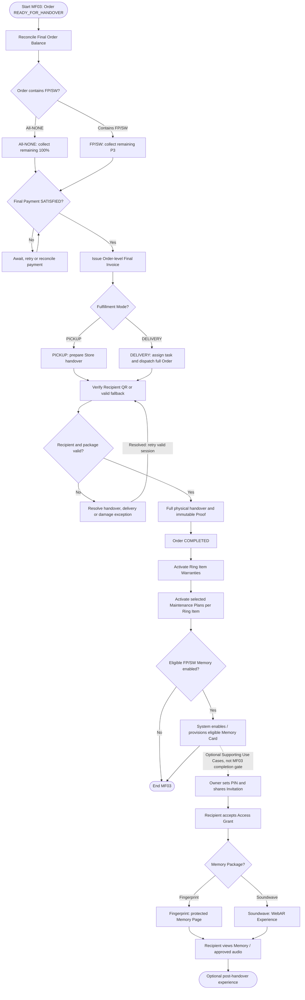
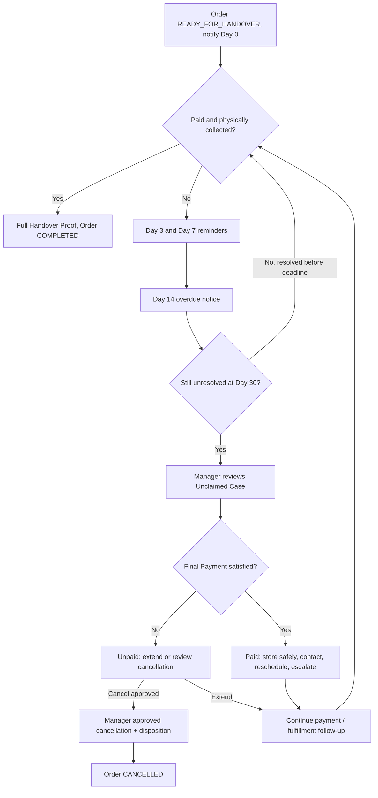
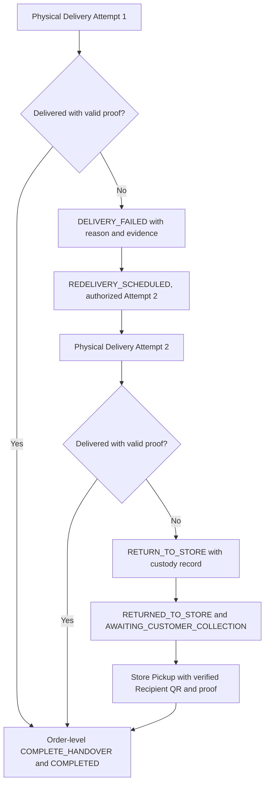

> **Repository snapshot, 2026-11-15** of the post-Review 2 Main Flow (numbering MF01–MF04). Source of truth: https://drive.google.com/file/d/1DW4A9Mk6WvOsBxq3awCXGP0lFCOK7KVl/view
> If this copy and the Drive file differ, the Drive file wins. Older documents (permission sources such as `MF02-07`, the 2026-10 API Master) use the previous six-flow numbering.

# MF03 — Complete Payment & Handover Order

> **MEMORA | Main Flow 03 — Business-level baseline sau Review 2**  
> **Trạng thái:** Đã duyệt và thống nhất nội bộ theo cuộc thảo luận MF03; chờ giảng viên phê duyệt.  
> **Phiên bản:** 2026-11-02  
> **Kế thừa:** MF05 — Final Payment, Handover, Invoice, Warranty & Digital Memory trước Review 2; cập nhật theo MF01/MF02 mới và quyết định A/B cho All-NONE.  
> **Đầu vào:** MF02 — Produce & Quality Check Ring Order.  
> **Đầu ra:** Order COMPLETED sau thanh toán và full-Order handover; yêu cầu hậu mãi sau bàn giao thuộc MF04.  
> **Cấu trúc:** 8 phần thống nhất cho 4 Main Flows. Business overview không thay cho Use Case/Activity/Sequence/State Machine.

## 1. Business Goal

**Mục tiêu nghiệp vụ:** Hoàn tất nghĩa vụ thanh toán của một Order có 1–2 Ring Items, tổ chức bàn giao toàn bộ Order theo đúng fulfillment mode và đúng Recipient, ghi nhận bằng chứng giao nhận hợp lệ, rồi kích hoạt Warranty và những quyền lợi Digital Memory đủ điều kiện sau bàn giao.

**Business outcomes:**
1. Verify toàn bộ Ring Items đã đạt Manager Final QC PASS và Order `READY_FOR_HANDOVER` từ MF02.
2. Đối chiếu **Final Order Total** với **Eligible Net Payment Credit** đã thực nhận và các refund/adjustment hợp lệ; chỉ yêu cầu thanh toán số dư còn thiếu.
3. Với **All-NONE**, thu thông thường **100% Final Order Total tại MF03** (không có P1/P2). Với **Order chứa FP/SW**, thu **P3 còn lại** sau P1/P2; P3 thường khoảng 30% nếu không reprice/credit khác.
4. Chỉ mở bàn giao sau khi Final Payment Gate `SATISFIED`; phát hành Payment Receipt khi có successful payment và Order-level Final Invoice đúng quote đã xác nhận.
5. Tổ chức `PICKUP` tại Store hoặc `DELIVERY` cho toàn Order; xác minh Recipient bằng single-use Recipient QR hoặc fallback hợp lệ, ghi nhận physical custody và Proof of Handover.
6. Chỉ chuyển Order `COMPLETED` sau khi **tất cả Ring Items đã được bàn giao vật lý cùng Order** và Handover Record/Proof lưu thành công; không có partial handover.
7. Kích hoạt Warranty cho từng Ring Item và xử lý Digital Memory entitlement/activation **chỉ** cho FP/SW đã chọn `memory_enabled=true`, sau successful full-Order handover.
8. Customer chậm thanh toán, không nhận hàng hoặc giao thất bại phải đi qua overdue/delivery exception, không tự `COMPLETED` hay `CANCELLED` ngoài quy tắc đã chốt.
9. Sau successful handover, MF03 mở Memory Activation Gate và chỉ dẫn hành trình tùy chọn Owner Setup → Recipient Access → Fingerprint Memory Page / Soundwave WebAR; trải nghiệm này thuộc Supporting Use Cases và không trì hoãn Order Completion.

**MF03 Success State:** `Order.status=COMPLETED`. Hậu xử lý Warranty/Memory có thể retry khi lỗi kỹ thuật nhưng không đảo ngược successful physical handover.

## 2. Actors

| Actor / External Entity | Trách nhiệm trong MF03 |
| --- | --- |
| **Customer / Order Owner** | Thanh toán cuối, kiểm tra hóa đơn, theo dõi Order, trực tiếp nhận hoặc chỉ định Recipient, quản lý Memory sau activation khi đủ điều kiện |
| **Guest (All-NONE Order)** | Truy cập Guest Tracking/Payment/Recipient QR thông qua order code + verified guest email/secure session; không bắt buộc Login/Register |
| **Recipient (business participant)** | Nhận toàn bộ Order, trình QR/fallback để xác minh; không nhất thiết là Registered User hay một system role riêng |
| **Store Staff** | Chuẩn bị Pickup, ghi nhận tiền mặt tại quầy khi được cấp quyền, verify Recipient QR/fallback, hoàn tất Pickup Proof; RELEASE package sang Delivery Staff theo handoff |
| **Delivery Staff** | ACCEPT được giao, RECEIVE package từ Store, vận chuyển, verify Recipient, thu Proof of Delivery, xử lý delivery failure/return custody; không được tự xác nhận payment/thu COD |
| **Manager / Operations** | Giao Delivery Task, quản lý reassignment và exceptions, xác minh emergency override đúng permission, review unclaimed/cancellation cases; không nhận giao hàng thay staff một cách tự động |
| **PayOS (external)** | Thanh toán điện tử và kết quả giao dịch được xác minh bởi backend; FE redirect/ảnh chụp giao dịch không là bằng chứng `SUCCEEDED` |

**Supporting components:** Payment, Invoice/Receipt, Fulfillment/Handover, Notification, Warranty, Digital Memory/Experience, audit. Các hệ thống này không thay thế quyết định của người có thẩm quyền.

## 3. Preconditions

MF03 chỉ bắt đầu khi **MF02 hoàn thành thành công**.

| Điều kiện | Required Input |
| --- | --- |
| Order | 1–2 Ring Items hợp lệ; chưa `CANCELLED`; `READY_FOR_HANDOVER` |
| Production/QC | Mọi current Ring Item latest valid Manager Final QC = PASS; không còn REWORK/REMAKE/QC FAIL đang pending |
| Commercial | Final Quote và Customer Final Confirmation active bind đúng exact locked Ring Item Versions |
| Production Lock | Có immutable active Order-level Design Lock, traceability production và QC |
| Payment | Có Final Order Total, payment transactions/eligible net payment credit; có thể chưa thanh toán đủ trước khi MF03 bắt đầu |
| Fulfillment | Một `fulfillment_mode=PICKUP|DELIVERY`, đã được xác nhận trước Final Confirmation/Lock; recipient/contact hợp lệ |
| DELIVERY | Service area được xác nhận trong TP.HCM, address snapshot hợp lệ; final delivery fee theo `FREESHIP_HCM` |
| Memory | Chỉ FP/SW `memory_enabled=true` là eligible; NONE `memory_enabled=false` và không có Memory entitlement/Card/PIN |
| Guest | Verified guest email/secure guest tracking hoặc verification session; order code đơn lẻ không cấp quyền |

**Không yêu cầu P3/All-NONE 100% đã được thanh toán trước entry**: đây chính là một bước của MF03. Không yêu cầu có handover session hay Memory ACTIVE trước entry.

## 4. Main Flow

### 4.1. Main Flow Overview

Sơ đồ gồm **hai nhánh Final Payment theo Order Type**, **hai nhánh Fulfillment**, **kích hoạt Warranty + selected Maintenance Plans** và **nhánh Digital Memory/AR Experience tùy chọn sau full-Order handover**. Nhánh Experience được thể hiện để người đọc thấy hành trình trọn vẹn của MEMORA nhưng **không là điều kiện Order COMPLETED hay MF03 exit gate**.

**Diagram rules:**
- `RETRY` không cho tự chuyển `PAID` khi chưa có trusted backend payment evidence/cash receipt.
- Với `DELIVERY`, Custody Store→Delivery Staff chỉ chuyển khi Store RELEASE + Delivery Staff RECEIVE có proof, sau đó mới `OUT_FOR_DELIVERY`.
- `Recipient VERIFIED` chỉ là điều kiện cần, không phải Successful Handover; phải có physical handover và proof.
- `Order COMPLETED` được xác lập **trước khi** Owner thiết lập PIN, share Invitation hay Recipient dùng AR; Owner có thể thực hiện các bước đó nhiều ngày sau hoặc không thực hiện.
- System kiểm tra `memory_enabled=true` và entitlement hợp lệ rồi enable/provision Memory Card của từng Ring Item; chưa provisioning thành công thì ghi pending/retry, không tuyên bố Card ACTIVE.
- Nhánh nét đứt `Owner → Recipient → Memory/WebAR` là **Optional Supporting Flow** được dẫn chiếu trong overview, **không phải gate bắt buộc** của MF03.
- Fingerprint mở protected Memory Page, Soundwave có WebAR Soundwave Experience; scan target không thay thế Access Grant/PIN. Nếu camera không nhận diện được target, sử dụng secure Memory Page/audio fallback theo quyền.
- Overdue, delivery failed, damage, payment dispute không phải đường hoàn thành thông thường; ở Alternative Flows.

### 4.2. Main Flow Description

| Step | Business Stage | Nghiệp vụ và đầu ra |
| --- | --- | --- |
| **MF03-S01** | Verify Order Readiness | Revalidate Order `READY_FOR_HANDOVER`, ALL current Ring Items latest valid Final QC PASS, active Final Quote/Confirmation và Production Lock. |
| **MF03-S02** | Calculate Final Balance | Từ Final Order Total trừ **eligible net payment credit** sau thanh toán, refund, adjustment hợp lệ; không thu lại khoản đã thành công. |
| **MF03-S03** | Complete Final Payment | All-NONE: thu 100% nếu chưa có credit; FP/SW: P3 remaining balance. PICKUP All-NONE hỗ trợ backend-verified PayOS hoặc authorized Store CASH; DELIVERY All-NONE bắt buộc verified PayOS trước Dispatch, không COD. FP/SW P3 chỉ PayOS theo BM04 trừ khi có phê duyệt cash policy riêng; không nhận manual bank-transfer confirmation ngoài PayOS. |
| **MF03-S04** | Issue Final Invoice | Khi Final Payment Gate SATISFIED, phát hành đúng **một Order-level PDF Final Invoice** trước handover, đúng confirmed Final Quote và fee; **mỗi successful payment có immutable PDF Receipt** riêng theo transaction. Zero-amount gate không phát hành receipt giả; notify Customer và kiểm tra quyền tải/xem PDF. |
| **MF03-S05** | Prepare Fulfillment | `PICKUP`: chuẩn bị full Order Store; `DELIVERY`: tạo/assign/accept Delivery Task, package check, custody release/receive rồi dispatch. |
| **MF03-S06** | Verify Recipient | Recipient lấy short-lived single-use QR (Account/Guest), Store/Delivery Staff scan, backend verify Order/Session/Recipient/expiry; fallback verified-email OTP/Magic Link hoặc controlled override. |
| **MF03-S07** | Complete Full-Order Handover | Đối chiếu đủ 1–2 Ring Items, thực hiện physical handover và lưu Order-level immutable Handover Record/Proof; Delivery có Proof of Delivery và custody to Recipient. |
| **MF03-S08** | Complete Order | Chỉ khi Payment SATISFIED + Recipient Verified + full physical handover + proof saved thì Order `READY_FOR_HANDOVER → COMPLETED`; không `IN_FULFILLMENT` Order status bắt buộc. |
| **MF03-S09** | Activate Post-Handover Benefits | Bảo hành và **selected Maintenance Plans** theo từng Ring Item/handed-over timestamp (nếu mua) với quyền lợi plan riêng; riêng FP/SW memory_enabled=true thì activate/provision Memory entitlement/Card; content/PIN/sharing/WebAR thuộc supporting use cases. |
| **MF03-S10 (Optional Reference)** | Experience Handoff (Supporting Flow) | Sau khi System kích hoạt/enable Memory Card đủ điều kiện, Owner có thể thiết lập PIN và gửi invitation, Recipient chấp nhận quyền, truy cập Fingerprint protected Memory Page hoặc Soundwave WebAR. Đây là reference branch, **không phải điều kiện để MF03 hoặc Order hoàn tất**. |

### 4.2.1. Maintenance Plan Activation — Sau Full-Order Handover

- Sau successful full-Order Handover/Proof và `Order COMPLETED`, hệ thống activate **chỉ những Maintenance Plans Customer đã mua cho từng Ring Item** tại MF01, được xác nhận trong Final Quote/Confirmation MF02.
- Baseline `LIFETIME_POLISHING`: activate `starts_at=activated_at=successful_handover_at`, `ends_at=NULL` nếu lifetime policy, quota tối đa **2 completed standard polishing per 12-month period**; ghi coverage/usage reference cho MF04.
- Ring Item không mua plan không có Plan ACTIVE; vẫn có Warranty chuẩn và có thể dùng Paid Maintenance khi đủ điều kiện. NONE/FP/SW đều được mua Plan.
- Activation idempotent, theo từng Ring Item; nếu thất bại thì pending/retry mà không đảo ngược Order COMPLETED. Plan không phải payment milestone hay điều kiện được bàn giao.
- Plan chỉ được tiêu hao quyền lợi khi Covered Maintenance Claim **hoàn tất/đóng** theo MF04; chưa xử lý/đã từ chối không trừ lượt.

### 4.3. Final Payment Branches — All-NONE và FP/SW

| Decision / Gate | All-NONE | Order chứa bất kỳ FP/SW (kể cả Mixed Order) |
| --- | --- | --- |
| P1 tại MF01 | Không áp dụng | 30% initial Order Total |
| P2 tại MF02 | Không áp dụng | Tổng paid credit tối thiểu đạt 70% Final Order Total |
| MF03 | Thu **100%** Final Order Total nếu credit=0 | Thu **remaining P3** (thường 30%) |
| Formula chung | `max(0, FinalOrderTotal - EligibleNetPaymentCredit)` | Cùng công thức |
| Payment Gate | `SATISFIED` mới handover | `SATISFIED` mới handover |
| Per-Ring-Item Payment | Không hỗ trợ | Không hỗ trợ |
| Final Invoice | Cấp Order | Cấp Order |

**Ví dụ Final Quote 10.000.000đ:** All-NONE credit 0đ → thu 10.000.000đ; FP/SW đã trả 7.000.000đ → thu 3.000.000đ. Nếu net credit hợp lệ đã >=100% thì gate SATISFIED, không tạo gateway transaction/receipt 0đ.

### 4.4. Payment Channels — Quyết định A (đã chốt)

| Fulfillment | Allowed final-payment methods | Constraint |
| --- | --- | --- |
| **PICKUP All-NONE** | PayOS online trước khi tới nhận **hoặc** cash tại Store | Store Staff có permission ghi nhận cash thực nhận, cash transaction/receipt/audit hợp lệ, đủ 100% trước verify/handover |
| **DELIVERY All-NONE** | PayOS được backend xác minh (không manual bank transfer hoặc COD) | Đủ 100% **trước Dispatch**, không COD, Delivery Staff không thu tiền |
| **PICKUP / DELIVERY có FP/SW** | P3 chỉ qua verified PayOS theo BM04; CASH chỉ nếu có cash policy bổ sung được phê duyệt chính thức | Phải `SATISFIED` trước handover; Delivery Staff không có payment confirmation authority |

**Cash at Pickup** không được giả tạo thành PayOS success: nó là transaction theo payment method `CASH`, verified bằng Store Staff có quyền + audit + reconciliation. Redirect, ảnh chụp màn hình hoặc lời xác nhận miệng không đủ để mark online payment SUCCEEDED. Quy tắc cash allowance trên được **chốt cho All-NONE PICKUP**; không tự mở rộng tiền mặt cho FP/SW nếu policy chưa duyệt.

### 4.5. Fulfillment Branches — PICKUP và DELIVERY

**PICKUP**  
Final Payment SATISFIED → Store prepares all items → Handover Session & Recipient QR → Store Staff scans/verifies → physically hand over all items → persist Pickup Proof → Order COMPLETED.

**DELIVERY**  
Final Payment SATISFIED + Final Invoice ISSUED → Create Order-level Delivery Task → Operations assign Staff → Staff ACCEPT/READY_FOR_PICKUP → Store validates full package → Store RELEASE + Delivery Staff RECEIVE (custody record) → PICKED_UP/OUT_FOR_DELIVERY → Recipient QR verification → full physical delivery + Proof of Delivery → custody DELIVERY_STAFF→RECIPIENT → Order COMPLETED.

- One Order has exactly one `PICKUP | DELIVERY` mode confirmed before Final Quote/Final Confirmation. Không tự đổi fulfillment mode sau Production Lock; việc nhận tại Store sau delivery thất bại là controlled recovery, không rewrite mode gốc.
- `DELIVERY` baseline chỉ trong TP.HCM; `FREESHIP_HCM` quy định `final_delivery_fee=0`. Nếu có internal base fee thì lưu adjustment reason để audit, không tính thêm lúc dispatch.
- Recipient có thể là Owner hoặc người được Customer chỉ định. Đổi Recipient trước Session phải hợp lệ; sau Session start phải cancel/recreate Session và giữ audit, không mutate Session đang verify.

### 4.6. Optional Maintenance Plan at Handover

| Case | After Successful Handover |
| --- | --- |
| Ring Item NONE có `LIFETIME_POLISHING` selected | Activate Plan theo Ring Item; **không** tạo Memory entitlement vì NONE |
| Ring Item FP/SW có selected Plan | Activate Plan độc lập Warranty + optional Digital Memory |
| Ring Item không chọn Plan | Không auto-activate Plan; vẫn activate Warranty |
| Hai nhẫn cùng Order, chỉ một nhẫn chọn Plan | Chỉ một plan record ACTIVE cho nhẫn có chọn; không transfer quota giữa hai Ring Items |

## 5. Alternative Flows

| ID | Trigger / Alternative | Handling & Return Point |
| --- | --- | --- |
| **MF03-AF01** | Final Payment fail/pending/timeout | Chưa `SATISFIED`, chưa Invoice/dispatch/handover; retry hoặc reconcile trusted payment result, giữ payment attempt history. |
| **MF03-AF02** | Net payment credit đã đủ 100% | Payment Gate SATISFIED, không tạo 0đ Payment Attempt, receipt hoặc gateway transaction. |
| **MF03-AF03** | All-NONE PICKUP cash | Store Staff đủ permission xác nhận cash thực nhận, lập transaction/receipt/audit; thiếu cash reconciliation/authorization thì block handover. |
| **MF03-AF04** | PayOS callbacks trùng/chậm, refund hoặc chargeback | Payment operations idempotent, đối soát ledger; payment dispute trước handover → block và Manager/Finance xử lý, không dựa vào FE redirect. |
| **MF03-AF05** | Customer không đến PICKUP đúng lịch | `READY_FOR_HANDOVER` ở Order; fulfillment `READY_FOR_PICKUP` hoặc chờ collection, notify/reschedule; không tự `COMPLETED`. |
| **MF03-AF06** | Customer chưa thanh toán/không phản hồi nhiều ngày | Theo Unclaimed Order 3/7/14/30 ngày; escalate Manager; sau Production Lock chỉ Manager approve cancellation theo A1, không auto `CANCELLED`. |
| **MF03-AF07** | Customer đã thanh toán 100% nhưng không nhận | Giữ sản phẩm, custody và nghĩa vụ bàn giao; lưu kho/nhắc/reschedule/escalate; không tự hủy hoặc tự bán lại. Warranty/Memory chưa activate. |
| **MF03-AF08** | QR hết hạn, hỏng hoặc Recipient không thể mở | Fallback Email OTP/Magic Link trên verified recipient email; verify đúng Order/Session/Recipient. Không bypass verification. |
| **MF03-AF09** | Recipient không thể được xác minh bằng primary/fallback | Controlled identity verification với reason và Manager hoặc permission `HANDOVER_OVERRIDE` approve; nếu vẫn không hợp lệ thì không handover. |
| **MF03-AF10** | Guest All-NONE Recipient QR | Gửi secure link tới verified guest email/Guest Tracking sau email verification; không bắt Guest tạo account. |
| **MF03-AF11** | Delivery Staff DECLINE task trước pickup | Log reason, Operations reassign; không tính một physical delivery attempt, custody vẫn STORE. |
| **MF03-AF12** | Dispatch thiếu Ring Item, sai seal, sai Order hoặc package damage | Chặn RELEASE/RECEIVE; không đổi custody, lưu DISPATCH_EXCEPTION/evidence, Manager/Operations xử lý. |
| **MF03-AF13** | Delivery Attempt #1 failed | Lưu reason, custody, evidence; hỗ trợ tối đa một redelivery nếu hợp lệ; redelivery fee theo fault/policy và được xác nhận riêng, không mutate Final Quote. |
| **MF03-AF14** | Delivery Attempt #2 failed | `RETURN_TO_STORE → RETURNED_TO_STORE → AWAITING_CUSTOMER_COLLECTION`, có custody return proof; Pickup recovery qua Recipient QR/fallback và full handover proof. |
| **MF03-AF15** | Damage/missing trước Complete Handover | Không handover/complete; `HANDOVER_DAMAGE_EXCEPTION` bind Order/Ring Item/evidence; quay lại controlled Production/QC subprocess MF02 nếu sửa/làm lại, không tạo hậu mãi MF04. |
| **MF03-AF16** | Damage/defect report sau Complete Handover | Khởi tạo Claim thuộc MF04 After-sales với Order/Ring Item/Proof; không tự classify mọi damage là Warranty. |
| **MF03-AF17** | Final Invoice issue/notification gặp lỗi | Issue idempotent, invoice không bị double-create; nếu notification thất bại thì retry notification riêng. |
| **MF03-AF18** | Warranty/Digital Memory activation processing failed | Retry activation/provisioning với đúng Order/Ring Item/handover evidence; không đảo Order `COMPLETED` nếu handover đã valid. |
| **MF03-AF19** | Customer yêu cầu hủy sau QC PASS | Manager-governed cancellation theo MF02 A1; không self-cancel. All-NONE deduction không vượt payment credit; paid Order cần tài chính/refund policy phù hợp. |
| **MF03-AF20** | Address/recipient cần đổi sau Lock | Không self-edit fulfillment mode/address đã freeze. Operations chỉ được cập nhật operational address trong TP.HCM theo policy/audit; Recipient Session đang hoạt động phải cancel & recreate; ngoài service area thì block Dispatch. |
| **MF03-AF21** | Physical Delivery Attempt hoàn tất nhưng Proof không được lưu | Không mark `DELIVERED/COMPLETED`; giữ custody/attempt xử lý đối soát có evidence, không giả định handover vì QR VERIFIED. |
| **MF03-AF22** | One of two Ring Items không có mặt hoặc chưa đủ điều kiện bàn giao | Block full handover; không tạo partial handover/partial Payment 3; mở exception đến khi đủ toàn Order. |
| **MF03-AF23** | Memory Card activation/provisioning lỗi sau handover | Giữ Order `COMPLETED`; Memory Card ghi pending/error, retry idempotently. Không mời Recipient vào Card chưa có quyền sử dụng hợp lệ. |
| **MF03-AF24** | Invitation hết hạn, Recipient chưa chấp nhận hoặc chưa nhập PIN | Owner có thể gửi lại lời mời; Access Grant/PIN kiểm soát ở Supporting Use Cases. Order `COMPLETED` và Warranty không đổi. |
| **MF03-AF25** | WebAR không nhận diện được Ring/AR Target hoặc camera không hỗ trợ | Cho guidance scan, sau đó secure Memory Page/approved audio fallback nếu đủ quyền; không bỏ qua Access Grant/PIN và không mở lại Production Lock. |

| **MF03-AF26** | Plan activation failed sau successful handover | Giữ Order COMPLETED; ghi plan `PENDING`/activation retry với handover evidence; không tự cấp usage benefit khi chưa ACTIVE. |
| **MF03-AF27** | Quote có Plan nhưng Customer không chọn tại Ring Item khác | Chỉ activate exact selected plan bind đúng Ring Item; không suy diễn mua cho toàn Order; kiểm tra Final Quote/Confirmation trước activation. |

### 5.1. Unclaimed Order / Payment Overdue — Quyết định B đã chốt

**Scope:** Customer không thanh toán hoặc không đến nhận Order `READY_FOR_HANDOVER`, bao gồm `PICKUP` và Order `DELIVERY` đã RETURNED_TO_STORE sau giao thất bại. Đồng hồ nhắc tính từ thông báo đầu tiên **Ready for Pickup/Customer Collection**, hoặc thông báo tương đương về khoản final payment đang chờ.

| Relative deadline | Action |
| --- | --- |
| **Day 0** | Notify Order ready for collection/payment, show payment options, Order reference và cách đặt lịch nhận |
| **Day 3** | Reminder #1 |
| **Day 7** | Reminder #2, offer rescheduling/contact |
| **Day 14** | Overdue notice, warn Manager Review if still unresolved |
| **Day 30** | Create Unclaimed Order case, Manager review; **no automatic cancellation** |
| **After review** | Manager may extend, coordinate pickup/payment, hoặc chấp thuận cancellation chỉ theo policy áp dụng; ghi decision + reason/audit |

**Case 1 — Unpaid All-NONE:** `payment_credit=0`, nếu Manager approve cancellation sau Lock theo quyết định MF02 A1 thì deduction 0đ, refund 0đ; vẫn ghi production/internal cost, material handling và inventory disposition, không claim đã thu stage cancellation fee. Không tự đưa sản phẩm đã chế tác về inventory AVAILABLE nếu chưa kiểm định/phê duyệt.

**Case 2 — Already paid 100% but uncollected:** giữ Order `READY_FOR_HANDOVER`, fulfillment `AWAITING_CUSTOMER_COLLECTION/PICKUP_OVERDUE` (derived/domain-level); Manager tiếp tục storage/contact/rescheduling. Không auto-cancel, auto-resell, auto-activate Warranty/Memory. Nếu phát sinh dispute hoặc exception dài hạn, áp dụng approved storage/dispute policy; không giả định quyền sở hữu hàng tự chuyển về Store.

**State ownership:** Không thêm `PICKUP_OVERDUE` hay `AWAITING_FINAL_PAYMENT` làm Order.status bắt buộc. Giữ Order `READY_FOR_HANDOVER` cho tới successful handover, valid cancellation hoặc exception state đã được thiết kế chính thức. Chi tiết overdue ở Fulfillment/Payment/Exception domain.

### 5.2. Delivery Failures — Max Two Physical Attempts

- Tối đa 2 physical attempts: first + one authorized redelivery. `DECLINE` assignment trước `PICKED_UP` không tính attempt.
- `DELIVERY_FAILED` phải lưu reason (Recipient unavailable/refused/verification failed/invalid address/operational issue) và evidence/custody.
- Nếu lỗi Store/Delivery operation, Customer không trả thêm redelivery fee. Nếu lỗi Customer/Recipient, fee có thể phát sinh theo approved policy; lưu adjustment riêng, không edit locked Final Quote.
- Sau hai thất bại, Store nhận lại bằng custody handoff proof; Customer nhận tại Store bằng QR verification, không chuyển tự động sang `CANCELLED` hoặc `COMPLETED`.
- Mất hàng/hư hỏng là delivery/handover exception, không đánh đồng với failure thông thường.

### 5.3. Damage Boundary

- **Trước successful complete handover:** MF03 Handover Exception, tạo evidence theo Ring Item, kiểm tra custody; nếu REWORK/REMAKE thì gọi lại subprocess MF02, QC PASS lại trước handover.
- **Sau successful complete handover:** MF04 — Manage After-sales Services xử lý claim, warranty/maintenance/return eligibility.
- Nếu Order 2 Ring Items mà 1 nhẫn hỏng/missing trước handover thì toàn Order chưa được giao; không partial handover.

### 5.4. Optional Digital Memory / AR Experience after Handover

1. **System Activation Gate (MF03):** Sau Full-Order Handover + `COMPLETED`, kiểm tra từng Ring Item có package FP/SW, `memory_enabled=true`, entitlement/payment condition SATISFIED. Enable/provision Memory Card và Experience Binding riêng; Memory OFF/NONE không tạo entitlement hoặc PIN.
2. **Owner Setup (Supporting Use Case):** Owner đăng nhập My Memories, thiết lập PIN riêng cho Memory Card và quyết định có chia sẻ hay không. Có thể làm sau ngày giao hàng; không quyết định Order Completion.
3. **Recipient Invitation & Access (Supporting Use Case):** Owner gửi signed Invitation qua email; Recipient (kể cả Guest) mở Mobile Web, xác minh/accept invitation để có Access Grant theo Card, nhập PIN khi required. Invitation ban đầu single-use, expiry 7 ngày theo tracker.
4. **Package Experience (Supporting Use Case):** FINGERPRINT → Protected Digital Memory Page; SOUNDWAVE → Mobile Web/WebAR để scan Ring/AR Target và trải nghiệm waveform/phát approved audio. Recognition failure → secure fallback, vẫn kiểm tra quyền.
5. **Repeat Access/Revocation (Supporting Use Case):** Owner/Recipient truy cập lại theo phiên/Access Grant; Owner revoke quyền và token liên quan. Sharing không chuyển ownership.

**Bảo mật:** Recipient QR dùng cho *handover* không phải QR cấp quyền Digital Memory. Nhận diện Ring/AR Target cũng không tự xác thực người xem. Chi tiết kỹ thuật AR target detection, PIN và Access Grant nằm trong Supporting Use Cases; MF03 chỉ mô tả nhánh tổng quan và activation boundary.

## 6. Postconditions

### 6.1. Successful Outcome

1. Order đã trải qua payment reconciliation và final payment gate `SATISFIED` (All-NONE 100% hoặc FP/SW remaining P3).
2. Mọi successful payment đã có immutable receipt/transaction evidence; Final Invoice cấp Order được phát hành đúng confirmed Final Quote, fulfillment fee và net payment history.
3. Full-Order Recipient QR/fallback verification hợp lệ, **tất cả** 1–2 Ring Items được giao vật lý cùng handover event hợp lệ.
4. Order-level immutable Handover Record/Proof đã persist. Với DELIVERY, delivery task `DELIVERED`, custody RELEASE/RECEIVE/DELIVERED lineage đầy đủ; với PICKUP, Store Staff + store proof hợp lệ.
5. Order `READY_FOR_HANDOVER → COMPLETED` chỉ sau successful full handover.
6. Warranty activation được tạo theo từng Ring Item và handover timestamp; **selected Maintenance Plans** cũng activate riêng theo từng Ring Item nếu có trong confirmed Final Quote, không dựa trên QC PASS hoặc paid-only.
7. FP/SW `memory_enabled=true`: entitlement/Card activation/provisioning dựa trên successful handover; mỗi Ring Item có Memory Card/Experience Binding riêng. NONE hoặc FP/SW `memory_enabled=false`: không tạo/activate Memory Card, PIN, Access Grants, WebAR.
8. Notification/provisioning errors sau handover được retry/idempotent, không làm sai sự thật Order đã bàn giao thành công.
9. Owner Setup, Recipient invitation/acceptance, Memory Page/WebAR usage là **post-handover optional**; không được coi là điều kiện để `Order.status=COMPLETED` hoặc Exit MF03.
10. Ring Item có Plan đã mua được activate hoặc có retry pending theo handover evidence; Ring Item không mua Plan không nhận quyền lợi Plan. Warranty và Plan độc lập với optional Digital Memory.

### 6.2. Incomplete / Non-success

| Condition | Result |
| --- | --- |
| Payment chưa `SATISFIED` | Không Invoice/Dispatch/Handover; theo Payment retry/overdue |
| Có payment nhưng chưa Recipient Verification | Không handover |
| QR `VERIFIED` nhưng chưa giao sản phẩm/Proof | Không `COMPLETED` |
| Delivery failed / Return to Store | Giữ Order `READY_FOR_HANDOVER`, tiếp tục exception/collection |
| Pickup quá hạn | Reminders/escalation; không auto-cancel |
| Chỉ một trong 2 Ring Items có thể bàn giao | Không partial handover |
| Damage trước Handover | Return to MF02 repair/QC subprocess, chưa Warranty/Memory activation |
| Handover completed nhưng Memory activation lỗi | Order vẫn `COMPLETED`; retry Memory provisioning và ghi pending |

## 7. Business Rules

| ID | Business Rule |
| --- | --- |
| **MF03-BR01** | Entry chỉ khi Order `READY_FOR_HANDOVER` và ALL current Ring Items latest valid Manager Final QC PASS. |
| **MF03-BR02** | `Final Balance=max(0, FinalOrderTotal-EligibleNetPaymentCredit)`; revalidate payment/refund/adjustment; không double-charge. |
| **MF03-BR03** | All-NONE không P1/P2; thu 100% tại MF03 nếu credit=0. Order chứa FP/SW thu remaining P3, thường khoảng 30%, không hard-code 30% sau repricing. |
| **MF03-BR04** | Final Payment SATISFIED trước physical handover; nếu payment credit đủ 100% thì không tạo zero-amount transaction/receipt. |
| **MF03-BR05** | All-NONE `PICKUP`: PayOS hoặc `CASH` tại Store; cash confirmed bởi authorized Store Staff với receipt/ledger/audit, không giả mạo gateway webhook. **Decision A**. |
| **MF03-BR06** | All-NONE `DELIVERY`: backend-verified **PayOS** trước Dispatch; **no COD/no manual bank-transfer confirmation**, Delivery Staff không có quyền thu/xác nhận payment. **Decision A**. |
| **MF03-BR07** | Successful payment có **PDF Receipt** riêng bind exact payment transaction, method, amount, time/reference; receipt idempotent, immutable, access-controlled; không tạo receipt cho zero-amount. |
| **MF03-BR08** | **Order-level PDF Final Invoice** duy nhất hợp lệ cho Order tại thời điểm issue sau Final Payment SATISFIED và trước handover; binds confirmed Final Quote, payment credit, fees; PDF phải có access-control/authorized download. Correction qua adjustment/credit/replacement record, không overwrite. |
| **MF03-BR09** | Một Order có đúng một `fulfillment_mode=PICKUP|DELIVERY` confirmed trước MF02 Final Quote/Final Confirmation; không tự thay mode sau Production Lock. |
| **MF03-BR10** | Baseline DELIVERY chỉ trong TP.HCM với final delivery fee 0đ theo `FREESHIP_HCM`; operational address updates sau Lock cần audit và vẫn trong HCMC service area. |
| **MF03-BR11** | Recipient QR là primary verification cho cả PICKUP/DELIVERY: short-lived, single-use, bind order/session/recipient/expiry/nonce; QR không chứa plaintext raw customer/order data. |
| **MF03-BR12** | QR fallback qua verified-email OTP/Magic Link; emergency identity override phải có reason, Manager hoặc `HANDOVER_OVERRIDE` permission, audit; không silent bypass. |
| **MF03-BR13** | Guest All-NONE lấy QR qua verified guest email/secure tracking, không cần account. Order code đơn lẻ không đủ quyền xác minh. |
| **MF03-BR14** | Full physical handover + Recipient Verification + immutable Order-level Proof/Handover Record mới là `COMPLETE_HANDOVER`, không chỉ QR verified. |
| **MF03-BR15** | Không hỗ trợ partial handover hoặc partial P3. Nếu một trong hai Ring Items chưa sẵn/giao được thì toàn Order chưa `COMPLETED`. |
| **MF03-BR16** | DELIVERY Task theo whole Order/physical attempt; Operations assign, Staff ACCEPT hoặc DECLINE có reason. DECLINE trước pickup không tiêu hao attempt. |
| **MF03-BR17** | Custody Store→Delivery Staff chỉ sau Store RELEASE + Delivery Staff RECEIVE có record; Return-to-Store và Recipient Delivery đều cần evidence/custody lineage. |
| **MF03-BR18** | Tối đa hai physical delivery attempts; sau Attempt #2 FAIL phải Return-to-Store và xử lý Customer Collection hợp lệ; không auto-complete. |
| **MF03-BR19** | Handover Proof cấp Order có order/session/recipient verification/actor/time và package items; Delivery thêm address snapshot, media proof nếu cần, immutable sau complete. |
| **MF03-BR20** | Damage trước Complete Handover xử lý ở MF03 Exception, quay lại MF02 QC nếu cần; damage sau Handover → MF04 After-sales. |
| **MF03-BR21** | Unclaimed Order reminders ngày 3/7/14 và Manager review ngày 30; không auto-cancel. Time anchor là first ready-for-collection/payment notification. **Decision B**. |
| **MF03-BR22** | Paid-but-uncollected Order không auto-cancel/resell; giữ custody, tiếp tục storage/escalation; Warranty/Memory chưa activate. **Decision B**. |
| **MF03-BR23** | All-NONE unpaid cancellation sau Production Lock phải có Manager decision theo MF02 A1, khấu trừ không vượt eligible actually paid credit, không tạo khoản thu thêm chỉ vì stage fee. |
| **MF03-BR24** | Order chỉ `COMPLETED` khi Final Payment SATISFIED, valid Recipient Verification, full physical handover và Proof persisted. Không cần new Order-level `IN_FULFILLMENT` status; fulfillment statuses thuộc domain riêng. |
| **MF03-BR25** | Warranty activation theo từng Ring Item chỉ **sau successful full-Order handover**, bind đúng Handover Record/timestamp; QC/P3 không tự kích hoạt. |
| **MF03-BR26** | Digital Memory chỉ eligible FP/SW `memory_enabled=true`, included free; NONE `memory_enabled=false`, không Memory entitlement/Card/PIN/WebAR. |
| **MF03-BR27** | Mỗi eligible Ring Item có Memory Card/Experience Binding riêng; activation/provisioning sau handover, không cross-share authorization vì Order có hai nhẫn. |
| **MF03-BR28** | Memory PIN, invitation, Access Grants, revoke, repeat access, WebAR và DATA_RIGHTS không phải Order completion gate; là Supporting Use Cases sau handover. |
| **MF03-BR29** | Customer/Recipient không cần native app để handover hoặc truy cập Memory cơ bản; Mobile Web/WebAR khi hỗ trợ. |
| **MF03-BR30** | Invoice/receipt/notification/activation đều idempotent, preserve audit; technical retry sau successful handover không tự đảo Order `COMPLETED`. |
| **MF03-BR31** | Redelivery Fee do Customer/Recipient fault nếu approved chỉ là fulfillment adjustment riêng, không mutate locked Final Quote; lỗi Store/Delivery operation không thu thêm của Customer. |
| **MF03-BR32** | Delivery Staff chỉ thấy dữ liệu cần thiết để giao hàng, không có quyền truy cập FP/SW raw source hoặc protected Memory; không được đổi recipient/address/order contents/payment. |
| **MF03-BR33** | Sau full handover, MF03 chỉ mở System Memory Activation/Provisioning Gate cho FP/SW memory_enabled=true và entitlement hợp lệ; Order completion không phụ thuộc vào Owner setup, PIN, Invitation, Recipient access hay AR. |
| **MF03-BR34** | MF03 Overview được phép dẫn chiếu nét đứt Optional Experience Flow: Owner PIN/Invitation → Recipient Access Grant → Fingerprint protected Memory Page hoặc Soundwave WebAR, nhưng đây là Supporting Use Cases, không phải một phần điều kiện Order COMPLETED. |
| **MF03-BR35** | Recipient QR xác minh bàn giao **khác** Memory Access Grant/PIN; Scan Ring/AR Target không tự vượt quyền truy cập. Recipient cần grant/session/PIN hợp lệ theo chính sách. |
| **MF03-BR36** | Camera/WebAR không nhận diện target → guidance và secure Memory Page/audio fallback khi authorized; không tự động mở khóa, thay physical design hoặc làm đảo trạng thái Order. |

| **MF03-BR40** | FP/SW P3 dùng PayOS đã xác minh theo BM04 F-06; không cho Store CASH ở FP/SW khi chưa có một cash policy riêng được phê duyệt. Không tự cấp quyền cho manual transfer/FE redirect/screenshot. |
| **MF03-BR37** | Maintenance Plan chỉ activate sau successful full-Order handover, riêng cho các Ring Items có selected paid Plan line trong confirmed Final Quote; áp dụng NONE/FP/SW và không phải điều kiện để `Order COMPLETED`. |
| **MF03-BR38** | `LIFETIME_POLISHING` có quota 2 completed standard polishing benefits mỗi 12 tháng, quyền lợi theo từng Ring Item; không mặc nhiên transferable, không cover resize/engraving/gemstone/structural repair. |
| **MF03-BR39** | Warranty và optional Digital Memory Activation độc lập với Maintenance Plan Activation; nếu activation thất bại thì pending/retry idempotently, không tự kích hoạt plan không mua, không undo successful handover. |

### 7.1. Payment, Invoice & Fulfillment Ownership

- **Payment Transaction** là nguồn đối chiếu số tiền đã thực nhận (cash/gateway), refund/adjustment và net credit.
- **Payment Receipt** cho mỗi transaction thành công, không tạo receipt giả cho milestone amount=0.
- **Order-level Final Invoice** phát hành sau Payment Gate SATISFIED và trước handover; không chờ successful physical handover mới issue.
- **Order Status** vẫn `READY_FOR_HANDOVER` trong các trường hợp unpaid/overdue/delivery failed; chi tiết `AWAITING_FINAL_PAYMENT`, `READY_FOR_PICKUP`, `PICKUP_OVERDUE`, `DELIVERY_FAILED`, `AWAITING_CUSTOMER_COLLECTION` ở Payment/Fulfillment/Exception domain, không phải tất cả thành Order enum.

### 7.2. Warranty & Digital Memory

| Package | memory_enabled | After Successful Handover |
| --- | --- | --- |
| **NONE** | false (bắt buộc) | Warranty only |
| **FINGERPRINT** | false | Warranty only |
| **FINGERPRINT** | true | Warranty + eligible Memory Card Activation |
| **SOUNDWAVE** | false | Warranty only |
| **SOUNDWAVE** | true | Warranty + eligible Memory Card Activation |

- Digital Memory optional ở MF01, mặc định OFF, phụ phí 0đ chỉ FP/SW. Không có NONE paid Memory add-on.
- Memory Card/Experience Binding riêng theo Ring Item và access boundary riêng. Nếu activation async fail thì pending/retry, không claim ACTIVE trước khi có success record.
- Sau System Activation/Provisioning hợp lệ, Owner được set/reset PIN, share/invite, revoke Access Grant; Recipient được Mobile Web/WebAR theo permission. **Nhánh tương tác này được dẫn chiếu bằng nét đứt trong MF03 Main Flow Overview** và triển khai chi tiết ở Supporting Use Cases.
- Fingerprint → protected Memory Page; Soundwave → WebAR Soundwave Experience và approved audio. Camera/AR Target không phải authorization gate; nếu không nhận diện được target thì cung cấp fallback có kiểm soát.
- Owner Setup và Recipient truy cập Memory có thể xảy ra bất kỳ lúc nào sau handover, không ảnh hưởng `Order COMPLETED`; PIN/Invitation/AR không là Order completion gate.
- Memory-only content updates không làm sửa Production Design đã Lock; source/audio segment dùng cho engraving là production-relevant và không thay ngầm.

### 7.2.1. Purchased Maintenance Plan Activation

- `selected_plan_code` hoặc equivalent per Ring Item lấy từ Final Quote đã Customer Confirm tại MF02, không suy ra từ kiểu package; tất cả NONE/FP/SW eligible chọn mua.
- Sau handover, khởi tạo/activate entitlement của Plan, giữ policy version, coverage và usage history. `LIFETIME_POLISHING`: 2 completed polishing per 12 months, không đồng nghĩa unlimited.
- Không mua Plan vẫn có Warranty 12 tháng và có thể tạo Paid Maintenance trong MF04. Plan không làm thay đổi Design Lock, Production Package, Final Payment hay Recipient QR.
- Có Plan nhưng chưa physically handed over → chưa ACTIVE. Error activation → retry, không tự kéo dài Order completion.

### 7.3. Các điểm supersede từ MF05 trước Review 2

1. Old MF05 mặc định P3 30% cho mọi Order → MF03 mới: **All-NONE thu 100%**, FP/SW remaining balance.
2. Old MF05 có policy giao/handover từng Ring Item trong vài đoạn → baseline mới: **full-Order handover only**, một Order-level Proof.
3. Old MF05 một số đoạn chọn OTP làm primary → current Decision Tracker: **Recipient QR primary**, Email OTP/Magic Link là fallback.
4. Old MF05 một số dòng cho **NONE + Memory paid add-on** → baseline MF01 mới: **NONE không Memory**, không entitlement, Card, PIN hay Access Grant.
5. Old MF05 có trải nghiệm Memory/PIN/Access/AR chi tiết ngay trong MF05 → MF03 mới chỉ xử lý eligibility/activation sau handover; Access/PIN/WebAR ở Supporting Use Cases.
6. Mốc ngày 3/7/14/30, channel cash All-NONE Pickup và PayOS-only Delivery là quyết định mới trong MF03, **không phải rule nguyên bản của Tracker cũ**.

## 8. Flow Boundary

### 8.1. MF03 Ownership

| MF03 Business Function | Ownership |
| --- | --- |
| Verify Order READY_FOR_HANDOVER, Final QC all PASS | Entry gate từ MF02 |
| Reconcile Final Order Balance, collect All-NONE 100% hoặc FP/SW P3 | Order-level |
| All-NONE cash at Store/PayOS, DELIVERY prepaid/no COD | Decision A |
| Payment Receipts, Final Invoice & invoice notification | Final commercial closeout |
| PICKUP and DELIVERY tasks, scheduling, custody, Recipient QR and fallback | Fulfillment |
| Full physical handover + Order-level Proof, Order COMPLETED | Completion gate |
| Delivery retry/return, damage before handover, unclaimed payment/collection | Exception handling |
| Warranty activation, purchased Maintenance Plan activation, eligible FP/SW Memory Card activation | Post-handover entitlements theo từng Ring Item |
| Optional Digital Memory / AR Experience Handoff | Dẫn chiếu tổng quan sau bàn giao; chi tiết giao cho Supporting Use Cases |

### 8.2. Không thuộc MF03

| Business Area | Main Flow / Supporting Owner |
| --- | --- |
| Catalog, Configure, Add to Cart, Checkout, Create Order, Provisional Quote | **MF01 — Configure & Place Ring Order** |
| P1, Consent, actual Fingerprint/Soundwave Collection/Processing/Placement, Customer Approval & Submit | **MF01** |
| Manager Design Review, Final Quote, Final Confirmation, P2, Design Lock, Production, Manager Final QC | **MF02 — Produce & Quality Check Ring Order** |
| Warranty Claim, Maintenance, Return hoặc damage report sau successful handover | **MF04 — Manage After-sales Services** |
| Owner Setup PIN, Invitation/Access Grants, Recipient Memory Page & WebAR Experience, repeat access | **Supporting Use Cases** (được thể hiện bằng nhánh tùy chọn trong overview MF03) |
| DATA_RIGHTS | **Supporting Use Case độc lập** |

### 8.3. MF02 → MF03 → MF04 Contracts

**Input MF03 từ MF02:**
- `Order READY_FOR_HANDOVER`, all current Ring Items latest valid Final QC PASS.
- Valid Final Quote, Final Confirmation, immutable Production Lock, fulfillment mode, recipient/address snapshot, production/QC lineage.
- Eligible Net Payment Credit: 0đ với All-NONE chưa trả; tối thiểu 70% Final Order Total với Order FP/SW theo milestone bình thường.

**Successful output MF03:**
- Final Payment Gate SATISFIED, Invoice/Receipts valid, one full-Order Handover Record with recipient verification/proof and custody lineage; `Order COMPLETED`.
- Warranty activated or pending idempotent fulfillment-linked processing per Ring Item.
- Selected Maintenance Plan(s) activated hoặc pending idempotent retry per Ring Item theo Final Quote, Handover Proof và policy/usage; nhẫn không mua Plan không có entitlement.
- Digital Memory activated/provisioning pending only for eligible FP/SW Ring Items opt-in.

**MF03 → MF04 boundary:**
- MF04 **không tự chạy** chỉ vì Order `COMPLETED`.
- Chỉ có Warranty/Maintenance/Return/other valid after-sales request xảy ra **sau** successful handover mới kích hoạt MF04; claim must bind exact Order/Ring Item/Handover Proof.
- Damage phát hiện **trước** successful handover là MF03 Handover Exception và có thể yêu cầu MF02 production/QC recovery, không là hậu mãi.

---

### 8.4. BM04-aligned API implementation contract (synchronization 2026-11-13)

> **Status:** Quy tắc triển khai theo BM04 v1.0 và baseline nội bộ 4 MF. Đây là business/API contract để thiết kế endpoint, payload, authorization và tests; **không** khẳng định API đã triển khai, test đã PASS hay reviewer đã ký. Các quyết định thay đổi phạm vi/giá/chính sách vẫn cần xác nhận theo quy trình.

- **Entry & balance:** Reject final-payment/handover mutation unless Order `READY_FOR_HANDOVER`, all latest Manager QC PASS and active Lock/Quote/Confirmation. Final balance = `max(0, FinalOrderTotal - EligibleNetPaymentCredit)`; All-NONE usually 100%, FP/SW remaining P3; no separate ring-item P3.
- **Payment methods:** All-NONE `PICKUP` → verified PayOS or authorized audited Store `CASH`; All-NONE `DELIVERY` → verified PayOS before dispatch. FP/SW P3 → verified PayOS for pickup/delivery unless separately approved CASH policy; no COD or standalone manual bank-transfer confirmation. Webhook/payment retries must be idempotent, actor-bound and ledger reconciled.
- **Sales documents:** Each nonzero successful transaction has a separate immutable **PDF receipt**. Issue one authorized **PDF Final Order Invoice** after final payment `SATISFIED` and before physical handover; no fake 0-amount receipt. Retain documents' storage reference, immutable snapshot and access-control tests.
- **Fulfillment:** Short-lived single-use Recipient QR is primary; verified-email OTP/Magic Link or authorized audited override is fallback. Validation alone cannot complete Order: all 1–2 Ring Items require actual physical handover and immutable Order-level proof. DELIVERY records Store RELEASE → Staff RECEIVE custody and no more than two physical attempts; no partial handover.
- **Post-handover:** `COMPLETED` after handover proof; activate Warranty and only purchased Plan(s) per Ring Item; enable Digital Memory only for FP/SW `memory_enabled=true`. PIN/invite/recipient grant/WebAR are optional supporting processes and do not block Order completion. Tests: BM04 WF-03 AC/TC, SW WebAR fallback and negative authorization cases.

## Reference / Change Record

- **2026-11-13 — BM04 sync:** khóa phương thức PayOS/CASH theo F-06, bắt buộc PDF receipt/invoice, làm rõ final payment/handover gating, QR/custody/Memory boundaries để thiết kế API.

- **Legacy source:** `MAIN FLOW/MAIN FLOW TRƯỚC REVIEW 2/MF05.md`, MEMORA Business Flow Decision Tracker tab MF05 (24 policy rows); áp dụng các quyết định mới khi mâu thuẫn với tài liệu cũ.
- **Current related baseline:** `MAIN FLOW/MF01.md` (All-NONE no P1/P2 and no Memory), `MAIN FLOW/MF02.md` (A1 Cancellation, B Lifecycle, C2 Certified Reservation, ALL Ring Items QC PASS).
- **MF03 decisions confirmed 2026-11-02:**  
  **A — Payment channels:** All-NONE PICKUP PayOS or authorized Store Cash; DELIVERY electronic PayOS before Dispatch, no COD.  
  **B — Unclaimed Order:** Day 0 notify; Day 3/7 reminders; Day 14 overdue notice; Day 30 Manager Review; no auto-cancel. Already-paid/uncollected must remain safely held and cannot auto-resell.  
  **C — Prior tracker policy retained:** DELIVERY within HCMC + FREESHIP_HCM, max two physical delivery attempts, QR primary verification.
- **Update 2026-11-02 — Digital Memory/AR journey:** Sau full handover, bổ sung Optional Experience branch ngay trên MF03 Overview: System Activation → Owner PIN/Invitation → Recipient Access → Fingerprint Memory Page / Soundwave WebAR. Nhánh nét đứt chỉ tham chiếu Supporting Use Cases, không phải gate Order completion.
- **Update 2026-11-02 — Maintenance Plan:** Sau successful full-Order handover, activate selected Plans theo từng Ring Item cho NONE/FP/SW, quota `LIFETIME_POLISHING` tối đa 2 completed standard polishing per 12 tháng. Không ảnh hưởng Order completion, Warranty hay Memory; MF04 quản lý quyền lợi sau khi yêu cầu service.
- **Status:** Đã duyệt nội bộ ở cấp Business Main Flow; chưa đồng bộ Report 1–5, Decision Tracker, Registration, ERD, API hoặc State Machine; giảng viên chưa phê duyệt.