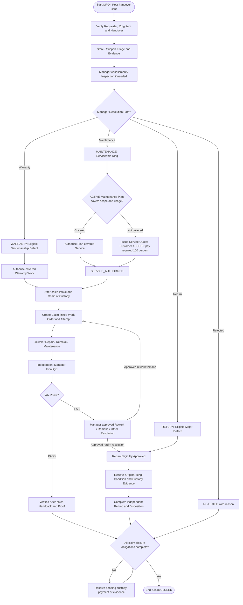
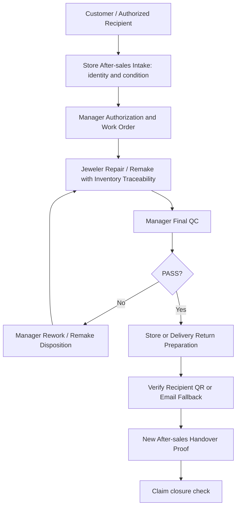
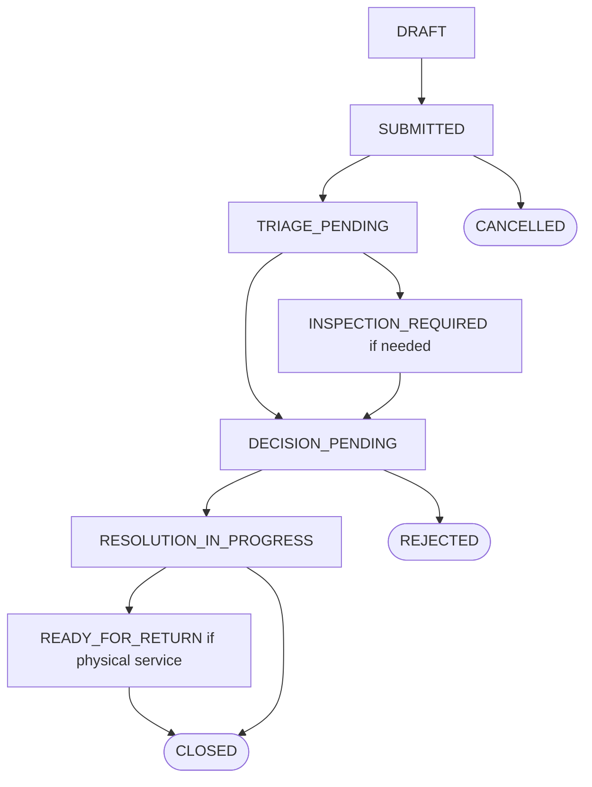

> **Repository snapshot, 2026-11-15** of the post-Review 2 Main Flow (numbering MF01–MF04). Source of truth: https://drive.google.com/file/d/1S7hr_CvkAxgV1QTTNKXJgYzxYTdsf00E/view
> If this copy and the Drive file differ, the Drive file wins. Older documents (permission sources such as `MF02-07`, the 2026-10 API Master) use the previous six-flow numbering.

# MF04 — Manage After-sales Services

> **MEMORA | Main Flow 04 — Business-level baseline sau Review 2**  
> **Trạng thái:** Đã duyệt nội bộ ba quyết định A/B/C và cập nhật chính sách All-NONE; chờ giảng viên phê duyệt.  
> **Phiên bản:** 2026-11-02  
> **Kế thừa:** Legacy MF06 — After-sales, Warranty, Paid Service, Return & Data Rights; sử dụng Decision Tracker tab MF06 và baseline mới của MF01–MF03.  
> **Đầu vào:** Original Order/individual Ring Item đã successful handover trong MF03.  
> **Đầu ra:** Một After-sales Claim độc lập `CLOSED` khi mọi nghĩa vụ đã hoàn tất; Original Order giữ lịch sử bán hàng `COMPLETED`.  
> **Giới hạn:** MF04 quản lý physical after-sales `WARRANTY | MAINTENANCE | RETURN`. `DATA_RIGHTS` là Supporting Use Case độc lập.

## 1. Business Goal

**Mục tiêu nghiệp vụ:** Tiếp nhận, xác minh, đánh giá và xử lý vấn đề phát sinh **sau successful handover** cho từng Ring Item của MEMORA. Nghiệp vụ hậu mãi bảo đảm quyết định minh bạch theo Warranty/Return/Maintenance policies, chính xác về khoản phí/hoàn tiền, toàn vẹn lịch sử thiết kế và sản xuất, an toàn Chain of Custody, Manager Final QC và bằng chứng trả sản phẩm.

**Business outcomes:**
1. Customer hoặc authorized Order Owner/representative gửi `issue_category`, mô tả, thời điểm phát hiện (nếu biết), evidence và requested resolution (tùy chọn) cho **một Ring Item trong một Claim**. Store Staff được tạo hỗ trợ nhưng lưu đúng requester và created_by.
2. Verify identity/ownership hoặc authorization, successful original handover, Order/Ring Item, policy version và evidence trước quyết định; Guest All-NONE có verification phù hợp, không dùng Order Code đơn lẻ để chứng minh quyền.
3. Store Staff/Support thực hiện Triage; Manager inspect khi cần và xác định resolution path **WARRANTY**, **MAINTENANCE**, **RETURN**, hoặc quyết định **REJECTED** có lý do. Customer không tự phê duyệt claim type.
4. WARRANTY xử lý workmanship/manufacturing defects đủ điều kiện; MAINTENANCE phân biệt **Plan-covered** và **Paid Maintenance**; RETURN chỉ khi có material mismatch/major defect hoặc Warranty resolution cho phép.
5. Với Repair/Remake/Service: tạo Claim-linked After-sales Work Order/Production Attempt, dùng đúng locked physical baseline, quản lý vật tư, Jeweler thực hiện, Manager Final QC trước handback.
6. Với RETURN: duyệt eligibility, nhận lại đúng Ring Item và custody evidence, đối chiếu refund base/actual paid credit attributable to that item, hoàn tiền độc lập, inventory disposition đúng quy tắc.
7. Claim có owner/SLA/status history rõ ràng; các vật lý custody events, customer authorizations, refunds, QC results và handback proof lưu thành audit evidence.
8. Chỉ `CLOSED` khi resolution và tất cả nghĩa vụ bắt buộc hoàn tất. Original Order `COMPLETED` không bị ghi lại thành đang sản xuất.

**Quan trọng về package:** NONE, FINGERPRINT (FP) và SOUNDWAVE (SW) **đều có Warranty, Maintenance và Return theo policy**. Không có Digital Memory ở NONE **không** làm mất quyền bảo trì/chỉnh size/sửa chữa. Maintenance Plan là dịch vụ vật lý tùy chọn theo từng Ring Item, không phải Personalization hoặc Digital Memory.

## 2. Actors

| Actor / External Entity | Trách nhiệm |
| --- | --- |
| **Customer / Order Owner** | Tạo Claim, mô tả tình trạng và cung cấp evidence; xác nhận Service Quote, thanh toán maintenance nếu cần, nhận lại nhẫn hoặc đồng ý resolution phù hợp |
| **Guest (All-NONE)** | Được hỗ trợ yêu cầu hậu mãi sau xác minh verified guest email và quyền trên Order qua secure flow; không buộc tạo registered account, nhưng không được chỉ dùng Order Code |
| **Store Staff / Support** | Hỗ trợ tạo Claim thay Customer, verify intake identity, phân loại ban đầu, nhận/giữ/trả sản phẩm, lập After-sales Intake và custody events |
| **Manager** | Kiểm tra eligibility/root cause, chọn resolution, duyệt plan coverage/service authorization, approve Return/Refund/Remake trong quyền hạn, thực hiện Manager Final QC độc lập |
| **Jeweler** | Repair/Remake/Resize/Polishing, ring blank/gemstone handling theo Claim-linked Work Order đúng skill, permission và locked design; không tự Manager Final QC cho công việc mình làm |
| **Delivery Staff** | Pickup/return after-sales Ring Item khi Claim hỗ trợ giao nhận; ghi custody, verification và proof; không quyết định Warranty/Refund |
| **Payment Provider / Finance** | Xử lý paid Service Payment hoặc Refund có đối soát, không chỉnh sửa payment/invoice gốc |

**Supporting services:** Warranty/Plan coverage, Claim & SLA management, Pricing & Service Quote, Inventory/Production, Fulfillment, Notification, Audit. **Administrator** xử lý DATA_RIGHTS ở Supporting Use Case riêng; không phải actor của nhánh physical Claim MF04.

## 3. Preconditions

### 3.1. Physical Claim Entry

1. Original Order có successful **full-Order** Handover Record/Proof từ MF03, thường là `Order.status=COMPLETED`. Damage phát hiện **trước** complete handover thuộc MF03 Handover Exception, không tạo ordinary MF04 physical Claim.
2. Identifiable Ring Item được bàn giao, bind `original_order_id + ring_item_id`. Mỗi Claim gắn với đúng **một** Ring Item; Order hai nhẫn có thể có hai Claim độc lập.
3. Requester là Order Owner hoặc người được Owner ủy quyền. Store Staff có thể hỗ trợ tạo Claim bằng cách lưu requester = Customer và created_by = Staff; Recipient không mặc định có quyền tạo Claim.
4. Claim có issue category, mô tả, discovered_at nếu có, evidence phù hợp với loại vấn đề và preferred resolution tùy chọn; không ép media khi lỗi không thể biểu diễn bằng ảnh.
5. Original locked Production Package, Customer Confirmation, QC evidence, Handover timestamp, Warranty Policy/Plan selection/Return Policy version có thể được truy vết.
6. Không bắt đầu paid maintenance work khi chưa Service Quote ACCEPTED và required payment `SATISFIED`; không bắt đầu plan-covered service khi chưa confirm eligible coverage/remaining benefit.
7. Nếu cần kiểm tra/sửa vật lý, Store/authorized Staff phải lập intake condition và custody evidence trước khi nhận Ring Item.

### 3.2. Handover-linked Entitlements

| Entitlement / Condition | Baseline |
| --- | --- |
| **Warranty** | 12 tháng từ successful handover timestamp **của Ring Item**; warranty_start/end + policy version được lưu, hiệu lực được derive tại Claim submitted_at |
| **Direct Return** | Trong 7 ngày từ successful handover, **chỉ** khi có serious mismatch/major manufacturing defect theo Return Policy |
| **Maintenance Plan (optional)** | Được mua tại MF01 cho từng Ring Item NONE/FP/SW, xuất hiện trong MF02 Final Quote/Confirmation, activate sau successful handover ở MF03 |
| **LIFETIME_POLISHING** | Mỗi Ring Item ACTIVE Plan được hưởng tối đa **2 completed standard polishing** trong mỗi kỳ 12 tháng; không đồng nghĩa unlimited use |
| **Paid Maintenance** | Cho dịch vụ ngoài Warranty/Plan coverage hoặc Plan benefit đã hết, sau accepted Service Quote + required payment |
| **Guest All-NONE** | Verification/authorization phù hợp; exact UX và credential chi tiết để Supporting Use Case xác định, không giả định yêu cầu tạo account |

**DATA_RIGHTS exception:** yêu cầu về quyền dữ liệu có thể phát sinh cả trước successful handover khi dữ liệu đã tồn tại; vì vậy **không đưa vào MF04 entry gate**. Đưa sang Supporting Use Case DATA_RIGHTS với Admin/identity verification, operational dependency và retention rules riêng.

## 4. Main Flow

### 4.1. Main Flow Overview

Sơ đồ này giữ rõ **Customer Submit Issue → Manager Triage/Decision → 3 resolution branches**. `REJECTED` là kết quả quyết định, **không phải Claim Type thứ tư**. All-NONE đi cùng các nhánh hậu mãi vật lý.

**Diagram interpretation:**
- `WARRANTY` là authorized covered cost theo Warranty Policy. Free Warranty không phát sinh Service Quote/Payment mới cho phần được cover.
- `MAINTENANCE` có **Plan-covered** hoặc **Paid** path. `SERVICE_AUTHORIZED` chỉ sau coverage check hoặc Accepted Quote + payment SATISFIED; `MAINTENANCE_ELIGIBLE` không đồng nghĩa authorized.
- `RETURN` được duyệt ở cấp Claim/Ring Item, nhận lại nhẫn trước REFUND. Không tự chuyển `Order COMPLETED` của đơn hai nhẫn về trạng thái chưa hoàn tất.
- `REJECTED` chỉ đến CLOSED khi đã trả mọi vật phẩm đang trong MEMORA custody, đóng các nghĩa vụ cần thiết, lưu reason/notice.
- FAIL QC không được giao lại; Manager phải quyết định rework/remake hoặc approved different resolution. Không có vòng quay QC tự động nếu chưa disposition.
- Claim Work Order/Attempt là after-sales mới, không overwrite original production history hoặc Order-level Design Lock.

### 4.2. Main Flow Description

| Step | Business Stage | Hành động, gate và kết quả |
| --- | --- | --- |
| **MF04-S01** | Submit After-sales Issue | Customer/authorized requester chọn đúng Ring Item, mô tả issue + evidence/requested resolution; Store Staff có thể submit hộ, lưu requester khác created_by. Claim `DRAFT → SUBMITTED`. |
| **MF04-S02** | Identity & Claim Triage | Verify ownership/authorization, original Handover Proof, warranty/return dates, selected Plan coverage; Store Staff/Support kiểm tra bằng chứng, tạo `TRIAGE_PENDING`. |
| **MF04-S03** | Inspect & Manager Decision | Nếu chưa đủ thông tin, yêu cầu thêm/inspection; Manager đánh giá manufacturing root cause, repairability, policy và chọn WARRANTY/MAINTENANCE/RETURN/REJECTED, ghi reason/policy/evidence/versioned decision. |
| **MF04-S04** | Authorize Resolution | Warranty-covered work theo policy; Maintenance Plan ACTIVE + scope/quota còn available → covered service; ngoài cover → versioned Service Quote, Customer ACCEPT, collect 100% required paid maintenance trước start; RETURN cần approved eligibility. |
| **MF04-S05** | After-sales Intake & Custody | Nhận đúng nhẫn với claim_id/order_id/ring_item_id; ghi tình trạng, actor, timestamp, evidence, stone certificate identity nếu có; mọi holder/location change tạo immutable custody event. |
| **MF04-S06** | Execute Resolution | Repair/Remake/Maintenance → Claim-linked Work Order và Production Attempt, quản lý inventory/costing/laser, Jeweler thực hiện. RETURN → physical receipt, inspection, accepted refund path; REJECTED không thực hiện công việc. |
| **MF04-S07** | QC / Refund Settlement | Repair/Remake hoàn tất mới Manager Final QC; FAIL → rework/remake/approved resolution; RETURN → refund only after required physical return receipt + audit, ghi riêng ledger/refund. |
| **MF04-S08** | After-sales Handback | Sau QC PASS của physical service, Store/Delivery verify Recipient bằng QR primary hoặc verified-email fallback, tạo **Handover Record mới** bind Claim/Ring Item, không reuse original sales Handover Record. |
| **MF04-S09** | Close Claim | Verify resolution thực thi, service/plan usage/quote/payment/refund, QC, custody, handback hoặc inventory disposition đều đủ; mark `CLOSED` với owner, timestamps và immutable history. |

### 4.3. Three Physical After-sales Branches

| Gate | WARRANTY | MAINTENANCE | RETURN |
| --- | --- | --- | --- |
| Mục tiêu | Khắc phục manufacturing/workmanship defect thuộc Warranty | Care/polishing/resize/repair ngoài Warranty hoặc theo Plan | Trả/hoàn tiền khi major mismatch/defect hợp lệ hoặc Warranty không khắc phục được |
| Thời hạn/gate | 12 tháng từ handover; Claim submitted trong hạn được xem xét dù xử lý kéo dài | Plan ACTIVE+benefit+covered scope hoặc paid Service Quote; không có 12-month warranty hạn chế paid service | Direct Return 7 ngày; sau đó có thể là Warranty→Return resolution |
| Thanh toán | 0đ cho phần Warranty covered; internal cost | Plan-covered → entitlement; Paid → Quote ACCEPTED + Payment SATISFIED trước Work Order | Refund theo actual paid amount attributable to returned Ring Item |
| Vật lý/custody | Intake, Work Order, Manager QC, handback | Intake, Work Order, Manager QC, handback | RETURN_RECEIVED + inspection + inventory disposition trước Refund |
| Claim closure | QC PASS + handback + no pending obligation | Service complete + QC PASS + handback + coverage/ledger close | Refund completed + disposition + no pending obligations |

### 4.4. All-NONE Warranty, Maintenance & Physical Adjustments

**All-NONE không có Fingerprint/Soundwave/Digital Memory, nhưng vẫn là Ring Item vật lý với đầy đủ hậu mãi hợp lệ.**

| Vấn đề All-NONE | Resolution | Business Handling |
| --- | --- | --- |
| MEMORA sản xuất sai size so với locked size | **WARRANTY** | Nếu xác định lỗi workmanship/manufacturing được cover, repair/resize miễn phí; không tiêu hao Plan |
| Gemstone setting lỏng do lỗi chế tác | **WARRANTY** | Repair/Remake theo policy, giữ stone identity/traceability |
| Standard cleaning/polishing/refinishing nhẹ | **MAINTENANCE** | Plan-covered nếu có `LIFETIME_POLISHING` ACTIVE và còn lượt; nếu không → Paid Maintenance |
| Customer muốn resize vì thay đổi nhu cầu sau khi đã nhận đúng size | **MAINTENANCE** | Kiểm tra technical feasibility; versioned Service Quote + accepted payment; Work Order ghi size trước/sau, không sửa Design Lock gốc |
| Móp, trầy nặng, hỏng do va đập/cách sử dụng | **MAINTENANCE** | Nếu serviceable: báo giá; nếu không sửa được: Manager đề xuất resolution hợp lệ |
| Muốn đổi material/stone layout/template/engraving design | **Không phải ordinary maintenance** | Controlled design/new Order path; không overwrite original locked design |
| Muốn nâng NONE thành FINGERPRINT/SOUNDWAVE sau khi mua | **Không phải ordinary maintenance** | Controlled Personalization/new Order, cần Consent/Source/Design Review/Laser nếu có policy hỗ trợ; không update package của Order đã COMPLETED |
| Major defect/mismatch đủ Return Policy | **RETURN** | Claim theo Ring Item, nhận lại sản phẩm và hoàn tiền hợp lệ |

**Resize after handover:** cho phép trong technical capabilities của Ring Template/Material. Sau sửa, lưu `requested_size`, `measured_size_before`, `measured_size_after`, service evidence và Final QC; version thiết kế vật lý ban đầu vẫn immutable.

### 4.5. Optional Maintenance Plan — Plan-covered vs Paid Service

- Plan được chọn/mua theo **từng Ring Item ở MF01**, nằm trong **Final Quote/Confirmation MF02**, **ACTIVE sau full-Order handover ở MF03**; **MF04 không bán lại Plan ngầm** trong Claim.
- `LIFETIME_POLISHING`: **2 lần standard polishing hoàn thành mỗi 12 tháng**. Covered: standard cleaning, standard polishing, light surface refinishing; **không** cover resize/engraving changes/gemstone replacement/stone setting repair/structural rebuild. `Lifetime` là quyền lợi theo vòng đời Ring Item theo policy, không phải unlimited usage.
- Plan được bind theo Ring Item/Owner/plan_code và policy version, `ACTIVE` khi handover thành công; baseline **non-transferable**. Với hai nhẫn, quota không tự chia sẻ.
- Có Plan nhưng service out of coverage/quota exhausted → paid service: versioned Service Quote `ISSUED → ACCEPTED` và payment 100% SATISFIED → `SERVICE_AUTHORIZED`. Customer DECLINED → không Work Order, return original Ring Item nếu đang custody.
- Benefit consumed **khi service thực sự hoàn tất và Claim CLOSED**, idempotently một usage per Claim. Rejected/cancelled/unfinished không trừ lượt; Warranty-covered work không trừ Plan benefits.
- Không có Plan vẫn được Warranty 12 tháng và quyền yêu cầu Paid Maintenance/Return theo policy.

## 5. Alternative Flows

| ID | Trigger / Alternative | Business Handling |
| --- | --- | --- |
| **MF04-AF01** | Không xác minh được requester/Guest All-NONE | `NEEDS_VERIFICATION`; không tiết lộ dữ liệu hoặc cho sửa/refund khi chưa verify owner/authorization. Guest cần verified-email secure flow; chi tiết credential ở Use Case. |
| **MF04-AF02** | Thiếu thông tin/evidence | `NEED_MORE_INFO`; ghi requirement, pause/resume SLA nếu policy cho phép, không tự Manager Approve. |
| **MF04-AF03** | Customer đòi Warranty nhưng evidence chỉ ra normal wear & tear/misuse | Manager có thể kết luận MAINTENANCE_ELIGIBLE nếu repairable; claim type do triage/decision, không dựa solely requested resolution. |
| **MF04-AF04** | Maintenance Plan inactive, quota hết hoặc service không covered | Không dùng benefit. Issue Service Quote cho Paid Maintenance, Customer ACCEPT và required payment 100% trước service. |
| **MF04-AF05** | Customer DECLINED Service Quote | Không thu tiền/không tạo Work Order; close theo SERVICE_DECLINED khi không còn obligations; trả nhẫn nếu MEMORA custody. |
| **MF04-AF06** | Scope/Service Quote thay đổi trong Paid Maintenance | Pause affected work; revised quote version, Customer re-accept, payment difference if applicable; không auto charge/cải sửa quote cũ. |
| **MF04-AF07** | Repair không thể hoàn tất đúng standard | Manager review REMAKE theo original locked spec hoặc Return/Refund/other authorized resolution; không tự skip QC. |
| **MF04-AF08** | Customer muốn thay physical design, gemstone option, material hoặc chuyển NONE→FP/SW | Không sửa Design Lock hoặc coi ordinary Maintenance; chuyển controlled design/new Order flow theo policy, giữ original history. |
| **MF04-AF09** | QC sau Repair/Remake FAIL | Manager disposition REWORK/REMAKE/other, tạo attempt mới nếu REMAKE; block handback và closure cho đến valid QC PASS/resolution. |
| **MF04-AF10** | Certified Stone/mounting inventory hỏng, scrap, thiếu hoặc identity mismatch | Log certificate/stone identity, inventory movement/write-off, new allocation nếu được duyệt, Manager audit; không đưa damaged stone về AVAILABLE. |
| **MF04-AF11** | Ring Item intake sai identity/missing stone/condition mismatch | Dừng normal intake/custody, ghi exception và evidence, Manager review trước khi Work Order. |
| **MF04-AF12** | Return approved nhưng Customer chưa giao lại Ring Item | Giữ `RETURN_PENDING`; không `REFUND_AUTHORIZED` hoặc `CLOSED`. |
| **MF04-AF13** | Refund failed/pending/chargeback issue | Giữ `REFUND_PENDING` và claim owner; đối soát ledger/idempotent trước closure. |
| **MF04-AF14** | Ring Item thất lạc/hư hỏng trong after-sales pickup/delivery | Incident + custody investigation/resolution, không tự claim fulfilled hoặc overwrite original status. |
| **MF04-AF15** | Customer không đến nhận nhẫn đã QC PASS sau repair | Claim và Custody vẫn pending, nhắc/escalate theo operational collection policy; **không tự CLOSED** trước verified handback. |
| **MF04-AF16** | Claim quá SLA | `SLA_OVERDUE` flag, notify/escalate, giữ Claim Owner, không auto-close hoặc sửa timestamp. |
| **MF04-AF17** | REJECTED Claim | Lưu reason/policy basis/appeal information nếu có; vẫn phải trả Original Ring Item nếu đang custody. |
| **MF04-AF18** | Claim đã CLOSED lại phát sinh lỗi | Tạo Claim mới link previous_claim_id, không sửa Claim/decision cũ. |
| **MF04-AF19** | Paid Maintenance bị tạo payment/work sai cho Warranty miễn phí | Block workflow, đối soát finance, thu hồi sửa lỗi transaction theo policy, không ghi đè lịch sử gốc. |
| **MF04-AF20** | Plan polishing benefit trừ quá sớm/trùng | Recompute from successful CLOSED covered Claims, idempotent usage per Claim, không count rejected/cancelled/unfinished. |
| **MF04-AF21** | Plan chưa được MF03 activate vì technical failure | Không giả ACTIVE; trigger entitlement reconciliation từ paid Final Quote + Handover Proof, retry activation; không tự chuyển paid path khi Customer thực sự đủ benefit. |
| **MF04-AF22** | RETURN một Ring Item trong Order hai nhẫn | Claim và refund chỉ theo returned Ring Item, allocates actual paid credit/discount/fees đúng policy; nhẫn còn lại không bị auto-refund/auto-cancel/auto-revoke benefits. |
| **MF04-AF23** | Data deletion/revoke request đang ảnh hưởng active service | Chuyển qua independent DATA_RIGHTS Supporting Use Case/operational dependency; không xóa raw assets/traceability đang cần cho repair hoặc xóa audit bắt buộc. |
| **MF04-AF24** | Claim cần thay nhẫn nhưng không còn equivalent material/stone để remake theo locked spec | Manager chọn authorized replacement/refund/controlled design path; không tự gán sản phẩm khác mà không có approval. |

### 5.1. Return / Refund, including Two-ring Orders

- **Direct Return** trong 7 ngày chỉ áp dụng khi sản phẩm giao sai nghiêm trọng/material mismatch/major manufacturing defect đủ Return Policy, không hỗ trợ đổi ý hoặc tự muốn đổi kích thước/đổi design với sản phẩm personalized. Yêu cầu Customer khác phạm vi Return có thể được tư vấn Paid Maintenance nếu hợp lý.
- Claim Warranty hợp lệ phát sinh sau mốc 7 ngày vẫn có thể dẫn tới `RETURN` nếu repair/remake không khả thi hoặc đã thất bại.
- `RETURN_APPROVED → RETURN_RECEIVED` cần physical custody evidence `claim_id + order_id + ring_item_id + received_by + condition_at_return + received_at + evidence`; chỉ **sau** mới authorize REFUND.
- Refund base là **locked Final Quote line amount** và **amount actually paid attributable to returned Ring Item**, không dùng active catalog/master price ngày Refund; nếu có Order-level discounts/payment credits/fees phải áp dụng allocation policy và lưu calculation snapshot. Không vượt tiền thực trả có thể quy cho Ring Item.
- Lỗi MEMORA không thu restocking/cancellation fee. Delivery/service fees không tự động refund; Manager include nếu resolution xác định lỗi thuộc MEMORA và policy cho phép.
- Refund là transaction độc lập, không sửa/xóa P1/P2/P3/Original Invoice; Original Order vẫn `COMPLETED` trong sales lifecycle.
- Return của Ring Item A **không** tự hủy Warranty/Memory/Maintenance Plan của Ring Item B trong cùng Order. Sau refunded Return, eligibility/plan/memory của **Ring Item A** cần controlled entitlement disposition/revocation theo policy/rights; **không** tự xóa Digital Memory content hoặc raw personalization data ngoài DATA_RIGHTS.
- Không có `EXCHANGE` claim state độc lập. Thay sản phẩm do lỗi dùng Claim-linked REMAKE/REPLACEMENT resolution giữ lineage; physical design khác cần controlled change/new Order.

### 5.2. Claim-linked Repair/Remake, Inventory & Custody

- After-sales Repair/Remake tạo **Work Order/Production Attempt mới** bind `claim_id + original_order_id + ring_item_id + previous_attempt + original_locked_production_package + manager_decision`. Không tạo commercial Ring Item mới hay sửa Work Order gốc.
- Repair/Remake dùng approved physical Design Lock/Production Package; MF04 không sửa source/engraving placement/engrave surface/laser-ready target đã khóa. Resize service được phép ghi `size_before/size_after` trong service execution/after-sales QC, không overwrite original Order configuration.
- Ring Blank/material/gemstone được cấp phát riêng cho Claim Work Order. Certified Stone/Certificate reference và inventory scrap/write-off audit được giữ theo chain.
- Mỗi custody holder/location change (Customer→Store→Jeweler→Store/Delivery→Customer) tạo immutable custody event với actor, timestamp, condition, evidence. `current_holder/current_location` derive từ event mới nhất.
- Chỉ Manager Final QC PASS mới trả Ring Item đã repair/remake; Jeweler không tự Final QC. Sau service, tạo **After-sales Handover Record mới** có `handover_type=AFTER_SALES_RETURN`, claim/ring_item/recipient/QR/fallback/evidence; không reuse sales Handover Record MF03.
- Manager decision REMAKE/Refund/Scrap vượt policy threshold cần maker-checker. Nếu Return refund, MEMORA có thể giữ sản phẩm trong custody sau disposition; closure kiểm tra disposition chứ không đòi handback.

### 5.3. SLA, Exceptions & Claim Lifecycle

**Claim top-level statuses (baseline tracker):**

`REJECTED` và `CANCELLED` trong sơ đồ vòng đời là các **outcome/terminal decision paths**; Claim chỉ được coi là đã đóng nghĩa vụ khi return custody, notifications, payment/refund/plan usage liên quan được giải quyết và closure evidence được ghi nhận. Nếu implement `REJECTED`/`CANCELLED` là terminal Claim.status, phải có closure checklist đồng bộ, không tạo trạng thái `CLOSED` mâu thuẫn với terminal status; State Machine/API contract cần chọn **một** biểu diễn chuẩn trước implementation.

Top-level Claim là source of truth; specific resolution statuses như `REPAIR_IN_PROGRESS`, `REMAKE_IN_PROGRESS`, `QC_PENDING`, `PLAN_COVERAGE_CHECK`, `QUOTE_PENDING`, `PAYMENT_PENDING`, `RETURN_PENDING`, `REFUND_PENDING` thuộc các resolution workflows. `SLA_OVERDUE` chỉ là flag, không phải Claim.status mới.

| SLA milestone | Baseline |
| --- | --- |
| First Triage | ≤ 1 business day |
| Manager Decision | ≤ 2 business days |
| Inspection Assessment | ≤ 3 business days từ lúc Ring Item nhận để kiểm tra |
| Service Quote | ≤ 2 business days sau MAINTENANCE_ELIGIBLE |
| Repair/Remake/Service Completion | Theo `target_completion_at` từng Claim, không một SLA cố định chung |

SLA có thể pause/resume khi chờ Customer evidence, Quote acceptance, payment hoặc Return Item theo policy; phải audit reason, timestamps và Claim Owner. Claim quá hạn không tự CLOSED.

## 6. Postconditions

### 6.1. Successful Claim Closure by Branch

| Resolution Path | Conditions to `CLOSED` |
| --- | --- |
| **WARRANTY Repair/Remake** | Approved covered work complete, after-sales Final QC PASS, new verified handback + custody proof và không outstanding obligation |
| **MAINTENANCE with Plan** | Plan ACTIVE, covered scope + benefit available, service authorized/completed, Final QC PASS, verified handback, **benefit usage consumed exactly once on Claim closure** |
| **Paid MAINTENANCE** | Service Quote ACCEPTED, required payment SATISFIED, service performed, Final QC PASS, handback proof, no pending balance |
| **RETURN/REFUND** | RETURN_APPROVED, original Ring Item physically RETURN_RECEIVED and inspected, refund settled/COMPLETED, inventory/custody disposition recorded, no pending obligation |
| **REJECTED / SERVICE_DECLINED** | Reason/notification/evidence recorded; original Ring Item returned if MEMORA custody; no open payment/physical obligation |
| **Administrative cancellation of Claim** | Authorized terminal cancellation, any custody/payment/usage obligation resolved, audit preserved |

### 6.2. Persistent Invariants

1. Original sales Order remains `COMPLETED` with original Payment/Invoice/Handover, Final Quote, Design Lock and production/QC audit **unchanged**. MF04 không tạo P1/P2/P3 mới trên Order.
2. Mỗi physical Claim bind đúng **one Ring Item**. Original Order hai nhẫn có thể giữ Ring Item B unaffected khi Claim của A được sửa hoặc Return.
3. Work Order/Production Attempt mới cho after-sales, Final QC riêng, Chain of Custody immutable và new after-sales Handover Proof khi có handback.
4. Warranty status là policy/time-derived; Maintenance Plan usage là per plan/per Ring Item, trừ đúng entitlement khi Claim CLOSED.
5. Refund là financial ledger transaction độc lập, not overwrite historical successful payments.
6. Không close Claim với pending QC, Work Order, Service Quote/payment, refund, custody/handback hay inventory disposition.
7. DATA_RIGHTS chỉ thực hiện từ Supporting Flow sau identity verification, không xóa audit/payment/invoice bắt buộc hoặc làm mất nguyên liệu/asset đang cần cho production/repair hợp lệ.
8. Customer khiếu nại lại sau CLOSED → new Claim, có link `previous_claim_id` nếu liên quan.

## 7. Business Rules

| ID | Business Rule |
| --- | --- |
| **MF04-BR01** | Physical after-sales Claim chỉ tạo sau successful original Handover Record, mỗi Claim bind một `order_id + ring_item_id`; damage trước COMPLETE_HANDOVER thuộc MF03. |
| **MF04-BR02** | Order Owner/authorized requester tạo Claim; Store Staff có thể tạo hỗ trợ và phải lưu requester khác created_by. Recipient không tự động có quyền Claim. |
| **MF04-BR03** | Guest All-NONE cần verified guest email/session + order authorization; không bắt account và không chỉ dùng Order Code. Chi tiết Identity UC xác định. |
| **MF04-BR04** | Customer submits Issue Category/description/evidence/requested resolution, không tự set `WARRANTY_APPROVED`, `MAINTENANCE` hoặc `RETURN_APPROVED`. |
| **MF04-BR05** | Manager versioned Decision dựa trên locked design, Handover/QC, warranty/return policy, root cause/evidence; `REJECTED` là outcome không phải Claim Type thứ tư. |
| **MF04-BR06** | Warranty window 12 tháng từ successful handover riêng từng Ring Item; validity derive tại Claim submitted_at, Claim nộp trong hạn không mất eligibility chỉ vì xử lý kéo dài. |
| **MF04-BR07** | Warranty cover manufacturing/workmanship defects so với locked spec (size, engraving, stone/setting, structural/finishing defects); normal wear & tear, misuse/impact, third-party unauthorized work hoặc chỉ muốn đổi design/size không mặc nhiên covered. |
| **MF04-BR08** | Warranty-covered Repair/Remake Customer charge = 0 cho phần covered; cost ghi internal warranty cost, không tạo Service Quote/Payment mới chỉ vì internal remake. |
| **MF04-BR09** | MAINTENANCE áp dụng cho NONE/FP/SW; có thể là Plan-covered hoặc Paid, gồm standard polishing, resizing sau handover, care, wear/tear hoặc user-caused repair nếu serviceable. |
| **MF04-BR10** | Maintenance Plan được mua theo từng Ring Item tại MF01, confirmed ở MF02, activated sau handover ở MF03; MF04 chỉ check `ACTIVE + coverage + usage`, không tự grant Plan chưa mua. |
| **MF04-BR11** | `LIFETIME_POLISHING`: 2 completed standard polishing benefits mỗi 12 tháng, cover standard cleaning/polishing/light refinishing; không cover resize, engraving/stone replacement/setting repair/major structural damage. |
| **MF04-BR12** | Plan usage chỉ consumed khi covered service hoàn tất + Claim CLOSED, idempotent per Claim; không trừ rejected/cancelled/in-progress Claim hoặc Warranty-covered services. |
| **MF04-BR13** | Baseline Plan không tự transferable; Ring Item khác của cùng Order không chia sẻ quota hoặc tự có entitlement. |
| **MF04-BR14** | Paid Maintenance ngoài Plan/Warranty bắt buộc `Service Quote ISSUED→ACCEPTED`, 100% required payment SATISFIED trước `SERVICE_AUTHORIZED`/Work Order. |
| **MF04-BR15** | Customer DECLINED Quote → không làm dịch vụ; trả nhẫn khi đang custody, close khi obligations giải quyết. Scope/price change cần revised quote version/Customer re-accept/payment difference. |
| **MF04-BR16** | Direct Return 7 ngày từ Handover chỉ cho material mismatch, wrong item/configuration hoặc major defect đủ policy; không cho đổi ý/đổi design thường lệ. |
| **MF04-BR17** | Warranty hợp lệ nhưng repair/remake không khả thi hoặc thất bại có thể dẫn đến Return Resolution sau 7 ngày; không có độc lập `EXCHANGE` Claim Type. |
| **MF04-BR18** | `RETURN_APPROVED → RETURN_RECEIVED` bắt buộc physical intake identity/condition/evidence trước Refund authorization. |
| **MF04-BR19** | Refund tính trên locked Final Quote line và actual paid amount attributable to Ring Item trả, Order-level allocation/fee rules phải có snapshot; refund không vượt net paid attributable. Lỗi MEMORA không charge restocking fee. |
| **MF04-BR20** | Refund/Service Payment là transaction riêng, idempotent và audit; không xóa/sửa original P1/P2/P3/Invoice hoặc biến Original Order thành incomplete. |
| **MF04-BR21** | Repair/Remake/Resize sau bán hàng dùng Claim-linked Work Order/Production Attempt mới, giữ lineage với Ring Item, original Design Lock, previous attempts, evidence và Manager Decision. |
| **MF04-BR22** | Không mở khóa hay sửa historical Production Design/Source/Placement/Engraving Surface; resize service ghi before/after trong Claim Work Order; physical redesign khác cần controlled new design/order. |
| **MF04-BR23** | Jeweler chỉ thực hiện after-sales route/laser theo đúng permission/skill, locked assets và service authorization; không thay stone material/config mà không audit/approve. |
| **MF04-BR24** | All inventory allocation/scrap/write-off theo Claim/Attempt, Certified Stone identity/certificate traceability; damaged Stone không silent AVAILABLE. |
| **MF04-BR25** | Manager Final QC độc lập với producing/repairing Jeweler và bind Claim + Work Order/Attempt; QC PASS mới cho phép handback; FAIL cần controlled disposition. |
| **MF04-BR26** | Mỗi custody change có immutable event `claim_id + ring_item_id + from/to holder/location + actor + timestamp + condition + evidence`; current holder/location derived. |
| **MF04-BR27** | After-sales handback dùng Recipient QR primary hoặc email verification fallback và **tạo Handover Record mới** `AFTER_SALES_RETURN` bind Claim/Ring Item, không reuse MF03 sales Proof. |
| **MF04-BR28** | Claim CLOSED chỉ khi mọi work/QC/refund/payment/plan usage/physical handback hoặc inventory disposition đã complete; CLOSED read-only, issue mới tạo Claim mới. |
| **MF04-BR29** | First triage ≤1 business day, Manager decision ≤2 business days, inspection assessment ≤3 business days từ intake, Service Quote ≤2 business days; repair target case-specific. |
| **MF04-BR30** | Claim phải có Claim Owner; SLA_OVERDUE là flag, không auto-close; pause/resume cần policy reason/audit. |
| **MF04-BR31** | Maker-checker bắt buộc với Refund/Remake/Scrap vượt threshold policy; proposal không đồng nghĩa approval. |
| **MF04-BR32** | Với Order hai nhẫn, Return/Refund nhẫn A không tự ảnh hưởng nhẫn B, không đổi Sales Order `COMPLETED`, không tự revoke Plan/Memory của B. |
| **MF04-BR33** | Với Ring Item đã Refund/Returned, entitlement Plan/Warranty/Memory disposition phải có approved policy theo exact returned Ring Item; **không** tự xóa Memory content/raw personalization data ngoài DATA_RIGHTS. |
| **MF04-BR34** | DATA_RIGHTS (export data, delete personalization, delete Digital Memory, revoke shared access) là **Supporting Use Case độc lập**, xử lý bởi Administrator sau verify, không là MF04 physical Claim Type. |
| **MF04-BR35** | Privacy/delete operation ảnh hưởng active repair/production phải xử lý operational dependency; không xóa invoice/ledger/Design Lock reference/approval/QC/audit bắt buộc. |
| **MF04-BR36** | NONE được Warranty/Maintenance/Return, nhưng không Digital Memory. Bổ sung FP/SW cho NONE đã COMPLETED là controlled Personalization/new Order, không ordinary Maintenance. |
| **MF04-BR37** | Refund/Return một Ring Item trong mixed or two-item Order sử dụng per-item attributable paid amount và share fee/discount allocation policy; source snapshot được audit, không làm partial sales handover. |
| **MF04-BR38** | After-sales Claim closure không được kích hoạt Warranty mới hay tính lại thời hạn bảo hành bán hàng trừ khi có approved explicit replacement/warranty policy; historical handover time giữ nguyên. |

### 7.1. Warranty vs Maintenance vs Return Decision Matrix

| Evidence / Root Cause | Path | Financial Treatment |
| --- | --- | --- |
| Workmanship/manufacturing defect theo locked design, trong Warranty | WARRANTY | Covered work free; internal cost |
| Standard polishing/cleaning với Plan ACTIVE, còn benefit | MAINTENANCE (Plan-covered) | Customer charge 0 cho covered scope; trừ usage sau CLOSED |
| Polishing vượt quota hoặc không có Plan | MAINTENANCE (Paid) | Accepted Quote + 100% payment gate |
| Resize sau handover do Customer đổi nhu cầu | MAINTENANCE (Paid) | Quote + payment; không sửa original Design Lock |
| MEMORA sản xuất sai size so với confirmed locked size | WARRANTY nếu evidence/policy hợp lệ | Covered repair; không trừ Plan |
| Major defect/mismatch trong direct Return window | RETURN | Receive physical item rồi refund |
| Warranty repair/remake bất khả thi hoặc đã fail | RETURN có approval | Refund/resolution theo policy |
| Customer muốn đổi material/stone layout/engraving/new package | Controlled design / new Order | Không ordinary Claim Repair |
| Not eligible and unserviceable | REJECTED with reason | Return item nếu custody, không auto-refund |

### 7.2. Maintenance Plan State & Usage

- Data baseline từ Decision Tracker MF06-17: Plan records theo `ring_item_id/owner_id/plan_code`; `status=PENDING|ACTIVE|SUSPENDED|CANCELLED|EXPIRED`; `starts_at` NULL trước handover, `activated_at=starts_at` sau handover thành công; `ends_at=NULL` cho lifetime plan, không auto-expire chỉ vì ngày hết hạn.
- `coverage_json` hoặc equivalent lưu scope, quota, period, policy version; Claim MAINTENANCE có `maintenance_plan_id` nullable bind chính xác Plan đã dùng.
- 2 **successful** standard polishing benefits trong mỗi rolling/plan-defined 12-month period cần cách tính nhất quán; chi tiết window tính ngày sẽ được chốt ở API/State Machine theo approved policy, không suy diễn hàng năm lịch.
- Một covered Claim tiêu hao đúng một usage khi CLOSED. Return/Cancelled/Rejected/pending không tiêu hao. Ring Item không mua Plan không được activate quyền lợi tự động.
- Original Order pricing/billing đã bao gồm plan purchase ở MF01→MF02→MF03, nên MF04 không thu gói lần hai khi Claim đã covered.

### 7.3. Approved Business Decisions & Details to Specify Later

**Đã chốt trong 4-main-flow baseline:**
1. Optional Maintenance Plan bán trên **từng Ring Item NONE/FP/SW** tại MF01, giá trong Final Quote MF02, kích hoạt sau handover tại MF03, được sử dụng tại MF04.
2. DATA_RIGHTS tách khỏi MF04 là Supporting Use Case riêng; Admin xử lý identity verification/retention/operational dependency.
3. Claim Return cấp Ring Item; Original Order hai nhẫn vẫn lịch sử Completed, refund independent và không tự ảnh hưởng Ring Item còn lại.
4. All-NONE được Warranty, Plan-covered/Paid Maintenance, Resize và Return theo policy; không tự chuyển package NONE thành FP/SW.
5. MF04 Claim không kéo dài hoặc tự sửa quyền lợi Digital Memory của nhẫn khác; Memory access/AR vẫn ở Supporting Use Cases.

**Chi tiết để đặc tả ở Use Case/Policy, không chặn Main Flow:**
- Guest All-NONE after-sales claim verification/session UX cụ thể (đã biết phải verified email + authorized Order access).
- Refund allocation khi Order có discount/order-level commercial adjustments; cách disposition Warranty/Plan/Memory của đúng Ring Item được Return/Refund.
- Identity fallback/incident, storage/collection overdue khi Customer không nhận lại Ring Item sau service.
- Detailed Work Order/Attempt statuses, Plan benefit accrual window và SLA calendar/business days.
- Data Rights API/status/retention requirements ở Supporting Use Case, không phải MF04.

## 8. Flow Boundary

### 8.1. MF04 Ownership

| Business Function | MF04 Responsibility |
| --- | --- |
| Physical After-sales Claim creation/verification/triage/Manager Decision | WARRANTY, MAINTENANCE, RETURN per Ring Item |
| Warranty eligibility and covered resolution | Warranty 12 tháng / cause based |
| ACTIVE Maintenance Plan check, covered service vs Paid Maintenance | Có thể áp dụng cho NONE, FP và SW |
| Versioned Service Quote, Customer Accept, Paid Service Payment | Claim-level, không phải Order P1/P2/P3 |
| Physical After-sales Intake, Custody, Repair/Remake/Resize/Polishing | Claim-linked Work Order/Attempt, locked design lineage |
| Independent Manager Final QC and after-sales handback | New proof, Recipient QR/fallback |
| Return eligibility, physical return, Refund / inventory disposition | Independent Claim and transaction |
| Claim SLA/escalation/status/closure | No pending obligations |

### 8.2. Không thuộc MF04

| Business Area | Flow / Supporting Owner |
| --- | --- |
| Catalog/Configure/Checkout, optional Plan selection, Create Order/P1, FP/SW source/consent/approval | **MF01 — Configure & Place Ring Order** |
| Manager Review, Final Quote incl Plan price, Customer Final Confirmation, P2, Lock, initial Production/Manager Final QC | **MF02 — Produce & Quality Check Ring Order** |
| Original Order P3/All-NONE final payment, Invoice, Pickup/Delivery, full-Order Handover, Warranty/Plan/eligible Memory Activation | **MF03 — Complete Payment & Handover Order** |
| PIN, Memory invitation, Access Grant/Revocation, Fingerprint Memory Page, Soundwave WebAR | **Supporting Use Cases** |
| Export/delete Personalization Data, Delete Digital Memory, Revoke Shared Access, Privacy Retention | **DATA_RIGHTS Supporting Use Case**, Admin authority |
| Physical damage found **before** original Handover completion | **MF03 Handover Exception**, có thể gọi MF02 QC/Production recovery |

### 8.3. MF03 → MF04 Contract & Claim Output

**Input MF04 (per physical Claim):**
- Original Order `COMPLETED` với successful full-Order Handover Record/Proof.
- `ring_item_id`, exact original Design Lock/Production Package, production/QC lineage, original warranty start/end and policy version.
- Customer/authorized claimant identity; optional per-item Maintenance Plan entitlement `ACTIVE` và usage/policy snapshot.
- Issue description, evidence, prior Claim history (nếu có), Return/Service relevant policy.
- Optional delivery/recipient/custody requirements for intake/handback.

**Output MF04:**
- Claim `CLOSED` sau resolution thực thi; history, SLA, Manager Decision, Quote/paid Service Payment hoặc Refund (nếu có), after-sales Work Order/Attempt/QC, custody, handback evidence, inventory/cost, Plan usage.
- Original Order sales `COMPLETED`, Final Quote/Payment/Invoice/Design Lock/Handover History **giữ nguyên**; no partial handover rollback.
- Một Ring Item Return/Refund không tự ảnh hưởng Ring Item còn lại của Order, nor automatically delete protected Memory data.

**Flow exit:** MF04 kết thúc trên từng Claim (không tự động phát sinh khi Order completed). Claim mới trong tương lai bắt đầu một MF04 instance khác.

---

### 8.4. BM04-aligned API implementation contract (synchronization 2026-11-13)

> **Status:** Quy tắc triển khai theo BM04 v1.0 và baseline nội bộ 4 MF. Đây là business/API contract để thiết kế endpoint, payload, authorization và tests; **không** khẳng định API đã triển khai, test đã PASS hay reviewer đã ký. Các quyết định thay đổi phạm vi/giá/chính sách vẫn cần xác nhận theo quy trình.

- **Entry & ownership:** Physical WARRANTY/MAINTENANCE/RETURN claim chỉ sau successful Order handover, một Claim đúng một `ring_item_id`; Guest All-NONE phải verified-email secure ownership, không dựa vào Order Code. Original Order vẫn `COMPLETED` suốt Claim lifecycle; DATA_RIGHTS nằm supporting Admin flow riêng, kể cả trước handover.
- **Decision & finance:** Manager quyết định eligible path; Warranty covered (12 tháng) không thu phí; Maintenance có ACTIVE Plan + scope + remaining quota (2 successful polishings/12-month period) hoặc accepted versioned Service Quote và 100% required payment trước Work Order. Return trực tiếp trong 7 ngày chỉ nếu major mismatch/defect; refund chỉ sau `RETURN_RECEIVED` và inspection, không vượt payment credit attributable to Ring Item.
- **Physical traceability:** Claim-linked Work Order/Production Attempt không sửa original Lock/Order; mọi custody transfer audit. Manager Final QC PASS trước after-sales handback, tạo handback proof mới. Refund/plan usage/claim close phải idempotent và giữ item khác của same Order unaffected.
- **Claim terminal state:** API/State Machine phải quyết định representation `REJECTED`/`CANCELLED` versus `CLOSED` + `resolution_outcome`; không đồng thời mô tả chúng là hai terminal statuses kế tiếp nếu chưa xác định transition. Closure obligations phải được enforce ở cả rejected/declined path. Test BM04 WF-04 F-09/F-10 và per-transition trước khi freeze API.

## Reference / Change Record

- **2026-11-13 — BM04 sync:** làm rõ rejected/cancelled terminal state versus CLOSED và thêm API safeguards về per-item claim, refund-after-intake, claim-linked QC/custody, idempotency.

- **Legacy source:** `MAIN FLOW/MAIN FLOW TRƯỚC REVIEW 2/MF06.md`; `MEMORA – BUSINESS FLOW DECISION TRACKER`, tab `MF06` (MF06-01..MF06-18). Quyết định trong tracker có ưu tiên so với các câu legacy lỗi thời về PAID_SERVICE hoặc DATA_RIGHTS.
- **Current baseline:** `MAIN FLOW/MF01.md`, `MF02.md`, `MF03.md` đã cập nhật Maintenance Plan 2026-11-02; Warranty/Memory/Plan chỉ activate sau full-Order handover.
- **Decision A (approved 2026-11-02):** Optional Maintenance Plan `LIFETIME_POLISHING` cho từng Ring Item NONE/FP/SW; mua ở MF01, Final Quote MF02, activate MF03, use MF04. 2 completed benefits/12 months; resize không thuộc Plan.
- **Decision B (approved):** DATA_RIGHTS nằm ở independent Supporting Use Case, không tạo MF04 physical Claim type.
- **Decision C (approved):** Return một Ring Item trong Order hai nhẫn là Claim/Refund per Ring Item, không thay trạng thái Original Order, không tự ảnh hưởng Ring Item còn lại.
- **All-NONE after-sales:** Warranty, MAINTENANCE (Plan-covered/Paid) và RETURN theo policy; controlled resize Work Order được phép, không ghi đè Production Lock, không chuyển NONE→FP/SW bằng ordinary maintenance.
- **Status:** Main Flow đã duyệt nội bộ để tạo tài liệu; giảng viên chưa phê duyệt. Chưa đồng bộ tự động Report 1–5, Registration, ERD, API Master Spec, State Machine hoặc Decision Tracker.